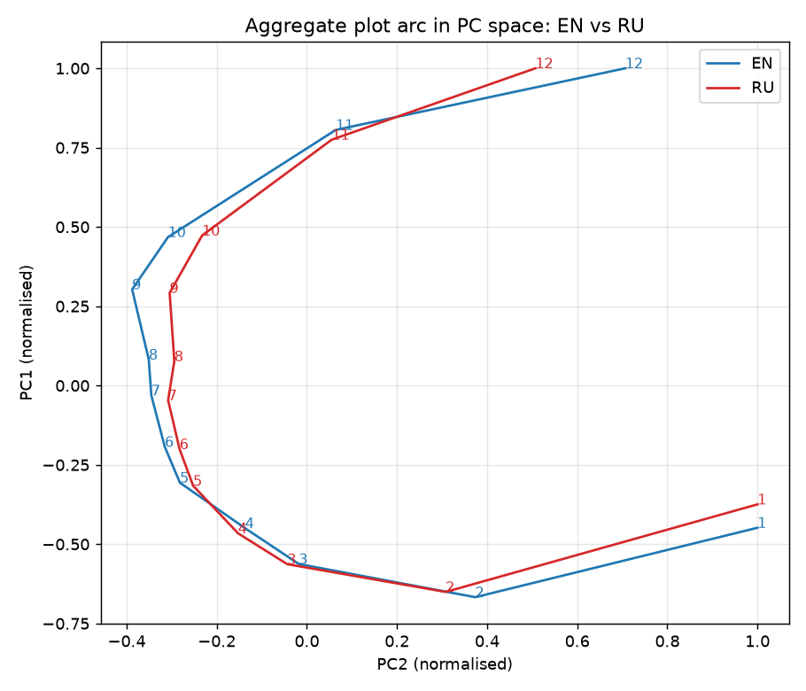

# Plot Arceology — воспроизведение и обобщение

Воспроизведение статьи B. M. Schmidt, *Plot Arceology: a vector-space model of narrative structure* (2015) на корпусе субтитров ~92 тыс. английских и ~81 тыс. русских ТВ-эпизодов. Дальше метод обобщается на письменную короткую прозу: сказки и рассказы proza.ru.

*Reproduction of Schmidt's "Plot Arceology" (2015) on ~92k English and ~81k Russian TV-episode subtitles, plus an extension to fairy tales and short stories. The full report (in Russian) is in [REPORT.md](REPORT.md).*

**Полный отчёт с картинками: [REPORT.md](REPORT.md).**



## Главное

| | Статья | EN | RU |
|---|---|---|---|
| эпизодов | ~27 000 | 91 801 | 80 547 |
| путь «место ↓ / правда ↑», r со временем | монотонный | +0,98 / −0,98 | +0,99 / −0,97 |
| первые 2 ГК объясняют | 93 % | 92 % | 92 % |
| z(PC2) против 1000 случайных блужданий | 9,7 | 9,7 | 10,1 |

* Все основные утверждения статьи воспроизводятся, включая отдельные детали: Law & Order «полиция → суд», отклонение Grey's Anatomy в финале.
* Арка не зависит от языка: независимые EN- и RU-модели дают одну и ту же подкову в PCA (r = 0,999 / 0,996 по 934 тыс. параллельных чанков).
* По жанрам (метаданные IMDB): подкова сильнее у Crime, Mystery, Animation и Family, слабее у Sci-Fi, Adventure и Comedy. У документалок и реалити тренд «правды» почти исчезает.
* Методологическая оговорка: z(PC2) растёт с размером выборки, поэтому группы корректно сравнивать только на равных n.
* Проза: сказки и рассказы proza.ru показывают тот же вектор «место → правда/примирение». Сказки — самые формульные: z(PC2) при равном n — 11,3 против 5,5 у прозы и 2,6 у ТВ. Это устойчиво к перемешанной нулевой модели и к контролю числа чанков.

## Структура

```
src/
  prep.py          субтитры .srt → рекурсивные чанки 2–4 мин → токены (EN) / леммы pymorphy3 (RU)
  stopwords.py     стоп-листы
  topics.py        LDA 127 тем (tomotopy, collapsed Gibbs) + вывод тем для всех чанков
  analyze.py       аналоги Fig. 1–7 статьи
  compare.py       EN ↔ RU: сопоставление тем по параллельным чанкам
  meta.py          жанры / страны / даты из ororo.sqlite
  genres.py        арки по жанрам и десятилетиям, равные подвыборки
  prep_text.py     сказки и proza.ru → чанки 150–300 слов по предложениям
  project.py       проекция прозы на готовую ТВ-модель
  joint.py         общая модель «субтитры + сказки + проза»
  compare_prose.py сравнение источников: равные n, перемешанная нулевая модель, диалог
scripts/run_all.sh полный прогон
results/           фигуры, таблицы, сводки (summary.json)
REPORT.md          отчёт
```

## Данные

Корпуса в репозиторий не входят (`datasets/` в `.gitignore`). Ожидаемая структура:

```
datasets/
  data_ororo/                  финальная выгрузка Ororo (05.11.2026)
    Serials/<Сериал>/Season<N>/<Сериал>_s<N>_e<M>_{EN,RU}.srt
    ororo.sqlite               метаданные шоу и эпизодов (жанры, IMDB, даты)
  fairytalez[Rus].sqlite       сказки
  proza[2022-2023].sqlite      рассказы proza.ru
  proza[2024-2025].sqlite
```

Старая раскладка (`datasets/Serials`, `datasets/ororo.sqlite`) тоже поддерживается; путь можно задать явно через `ORORO_DIR` (см. [src/paths.py](src/paths.py)). Список имён NLTK для английского стоп-листа скачивается автоматически при первом запуске `src/prep.py EN`.

## Запуск

```bash
python -m venv .venv && .venv/bin/pip install -r requirements.txt   # Python 3.12
PY=.venv/bin/python scripts/run_all.sh
```

Отдельные этапы описаны в `scripts/run_all.sh`. Промежуточные данные пишутся в `work/` (десятки ГБ), результаты — в `results/`.
