# Воспроизведение «Plot Arceology» (Schmidt, 2015) на корпусе сериальных субтитров

Статья: B. M. Schmidt, *Plot Arceology: a vector-space model of narrative structure* (2015). PDF в репозиторий не включён (авторские права); локально он лежит в `paper/`.

Статус:
* **Идёт пересчёт на финальной выгрузке Ororo** (05.11.2026, `datasets/data_ororo`: 97 037 EN и 84 705 RU субтитров, 4 015 шоу; было 95 879 / 83 638 / 3 989). **Разделы 2–6 (EN, RU, сравнение) уже пересчитаны**; цифры раздела 8 ниже пока **от предыдущей выгрузки**; по мере пересчёта они будут заменяться, а этот статус — обновляться.
* Добавлен четвёртый корпус — **фанфики ficbook.net** (раздел 9).
* Готово: EN, RU, сравнение EN↔RU, жанры, методология для прозы (раздел 7), проекция прозы на ТВ-модель (раздел 8), направления для статьи на «Диалог» (раздел 10). В работе: общая модель (8.5) и фанфики (9).

## 1. Что утверждает статья

1. Если нарезать сценарии на равные доли экранного времени и обучить на кусках LDA-модель, то многие темы
   систематически меняются по ходу эпизода: одни **линейно** (растут к концу / убывают), другие **дугой**
   (пик или провал в середине).
2. Эпизод — это путь в пространстве тем. В двумерной проекции «3 темы места» × «3 темы правды/примирения»
   агрегатный сюжет идёт из «много места, мало правды» в «мало места, много правды».
3. Отдельные шоу следуют этому тренду в разной степени: сильнее всего процедуралы (CSI, NCIS); Grey's Anatomy
   отклоняется в финальной сцене.
4. PCA матрицы «12 частей × темы»: PC1 ≈ направленное время, PC2 ≈ «середина vs края» (подкова);
   первые две ГК объясняют **93 %** дисперсии; PC2 объясняет на **9,7 σ** больше оставшейся дисперсии, чем
   в любом из 1000 случайных блужданий.

## 2. Данные и метод

| | Статья | Здесь |
|---|---|---|
| Источник | opensubtitles, ~80k файлов, из них ~27k ТВ-эпизодов | финальная выгрузка Ororo (05.11.2026): `datasets/data_ororo/Serials`, файлы `*_EN.srt` (97 037) |
| Эпизодов в анализе | ~27 000 | **92 930** (3 904 сериала) |
| Отбор | ТВ-эпизоды по IMDB | длительность 15–95 мин, ≥ 400 слов |
| Нарезка | 3 части, рекурсивное деление пополам до 2–4 мин | то же самое (3·2ᵏ чанков) |
| Документов (чанков) | ~1,8 млн, 364 слова | **1 152 324**, ~98 значимых токенов на чанк (после стоп-слов) |
| Тематическая модель | Mallet LDA, 127 тем | tomotopy LDA (collapsed Gibbs, как Mallet), 127 тем, α-оптимизация; 500 итераций на 300k чанках, затем вывод тем для всех чанков (100 итераций) |
| Стоп-слова | расширенный список Джокерса (функциональные слова + ~5k имён) | sklearn + разговорные междометия; имена из NLTK names (если в корпусе слово ≥ 50 % пишется с заглавной); прочие имена собственные (≥ 80 % с заглавной, встречаются < 30 % сериалов); строки с титрами сабберов удалены. Словарь — 38 081 слово |
| Агрегация | доля слов темы по 12-м / 6-м экранного времени | то же; чанки раскладываются в 12-е пропорционально перекрытию; доля = Σ слов темы / Σ слов |

Код: [src/prep.py](src/prep.py) → [src/topics.py](src/topics.py) → [src/analyze.py](src/analyze.py) (→ [src/compare.py](src/compare.py)).
Темы и тренды всех тем: [results/EN/topic_trends.csv](results/EN/topic_trends.csv) (`label`, `top10`, `r_linear`, `r_arc`); сводка: [results/EN/summary.json](results/EN/summary.json).

Отличия, которые стоит держать в голове:
* Корпус в 3,4 раза больше, и в нём только сериалы (без фильмов на этапе обучения LDA).
* Метаданные берутся из `ororo.sqlite` (4 015 шоу: IMDB ID, жанры IMDB, страны, год, рейтинг; 97 995 эпизодов с датами выхода). `shows.directory_name` совпадает с именем папки сериала для 100 % анализируемых сериалов; дата выхода есть у 99,75 % эпизодов ([src/meta.py](src/meta.py)). Шоу для Fig. 5 подобраны по названиям, часть заменена (см. ниже).
* Шесть тем для Fig. 4 выбираются автоматически по пересечению топ-слов с затравочными списками, а не вручную.

## 3. Результаты EN

### Fig. 1 — темы с сильнейшим линейным трендом
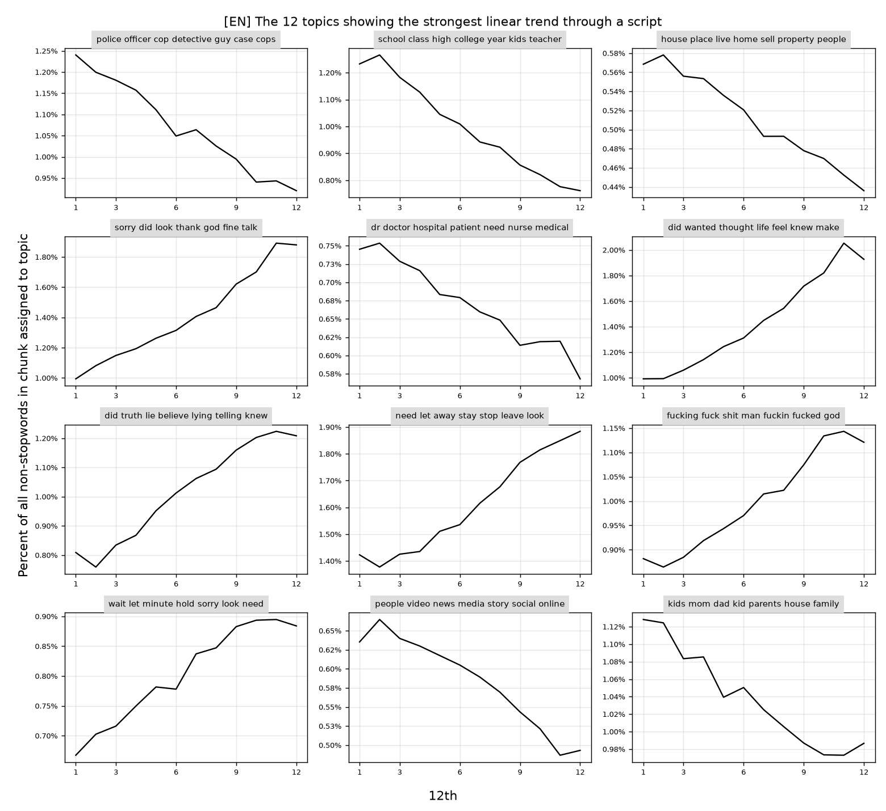

| r | тема | направление |
|---|---|---|
| −0,990 | police officer cop detective guy case cops | ↓ |
| −0,990 | **school class high college year kids teacher** | ↓ |
| −0,988 | **house place live home sell property people** | ↓ |
| +0,987 | **sorry did look thank god fine talk** | ↑ |
| −0,981 | dr doctor hospital patient need nurse medical | ↓ |
| +0,981 | did wanted thought life feel knew make | ↑ |
| +0,980 | **did truth lie believe lying telling knew** | ↑ |
| +0,978 | **need let away stay stop leave look** | ↑ |
| +0,977 | fucking fuck shit man fuckin fucked god | ↑ |
| +0,974 | wait let minute hold sorry look need | ↑ |
| −0,966 | people video news media story social online | ↓ |
| −0,964 | kids mom dad kid parents house family | ↓ |

Жирным выделены темы, которые почти дословно совпадают с темами Fig. 1 статьи: «school class teacher college high kids year», «house room place live living apartment move», «truth believe lie true lying», «sorry life wasn wrong fault done love», «leave won away stay Please care promise». Совпадают и знаки трендов: школа и дом убывают, правда, извинения и «уйти/остаться» растут. Работа/офис тоже убывает (r = −0,90), смерть растёт (+0,78 у «kill killed did dead let man die», +0,81 у «murder did police killed evidence»). У 28 из 127 тем |r| > 0,9.

Вывод статьи «школы, рабочие места и дома чаще упоминаются в начале, язык извинений и смерть — в конце» **воспроизводится**.

### Fig. 2 — темы с сильнейшим дугообразным трендом
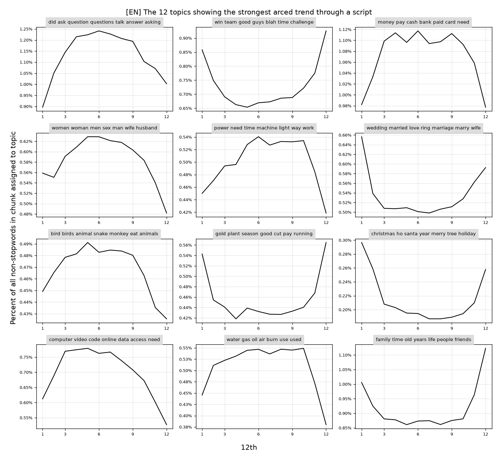

* Пик в середине: воспоминания/фото («remember look years picture», r_arc = +0,99), вопросы/расспросы, деньги/банк, кража/сокровище, телефон/сообщения, психология.
* Провал в середине: **«team win race game»** (−0,96), свадьба/брак (−0,93), Рождество (−0,87).

В статье: «семьи и правила соревнования — в основном в начале и конце; выпивка, сексуальность, друзья и животные — ближе к середине». У нас:
* соревнование (−0,96) и свадьба (−0,93) — по краям;
* выпивка («party night drink bar drunk», +0,89; «drink coffee wine», +0,80), секс («sex women gay woman men», +0,89) и животные («dog cat animals», +0,55; «bird dragon spider», +0,77) — в середине.

**Воспроизводится**, кроме семьи: «father family mother son» у нас растёт линейно (r = +0,81), а не провисает.

### Fig. 3 — Law and Order
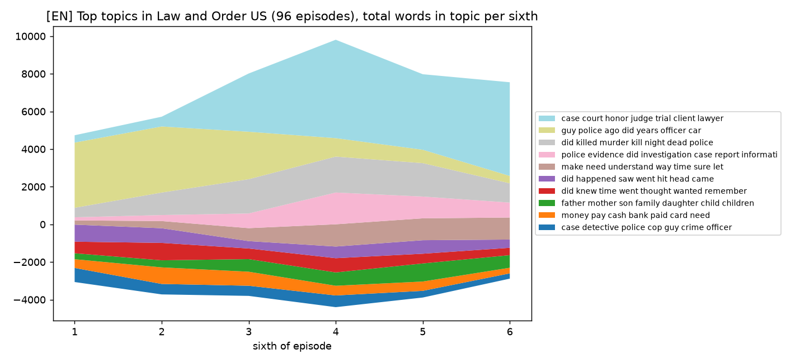

96 эпизодов. Начало эпизода — «guy car missing van looking», «police officer cop detective», «victim body killer blood», затем «murder … evidence case detective». Вторая половина — «case court honor judge trial client lawyer». Структура «полицейское расследование → суд» **воспроизводится**.

### Fig. 4 — путь агрегатного сценария в пространстве 6 тем
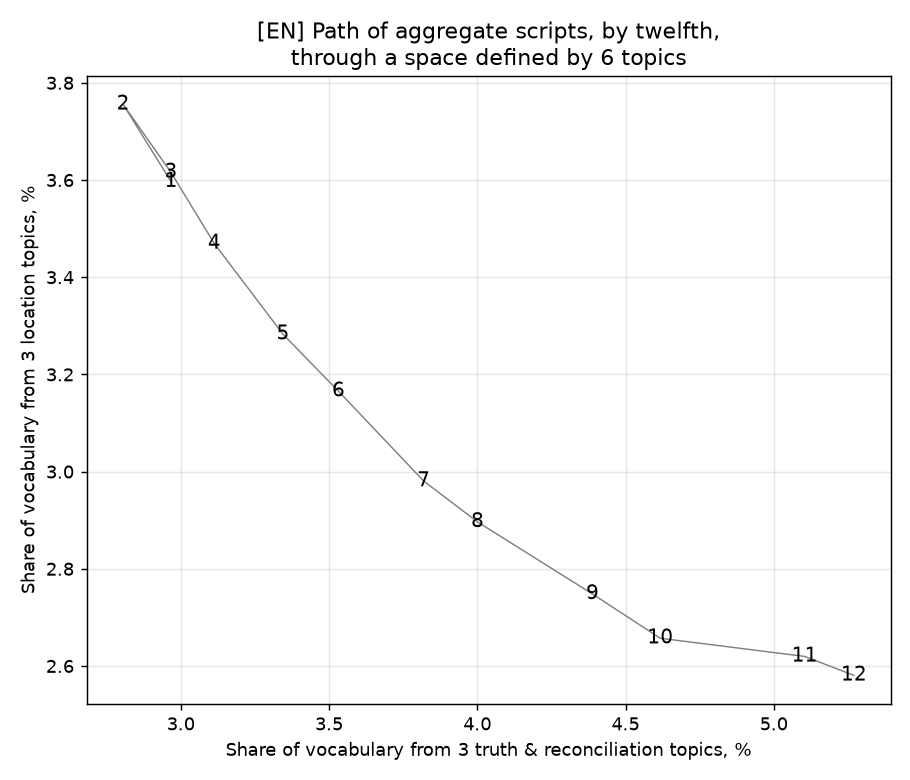

* Ось X (правда и примирение): truth/lie, sorry/thank, **leave/stay/away** — все три совпадают со статейными.
* Ось Y (место): room/house/hotel, school/class, job/work/office — тоже все три как в статье.

Траектория почти совпадает со статейной: 1 → 2 вверх, затем монотонно из верхнего левого угла в нижний правый, к 11–12. Корреляция со временем: X +0,991, Y −0,971. **Воспроизводится.**

### Fig. 5 — отдельные шоу (по шестым)
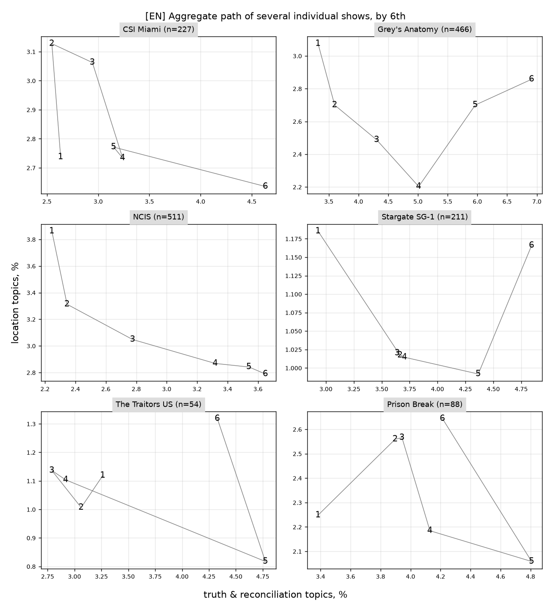

| Шоу (у нас) | В статье | n | r(правда, время) | r(место, время) |
|---|---|---|---|---|
| CSI Miami | CSI | 227 | +0,85 | −0,51 |
| NCIS | NCIS | 511 | **+0,98** | **−0,91** |
| Stargate SG-1 | Stargate SG-1 | 211 | +0,95 | −0,11 |
| Grey's Anatomy | Grey's Anatomy | 466 | +0,99 | −0,24 |
| The Traitors US | Survivor (реалити) | 54 | +0,69 | +0,13 |
| Prison Break | The Fugitive (1963) | 88 | +0,81 | +0,02 |

* NCIS — единственное шоу, где обе оси идут ровно по агрегатному тренду (как в статье). CSI Miami — следом.
* Grey's Anatomy: «место» убывает до середины, а в **последних двух шестых снова растёт**. В статье: «the medical drama departs primarily in its final scene». **Воспроизводится.** Похожий возврат «места» в финале есть у Stargate SG-1.
* The Fugitive в корпусе — ремейк 2020 года для Quibi с ~8-минутными эпизодами, он отсечён фильтром длительности. Его заменил Prison Break. Survivor в корпусе нет, его заменил The Traitors US.

### Fig. 6 — PCA плот-арки (12 частей × 127 тем)
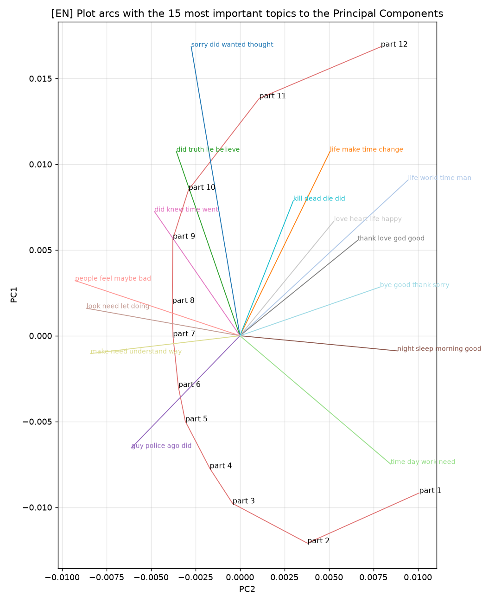

* Первые 2 ГК объясняют **91,8 %** дисперсии (в статье 93 %).
* PC1 коррелирует со временем: |r| = 0,960. Положительный полюс — «did wanted thought life», sorry, truth/lie, kill/dead, love/happy; отрицательный — «guy car missing van», «dr surgery heart», school/class.
* PC2 коррелирует с «серединностью» (x−6,5)²: |r| = 0,926. Части 1–2 и 11–12 лежат по одну сторону, середина — по другую. Это та же подкова, что в статье: начало и конец ближе друг к другу, чем к середине.

### Fig. 7 — оставшаяся дисперсия по ГК vs 1000 случайных блужданий (12 × 100 тем)
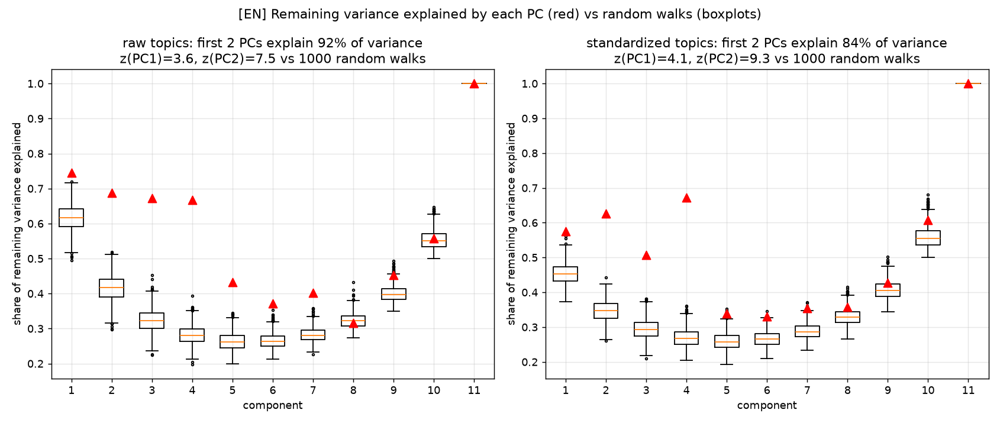

| | первые 2 ГК (данные) | первые 2 ГК (случайное блуждание) | z(PC1) | z(PC2) |
|---|---|---|---|---|
| доли тем как есть | 92,1 % | 77,6 % | 3,6 | 7,5 |
| темы стандартизованы | 84,1 % | 64,3 % | 4,1 | **9,3** |
| статья | 93 % | — | — | **9,7** |

В статье не уточнено, стандартизировались ли темы. В обоих вариантах вывод статьи **воспроизводится**: PC2 — заметно «неслучайная» компонента, и её доля оставшейся дисперсии выше, чем в любом из 1000 блужданий. PC3–PC4 у нас тоже заметно выше случайного уровня. В статье на Fig. 7 они тоже выше боксплотов.

## 4. Итог по EN

| Утверждение статьи | Результат |
|---|---|
| Многие темы имеют линейный тренд по экранному времени; место/школа/работа ↓, правда/извинения/смерть ↑ | ✅ воспроизведено (28 тем с \|r\| > 0,9) |
| Есть дуговые темы: соревнование по краям; выпивка, секс, животные — в середине | ✅ воспроизведено (семья — нет: у нас линейный рост) |
| Law and Order: полиция → суд | ✅ |
| Путь 6 тем: из «место↑ правда↓» в «место↓ правда↑» | ✅ (r = +0,99 / −0,97; все 6 тем совпадают со статейными) |
| Процедуралы следуют тренду сильнее; Grey's Anatomy отклоняется в финале | ✅ NCIS, Grey's Anatomy; CSI Miami — чуть слабее NCIS |
| 2 ГК объясняют ~93 % дисперсии, PC1 = время, PC2 = подкова | ✅ 92 % |
| PC2 на 9,7σ превосходит случайные блуждания | ✅ 9,3σ (стандартизированно) / 7,5σ (без стандартизации) |

Результаты статьи на английском материале воспроизводятся на корпусе в 3,4 раза большем и с другой реализацией LDA. Совпадают и сами темы (все шесть тем Fig. 4), и количественные показатели. Главная оговорка, которую делает и сама статья: подкова в PCA частично ожидаема (horseshoe effect). Значим её *масштаб* относительно случайных блужданий, и он подтверждается. По сравнению с предыдущей выгрузкой (91 801 эпизод) все выводы те же; основные показатели (r путей, доля дисперсии, z всего корпуса) отличаются не больше чем на 0,02 для r и 0,4σ для z. Темы модели при этом другие (новый корпус — новая LDA), поэтому отдельные метки тем в таблицах не совпадают со старой версией отчёта.

## 4a. Жанры и десятилетия (EN, метаданные ororo.sqlite)

Это то, что статья оставляет на будущее: «What similarities in plot directionality can occur across genres?». Код: [src/genres.py](src/genres.py), таблица: [results/EN/genre_stats.csv](results/EN/genre_stats.csv).

**Сначала методологическая оговорка.** z(PC2) против случайных блужданий сильно зависит от числа эпизодов: чем меньше выборка, тем шумнее 12-точечная арка. Случайные подвыборки из всего EN-корпуса (стандартизированные темы / доли как есть / доля дисперсии на 2 ГК без стандартизации, среднее по 10 подвыборкам):

| эпизодов | 1 500 | 5 000 | 10 000 | **27 000 (≈ статья)** | 50 000 | 92 930 |
|---|---|---|---|---|---|---|
| z(PC2), станд. | −2,0 | 2,8 | 4,6 | **7,4** | 8,5 | 9,1 |
| z(PC2), как есть | −0,9 | 3,9 | 5,5 | **6,9** | 7,4 | 7,6 |
| 2 ГК, как есть | 75 % | 86 % | 89 % | **91 %** | 92 % | 92 % |

Отсюда два вывода:
* при объёме корпуса статьи мы получаем z ≈ 7 и 91 % дисперсии на 2 ГК, что согласуется с её 9,7σ и 93 %;
* сравнивать группы по z можно только на выборках равного размера. Ниже приведено z на 20 случайных подвыборках по 5 000 эпизодов.

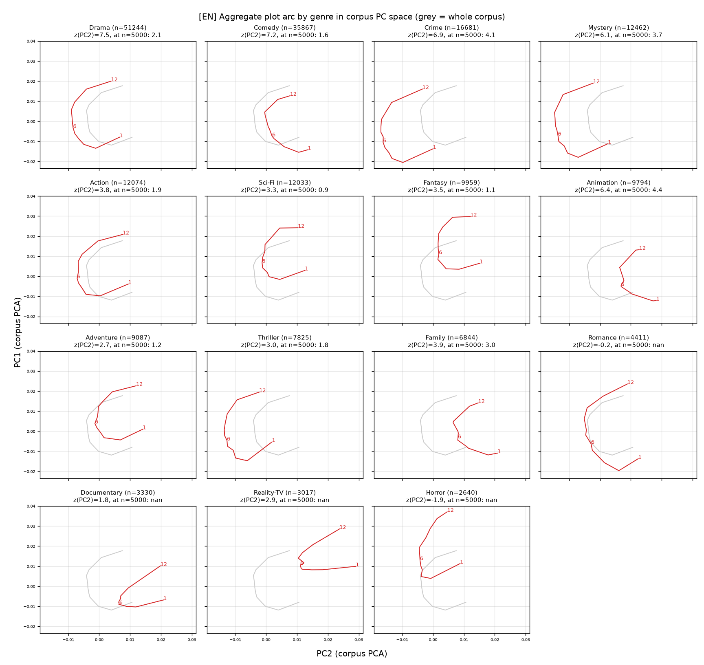

| группа | эпизодов | z(PC2) при n = 5000 | r(правда, время) | r(место, время) | тем с \|r_lin\| > 0,9 |
|---|---|---|---|---|---|
| весь корпус | 92 930 | 2,3 | +0,99 | −0,97 | 28 |
| только художественные (без Documentary / Reality / Talk / Game-Show / News) | 85 534 | 1,9 | +0,99 | −0,97 | 30 |
| Animation | 9 794 | **4,4** | +0,94 | −0,97 | 21 |
| Crime | 16 681 | **4,1** | +0,97 | −0,93 | 15 |
| Mystery | 12 462 | **3,7** | +0,97 | −0,92 | 16 |
| Family | 6 844 | 3,0 | +0,97 | −0,98 | 21 |
| Drama | 51 244 | 2,1 | +0,99 | −0,96 | 24 |
| Action | 12 074 | 1,9 | +0,97 | −0,92 | 12 |
| Thriller | 7 825 | 1,8 | +0,96 | −0,83 | 11 |
| Comedy | 35 867 | 1,6 | +0,98 | −0,98 | 28 |
| Adventure | 9 087 | 1,2 | +0,99 | −0,92 | 14 |
| Fantasy | 9 959 | 1,1 | +0,99 | −0,92 | 10 |
| Sci-Fi | 12 033 | 0,9 | +0,99 | −0,92 | 12 |
| Romance / Horror | 4 411 / 2 640 | — (< 5000) | +0,98 / +0,97 | −0,94 / −0,89 | 19 / 8 |
| Documentary | 3 330 | — | **+0,57** | −0,89 | 5 |
| Reality-TV | 3 017 | — | **+0,75** | −0,91 | 4 |

(r(правда, время) у жанров здесь считается по тем же трём темам, что в Fig. 4, включая leave/stay.)

* **Тренд «место ↓ / правда ↑» универсален для художественных жанров** (|r| ≥ 0,83 везде). У документалок и реалити тренд «правды» заметно слабее. Это ожидаемо: в них нет развязки с признаниями и извинениями.
* **Подкова (PC2) сильнее всего в жанрах с жёсткой формулой**: Crime, Mystery (процедуралы), Animation, Family. Слабее всего она в Sci-Fi, Fantasy, Adventure и Comedy. Это согласуется с тезисом статьи, что регулярности ярче там, где структуру навязывают производственные ограничения. Ранжирование то же, что на предыдущей выгрузке.
* Десятилетия: z при n = 5000 для 2000-х, 2010-х и 2020-х — 2,1 / 2,0 / 3,0; 1990-е (3 383 эп.) малы для сравнения ([results/EN/decade_arcs.png](results/EN/decade_arcs.png)). Есть слабый намёк на усиление формульности к 2020-м, но на RU его нет (4,0 / 3,3 / 3,9), так что вывода здесь нет.
* Исключение нехудожественных шоу основные результаты не меняет.

## 5. RU

Корпус: файлы `*_RU.srt` финальной выгрузки, **81 584 эпизода** (3 394 сериала), 1 027 668 чанков, 116 млн значимых токенов (113 на чанк). Отличия от EN-пайплайна:
* лемматизация pymorphy3, ё → е;
* имена отсеяны по тегам `Name/Surn/Patr` (123 тыс. словоформ), прочие имена собственные — эвристикой капитализации;
* словарь — 35 131 лемма.

Модель LDA та же: 127 тем, 500 итераций на 300k чанках, вывод тем для всех чанков со 100 итерациями. Фигуры: [results/RU/](results/RU/), сводка: [results/RU/summary.json](results/RU/summary.json).

| Показатель | Статья | EN | **RU** |
|---|---|---|---|
| эпизодов | ~27 000 | 92 930 | **81 584** |
| тем с \|r_lin\| > 0,9 | — | 28 | **25** |
| путь 6 тем: r(правда, t) / r(место, t) | монотонный | +0,99 / −0,97 | **+0,97 / −0,97** |
| 2 ГК, доля дисперсии | 93 % | 92 % | **92 %** |
| PC1 ~ время / PC2 ~ «середина» (\|r\|) | да / да | 0,960 / 0,926 | **0,949 / 0,912** |
| z(PC2) vs 1000 random walks, станд. / как есть | 9,7 | 9,3 / 7,5 | **9,7 / 7,5** |

**Fig. 1 (линейные тренды).**
* Убывают: «дом, жить, место, город, квартира» (r = −0,996), «школа, класс, учитель, урок» (−0,995), «колледж, университет» (−0,983), «работа, работать, неделя» (−0,975), «вечеринка, танец, клуб», «видео, статья, фото», «кофе, чай».
* Растут: «простить, ошибка, жаль» (+0,983), «правда, рассказать, верить, узнать» (+0,979), «решение, принять» (+0,978), «боль, причинить, вред» (+0,970).

Это та же картина, что в статье и в EN: место, школа, работа и быт в начале; признание, прощение и решение к концу.

**Fig. 2 (дуги).**
* Пик в середине: «вопрос, ответ, задать» (+0,953 — та же тема, что и в EN), «почему, рассказать, поговорить», «украсть, ключ, вор», «деньги, доллар, заплатить», «телефон, звонить», «компьютер, камера, код», «фотография, картина».
* Провал в середине: свадьба (−0,906, как в EN), «ночь, спать, сон», «спасибо, сегодня, шоу» (вступления и финалы шоу).

**Fig. 4.** Траектория та же, что в EN и в статье: монотонно из «много места» в «много правды», r(правда, t) = +0,967, r(место, t) = −0,968.
* Темы оси «место»: «дом/жить/город/квартира», «школа/класс/учитель», «работа/уволить».
* Темы оси «правда»: «правда/рассказать/верить», «простить/ошибка/жаль», «любить/любовь/сердце». Затравка «уйти/остаться», аналог статейной «leave/stay», ближе всего совпала с темой любви.

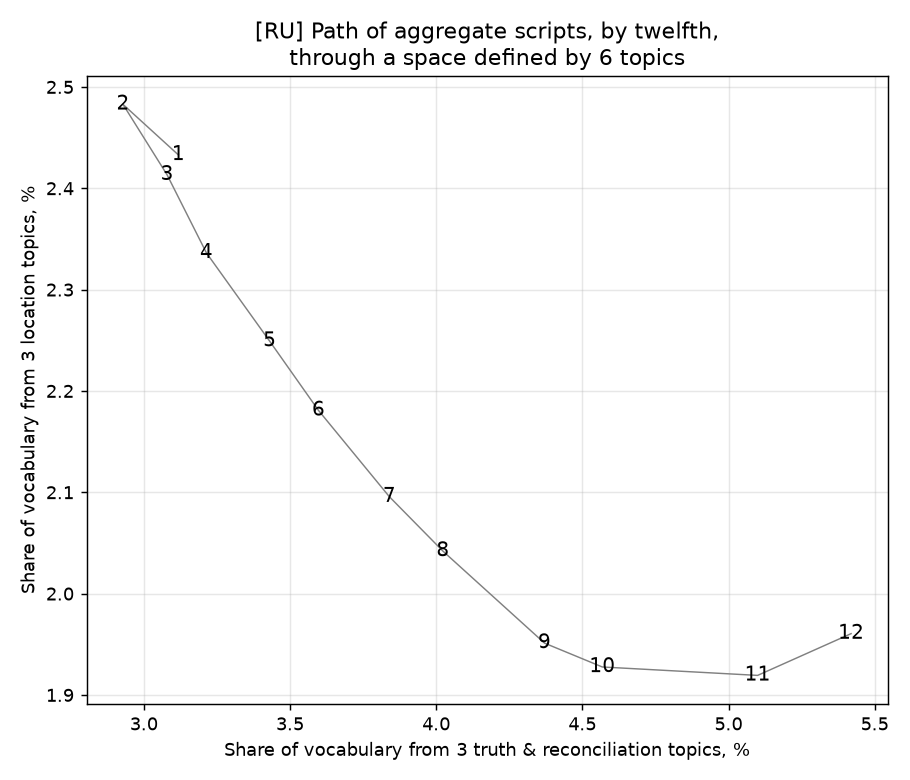

**Fig. 5.** NCIS снова следует тренду лучше всех (r = +0,99 / −0,76). У Grey's Anatomy «место» не убывает (−0,03), как и в EN. RU-субтитров к CSI Miami мало (64 эпизода).

**Жанры (RU, равные подвыборки по 5 000 эпизодов;** [results/RU/genre_stats.csv](results/RU/genre_stats.csv)**).**
* Самая выраженная подкова — у Animation (z = 6,7), Family (4,9), Crime (3,7), Drama (3,6), Mystery (3,4).
* Самая слабая — у Sci-Fi (2,5), Adventure (2,7), Thriller (2,9).
* Ранжирование в целом то же, что в EN: Animation, Family и Crime наверху, Sci-Fi и Adventure внизу.
* У документалок и реалити тренд «правды» ослаблен: r = +0,58 и +0,63 против ≥ +0,93 у всех художественных жанров.
* 2000-е / 2010-е / 2020-е: z = 4,0 / 3,3 / 3,9 — тренда по десятилетиям нет.

**Вывод: на русском материале статья воспроизводится так же хорошо, как на английском.** z(PC2) = 9,7 — ровно как в статье.

## 6. Сравнение EN ↔ RU

Русские субтитры — переводы с теми же таймкодами, поэтому чанк (эпизод, i) в обоих языках покрывает один и тот же отрезок экранного времени. Найдено **949 363 параллельных чанка**.

Две модели обучены независимо, и номера их тем никак не связаны. Темы сопоставлены венгерским алгоритмом по корреляции долей на параллельных чанках. Код: [src/compare.py](src/compare.py), таблица пар: [results/compare/topic_alignment.csv](results/compare/topic_alignment.csv).

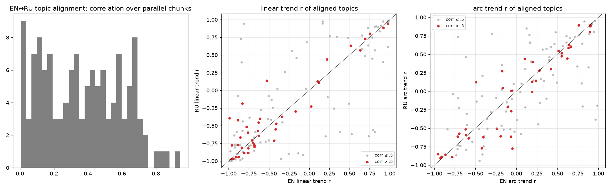

| Показатель | Значение |
|---|---|
| пар тем с корреляцией > 0,5 | 41 из 127 (медиана по всем парам 0,35) |
| согласие линейных трендов r_lin(EN) vs r_lin(RU), все 127 пар | 0,77 |
| то же, только надёжные пары (> 0,5) | **0,93** |
| согласие дуговых трендов, надёжные пары | **0,92** |
| медианная корреляция 12-точечных профилей надёжной пары | **0,968** |
| корреляция PC1 EN vs RU по 12 частям | **0,999** |
| корреляция PC2 EN vs RU по 12 частям | **0,991** |

Примеры надёжных пар (корреляция пары; r_lin EN / RU):
* court/judge/trial ↔ суд/судья/присяжный (0,79; +0,75 / +0,80);
* surgery/heart/patient ↔ доктор/операция/сердце (0,82; −0,71 / −0,71);
* god/church/pray ↔ бог/церковь/вера (0,75; +0,69 / +0,73);
* music/song/band ↔ песня/музыка/концерт (0,71; −0,81 / −0,88);
* food/dinner ↔ еда/ужин (0,68; −0,76 / −0,82).

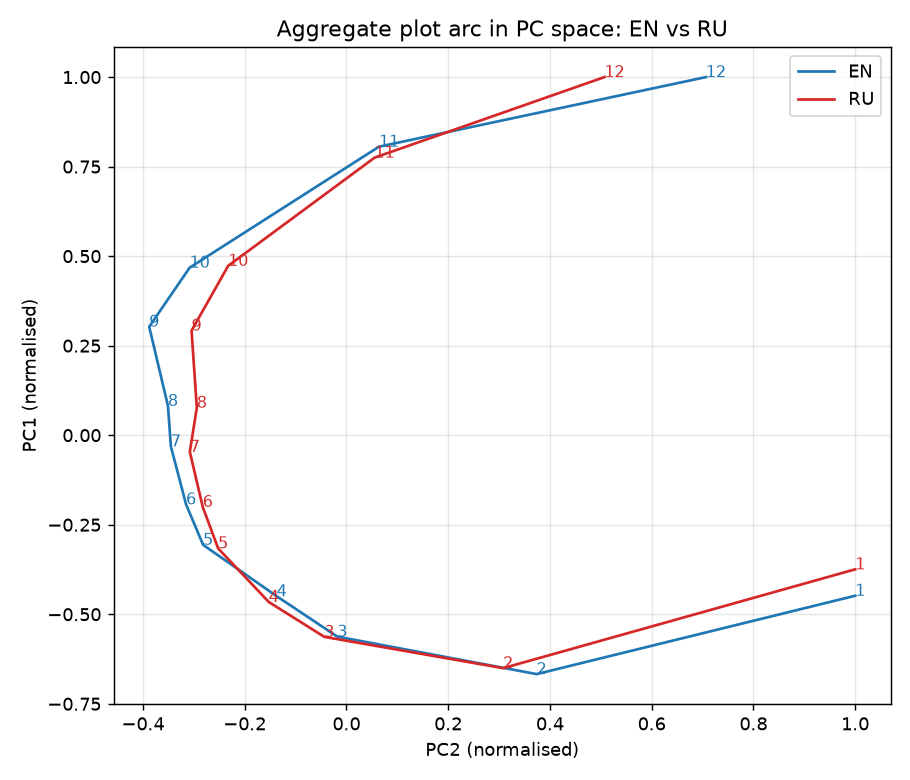

Выводы:
* **Плот-арка не зависит от языка и токенизации.** Две независимые модели (словоформы EN против лемм RU) дают практически одну и ту же подкову в PCA (r = 0,999 / 0,991), и согласованные темы ведут себя по экранному времени одинаково.
* Только треть тем имеет чёткого «двойника» в другом языке: границы тем в независимых LDA расходятся. Но агрегатная структура арки от этого не зависит. Это прямо подтверждает тезис статьи, что важна не семантическая точность отдельных тем, а сама сниженная размерность.
* Все показатели совпадают с предыдущей выгрузкой в пределах 0,05. Методологически параллельный корпус даёт сильный тест на устойчивость, которого в статье не было. Его стоит сохранить при переходе к прозе (раздел 7): у сказок есть `url_en`, то есть английские оригиналы.

## 7. Обобщение метода на рассказы и малую прозу: методология

Цель: перенести «плот-арки» с ТВ-субтитров на письменные короткие тексты и сравнить три типа повествования в одном измерительном аппарате:
* сериалы (диалог, экранное время);
* литературные сказки (фольклорная формула);
* любительские рассказы proza.ru (свободная форма).

Сама статья подсказывает, что это возможно. LDA там нужна только как способ сжатия словаря («strict semantic coherence is not necessary… PCA might work as well»), а сравнение идёт по *долям* текста, а не по абсолютному времени.

### 7.1. Корпуса

| | Сказки (`fairytalez[Rus].sqlite`) | Рассказы proza.ru (`proza[2022-2023]` + `proza[2024-2025]`) |
|---|---|---|
| Объём | 3 270 сказок (русские переводы англоязычного сайта, есть `url_en`) | 205 055 записей рубрики «рассказы», 197 725 с текстом |
| Длина, слов (медиана; 90-й перцентиль) | 982; 3 146 | 860; 3 100–3 400 |
| Пройдут фильтр длины | ≥ 600 слов: 2 174; ≥ 1000: 1 609 | 1 000–10 000 слов: 84 411 → после удаления дублей и лимита 20 текстов на автора: **55 517** (13 734 автора) |
| Метаданные | регион/народ (63 региона, мульти-метки), сборник (Лэнг, Гримм, Андерсен, Эзоп…), уровень чтения, «мораль», «истоки» | автор, дата/год публикации; **жанров нет** |
| Диалог | ~25 % абзацев (медиана) | медиана 25 % строк — реплики, разброс 1–50 % |
| Особенности | басни Эзопа очень короткие (медиана 88 слов); заметен машинный перевод названий регионов | сильная концентрация авторов: 1 % авторов дают 31–33 % текстов, у одного автора 3 916 текстов; ~1 000 дублей; немного стихов, эссе, мемуаров |

### 7.2. Что меняется по сравнению с субтитрами

| Аспект | ТВ (статья) | Проза: решение |
|---|---|---|
| Ось времени | экранное время (таймкоды) | **нарративное время = доля слов текста**: позиция токена / длина текста. Таймкоды дают и реплики, и паузы, а в прозе остаются только слова. |
| Единица для LDA | чанк 2–4 мин (≈ 360 слов) | чанк **фиксированного размера в словах** (см. 7.3) |
| Длина | почти фиксированная (22 / 42 мин) | от сотен до десятков тысяч слов, поэтому нужны страты длины |
| Текст | только диалог | повествование + диалог. Доля диалога — отдельная траектория-признак |
| Имена | стоп-лист Джокерса | pymorphy3 (`Name/Surn/Patr`) + эвристика капитализации, как в [src/prep.py](src/prep.py). В сказках имена-прозвища («Эму Диневан») пишутся с заглавной: правило ≥ 80 % заглавных и < 30 % текстов их уберёт |
| Метаданные | IMDB-жанры | сказки — регион и сборник; проза — жанр выводится из текста (7.3, шаг 6) |

### 7.3. Конвейер

**Шаг 0. Отбор и очистка.**
* Проза:
  * `status = 200`, 1 000–10 000 слов;
  * удалить дубли по хешу нормализованного текста; для реплик с правкой — MinHash;
  * не более 20 текстов на автора, выбор детерминированный по полю `bucket`, иначе арки будут описывать стиль 100 плодовитых авторов;
  * отсечь стихи (медианная длина строки < 8 слов, ~4 %);
  * убрать служебные строки («Фото из интернета», посвящения, «© …», «Продолжение следует»).
* Сказки:
  * ≥ 600 слов;
  * басни Эзопа и другие тексты < 600 слов — отдельная группа «микро», только в 3-частном анализе.
* Для обоих: нормализовать тире прямой речи и сохранить разметку «реплика / повествование» по абзацам.

**Шаг 1. Нарезка — прямое обобщение рекурсивной схемы статьи.** Текст делится на 3 части, каждая рекурсивно пополам, пока чанк не окажется в пределах **150–300 слов**. Получается 3·2ᵏ чанков, границы сдвигаются к ближайшему концу предложения. Это сохраняет обе идеи статьи:
* документ для LDA примерно постоянного размера;
* сопоставимость текстов разной длины через доли.

Для сравнения с ТВ можно дополнительно брать чанки 300–600 слов: это ближе к 364 словам у Шмидта. Агрегация в 12-е и 6-е — через пропорциональное перекрытие, как в [src/analyze.py](src/analyze.py) (`overlap_matrix`). Тексты 600–1 000 слов дают всего 3 чанка. Их 12-я арка — интерполяция, поэтому все сводки дополнительно считаются по **стратам длины**: 600–1 500, 1 500–3 000, 3 000–10 000 слов.

**Шаг 2. Представление чанков (от сопоставимого к точному).**

*Почему не переиспользовать готовую ТВ-модель как основную.* Формально словарь RU-модели субтитров покрывает 92,4 % значимых токенов прозы (выборка 570 рассказов) и 96,3 % токенов сказок. Но выпадает именно то, что отличает письменный нарратив от диалога:
* в прозе — реалии (Россия, Москва, СССР, колхоз, Петербург, Арбат: ТВ-правило имён собственных их отсекло, потому что в сериалах они редки) и глаголы авторской речи (усмехнуться, задумчиво, вздыхать);
* в сказках — фольклорная лексика (царевна, прялка, веретено, вельможа, взмолиться, разгневаться);
* в обоих — «думать»: в субтитрах это слово слишком частое.

Кроме того, темы ТВ-модели обучены на диалоге. Вывод тем на прозе силой «вписывает» повествование в диалоговые темы, и все различия форм будут читаться через чужую оптику.

Поэтому используются три модели:

1. **Основная — общая RU-модель** на сбалансированной конкатенации «субтитры RU + проза + сказки».
   * Обучающая выборка — поровну чанков из каждого источника (например, по 100k из субтитров и прозы и все ~15k чанков сказок с повторным весом). Иначе темы определит самый большой корпус.
   * Словарь и стоп-правила строятся заново по объединению. Правило имён собственных считается по доле *источников и текстов*, а не сериалов, чтобы «Россия» и «царевна» не отсекались. «Слишком частые» слова определяются по каждому корпусу отдельно.
   * Чанки одного масштаба: 150–300 слов. Для ТВ это значит заново нарезать субтитры по словам, а не по минутам: 2–4 мин ≈ 360 слов, так что можно взять 150–300 или привести все корпуса к 300–600.
   * Все три типа текстов оказываются в одном пространстве тем: их арки можно накладывать в одной PCA и считать одни метрики, а темы «родные» для каждого источника.
2. **Базовая проекция — готовая ТВ-модель без переобучения** (`work/RU/lda.bin`, `infer` на чанках прозы). Это быстрый первый замер: проявляется ли в прозе ТВ-вектор «место → правда/примирение» в ТВ-координатах. Если тренды видны даже в чужой оптике, результат особенно убедителен. Если нет, это мало о чём говорит, поэтому главной метрикой проекция не будет.
3. **Отдельные модели** на каждом корпусе дают более «родные» темы: у сказок — царь, лес, волк, испытание; у прозы — бытовые и мемуарные темы. Для сказок нужно меньше тем (~40–60: около 15 тыс. чанков). Число тем выбирается по когерентности (C_v / NPMI) и перплексии на отложенных текстах; 127 тем — для сопоставимости со статьёй.
4. **Проверка устойчивости на эмбеддингах**: мультиязычные sentence-эмбеддинги чанков (например, `multilingual-e5` или LaBSE) → PCA и те же метрики. Если подкова и линейные тренды повторяются без LDA, это подтверждает тезис статьи, что результат не зависит от способа сжатия.

**Шаг 3. Агрегатные арки (аналоги Fig. 1–2, 4, 6–7) — по корпусу, по стратам, по группам.**
* Линейный и дуговой тренд каждой темы: r с t и с −(t − 6,5)².
* «Пространство 6 тем» с затравками из [src/analyze.py](src/analyze.py) (RU: дом/квартира, школа, работа против правды/лжи, извинений, любви). Это проверяет, переносится ли главный сюжетный вектор «место → правда/примирение» из диалогового ТВ в повествовательную прозу.
* PCA матрицы 12 × K, доля дисперсии на 2 ГК, тест против случайных блужданий.

**Шаг 4. Две нулевые модели и контроль размера (вывод раздела 4a).**
* *Случайное блуждание*, как в статье.
* *Перемешивание чанков внутри текста* — более строгий контроль: сохраняет лексику каждого текста и разрушает только порядок. Все z и r сравниваются с 1 000 перестановок.
* Все сравнения групп — только **на равных подвыборках**: разделы 4a и 3 показали, что z(PC2) растёт с n от −1 до 9,5. Ориентир: 1 500 текстов для сказок (весь корпус) и 1 500 / 5 000 / 20 000 для прозы.

**Шаг 5. Индивидуальные траектории — открытый вопрос статьи** («Is it possible to characterize several different fundamental plots by clustering the paths…?»).
* Каждый текст — путь из 6 точек в пространстве первых 10–20 ГК (или в 6-мерной сводке тематических групп).
* Кластеризация: k-means по выпрямленным траекториям и DTW-иерархическая; k выбирается по силуэту и стабильности на бутстрепе.
* Качественная интерпретация по центроидам (какие темы растут и падают) и сравнение с 6 эмоциональными арками Reagan et al. (2016).
* Для сопоставления с Jockers — параллельная **тональная арка**: RuSentiLex / rubert-tiny-sentiment по тем же чанкам. Насколько тематические кластеры совпадают с сентиментными, видно по ARI.

**Шаг 6. Валидация внешними знаниями.**
* **Сказки и Пропп.**
  * Ожидаем: в начале — «дом, семья, царство, запрет»; в середине — «дорога, лес, испытание, чудесный помощник, бой»; в конце — «свадьба, награда, возвращение, царство». Формально проверяем:
    * линейный тренд (свадьба/награда ↑);
    * дугу (путь/испытание — пик в середине);
    * «круг» Хармона: близость частей 1 и 12 в PCA.
  * Группы: регион (Славянский, Немецкий, Скандинавский, Североамериканский/индейский, Китайский/Японский, Арабский — у всех ≥ 70 сказок) и сборник (Гримм vs Андерсен vs Лэнг). Гипотеза: у авторских сказок Андерсена арка менее формульна, чем у фольклорных.
  * Поле `moral` позволяет проверить, тематически ли концентрируется «мораль» в последней шестой части.
* **Проза proza.ru.** Жанров нет, поэтому три варианта:
  * (a) кластеры документных смесей тем (мемуар, военная, любовная, мистика, юмор, детская);
  * (b) zero-shot-разметка LLM на подвыборке 2–3 тыс. текстов с ручной проверкой 200 текстов и дообучением лёгкого классификатора;
  * (c) маркеры жанра: доля 1-го лица («я»), прошедшее время, доля диалога.
  
  Арки сравниваются по жанрам на равных n. Тот же разрез: 2022 / 2023 / 2024 / 2025.

**Шаг 7. Признак «диалог/повествование».** Доля реплик по 12-м частям — самостоятельная арка. Гипотеза: в прозе диалог нарастает к кульминации и падает в эпилоге. Отдельно стоит проверить, держится ли тренд «правда/извинения ↑» в прозе только на диалоговых чанках (тогда он про драматургию диалога, а не про сюжет) или и на повествовательных тоже.

### 7.4. Гипотезы и критерии

| # | Гипотеза | Проверка | Успех |
|---|---|---|---|
| H1 | В прозе и сказках есть темы с устойчивым линейным трендом по нарративному времени | число тем с \|r_lin\| > 0,9 против перемешанной нулевой модели | значимо больше, чем при перестановках, p < 0,001 |
| H2 | Вектор «место/быт ↓ — правда/примирение/чувства ↑» универсален | r(«правда», t), r(«место», t) в общей модели | тот же знак во всех трёх корпусах, \|r\| > 0,7 |
| H3 | Сказки формульнее любительской прозы | z(PC2) и доля дисперсии на 2 ГК при равном n | сказки > проза при n = 1 500 |
| H4 | Начало и конец сказки схожи («круг») | расстояние часть 1 ↔ 12 относительно 1 ↔ 6 в PCA | меньше, чем в перемешанных |
| H5 | Сюжетные траектории кластеризуются в небольшое число устойчивых типов | силуэт, стабильность (ARI на бутстрепе) | k ≤ 8, ARI > 0,6 |
| H6 | Результаты не артефакт LDA | повтор H1–H3 на эмбеддингах | качественное совпадение |

### 7.5. Риски

* **Концентрация авторов** в proza.ru: лимит на автора, отчётность «на авторах» (бутстреп по авторам, а не по текстам).
* **Неоднородность жанра** (эссе, мемуары, публицистика в рубрике «рассказы») размывает арки. Решение — шаг 6, плюс отдельный анализ «явно сюжетных» текстов (есть диалог, 3-е лицо, прошедшее время).
* **Короткие тексты**: при 3 чанках 12-я арка — интерполяция, поэтому выводы делаются по стратам длины, а главные — по 6-м частям.
* **Сказки — переводы** (местами машинные), часть лексики — артефакт перевода. Отчасти это компенсирует общая модель с ТВ-RU, где тоже переводы. Сказки малы, поэтому все интервалы — бутстреп.
* **Горизонт proza 2022–2025**: возможны тематические сдвиги по годам. Это вопрос для отдельного разреза, но не для агрегатных арок.

### 7.6. План пилота

1. `src/prep_text.py` — загрузка из SQLite (`immutable=1`), очистка, рекурсивная нарезка по словам, тот же формат `chunks.jsonl.gz`. Затем [src/topics.py](src/topics.py) и [src/analyze.py](src/analyze.py) без изменений, кроме подписи оси: «доля текста» вместо «12th of screen time».
2. Сначала быстрая проекция прозы и сказок на готовую ТВ-RU модель (шаг 2, п. 2). Затем общая RU-модель: сказки (весь корпус) + проза (выборка 20 000 по `bucket`) + субтитры RU, сбалансированно.
3. Метрики 7.4 + перестановочная нулевая модель + равные подвыборки.
4. Кластеризация траекторий и тональная арка.
5. Эмбеддинговая проверка.

По ресурсам: сказки — минуты; 55 тыс. рассказов (~150 млн слов) — сопоставимо с одним языком ТВ-корпуса, ~30–40 мин на этой машине.

## 8. Пилот на прозе: результаты

Код: [src/prep_text.py](src/prep_text.py) → [src/project.py](src/project.py) → [src/analyze.py](src/analyze.py) → [src/compare_prose.py](src/compare_prose.py). Таблицы: [results/prose_proj/](results/prose_proj/).

### 8.1. Данные после подготовки

| | Сказки | proza.ru |
|---|---|---|
| отбор | ≥ 600 слов | 1 000–10 000 слов: 84 411 → без дублей 83 573 → без стихов 80 175 → ≤ 20 текстов на автора: **53 998** |
| текстов | **2 174** | 53 998 (в анализе — детерминированная выборка 20 000 по `bucket`) |
| чанков (150–300 слов) | 20 181 | 609 339 (225 903 в выборке) |
| чанков на текст, медиана | 6 | 6 |
| доля слов в диалоге, медиана | 21 % | 18 % |

### 8.2. Проекция на ТВ-модель (без переобучения)

Чанки сказок и рассказов пропущены через RU-модель субтитров (`work/RU/lda.bin`). Словарь модели покрывает **96,3 %** значимых токенов сказок и **93,1 %** рассказов. Все 7 фигур статьи: [results/PROJ_TALES/](results/PROJ_TALES/), [results/PROJ_PROZA/](results/PROJ_PROZA/).

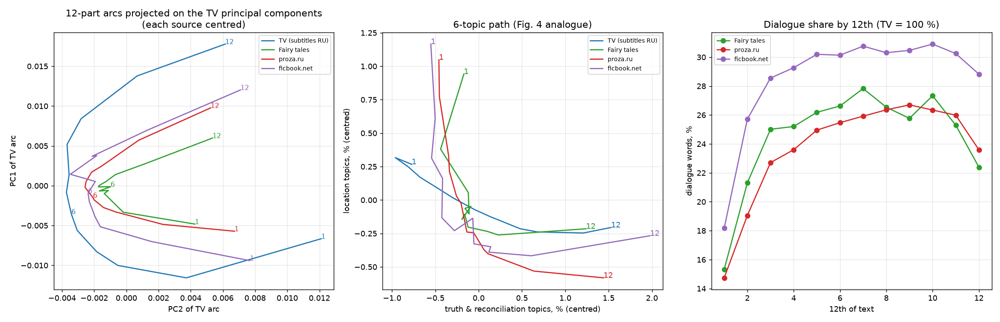

*Слева:* 12-частные арки трёх источников в осях PCA субтитров — у всех та же подкова, у прозы и сказок она короче. *В центре:* путь «правда × место» (аналог Fig. 4). *Справа:* доля диалога по 12-м частям.

**Сказки (2 174).**
* Растут к концу: «мир, сила, земля, великий, меч» (r = +0,98), смерть, «тюрьма, наказание», магия, «помнить, вернуться».
* Убывают: еда, природа (вода, дерево, гора), «дом, жить, комната», животные.
* Пик в середине: ночь/сон, план, «идти, пойти, вернуться», «бежать, вперёд», «дверь, открыть». Это и есть середина сказки по Проппу — дорога и испытания.
* r(правда, t) = +0,81, r(место, t) = −0,94.

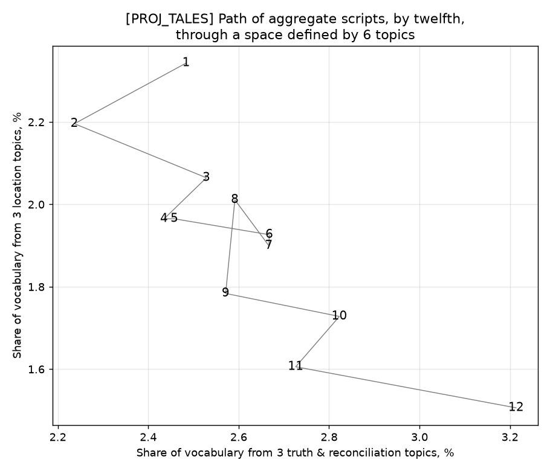

**Рассказы proza.ru (20 000).** Картина почти зеркальна ТВ:
* 30 тем с |r_lin| > 0,9.
* Убывают: дом, работа, школа, одежда, бизнес.
* Растут: боль/вред, тюрьма, суд, смерть, магия.
* Пик в середине: выпивка, еда (как у Шмидта в ТВ).
* Провал в середине: «книга, письмо, написать» и «год назад, месяц, неделя» — вероятно, рамка рассказа (предыстория в начале, эпилог в конце).
* r(правда, t) = +0,93, r(место, t) = −0,99. 2 ГК объясняют 96 % дисперсии.

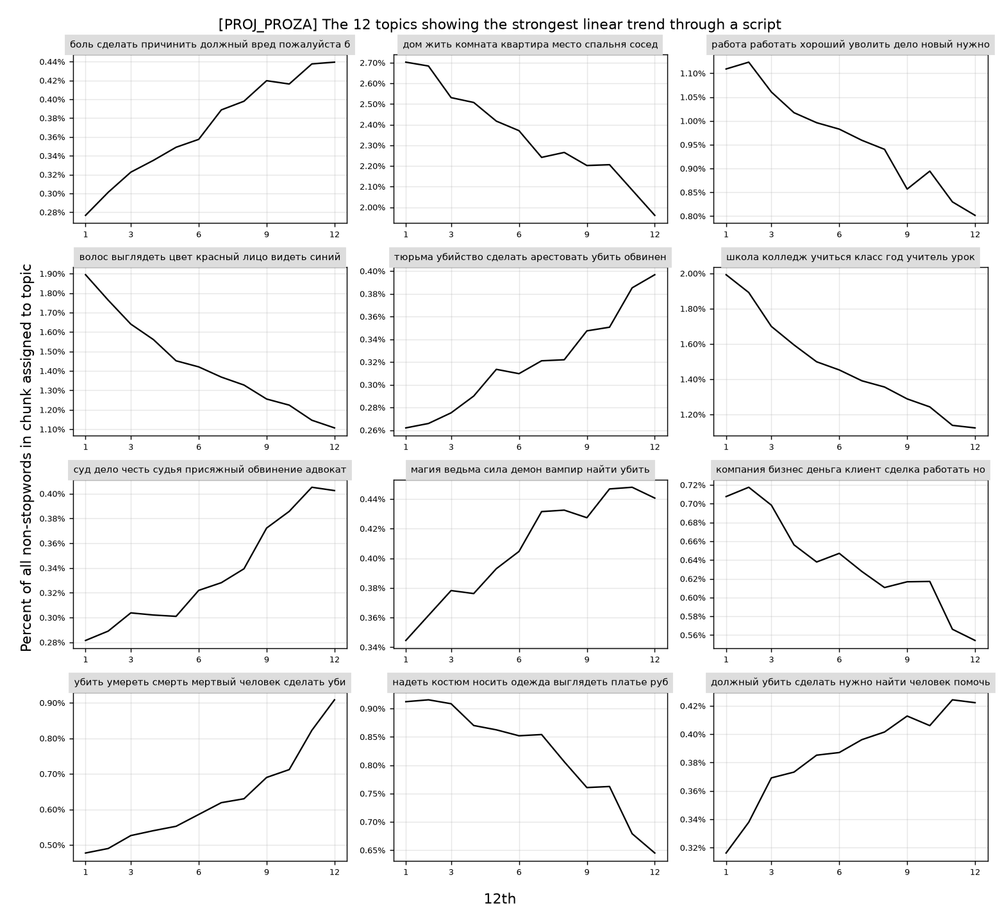

### 8.3. Сравнение источников: равные выборки и перемешанная нулевая модель

Все три источника измерены в одних координатах (темы ТВ-модели), на равных выборках по 2 000 текстов (среднее по 20 подвыборкам; [comparison.csv](results/prose_proj/comparison.csv)):

| источник | тем \|r_lin\| > 0,9 | тем \|r_lin\| > 0,7 | тем \|r_arc\| > 0,7 | r(правда, t) | r(место, t) | 2 ГК | z(PC2) |
|---|---|---|---|---|---|---|---|
| ТВ (субтитры RU) | 11,6 | 44,8 | 14,6 | +0,96 | −0,95 | 0,80 | 2,6 |
| сказки | 8,2 | 34,3 | **23,4** | +0,80 | −0,94 | **0,94** | **11,2** |
| proza.ru | 9,8 | 44,0 | 17,0 | +0,91 | −0,97 | 0,85 | 5,8 |

**Перемешанная нулевая модель.** Порядок чанков внутри каждого текста случайно переставлен 200 раз: лексика текста сохраняется, разрушается только порядок ([shuffle_null.csv](results/prose_proj/shuffle_null.csv)). Для всех трёх источников и всех метрик наблюдаемое значение лежит за пределами нулевого распределения (p ≤ 0,01 — минимум при 200 перестановках). Например, тем с |r_lin| > 0,9 в перемешанных данных в среднем 0,005–0,025 против 8–13 наблюдаемых; z(PC2) — от −5,5 до −7 против наблюдаемых 4,0 (ТВ), 11,3 (сказки) и 5,2 (проза).

**Контроль разрешения нарезки.** У текстов из 3 чанков 12-я арка — ступенчатая интерполяция. Поэтому метрики пересчитаны только на текстах с одинаковым числом чанков (по 600 текстов):

| источник | z(PC2), только 6 чанков | z(PC2), только 12 чанков | 2 ГК (6 / 12) |
|---|---|---|---|
| ТВ | 1,2 | −2,1 | 0,80 / 0,64 |
| сказки | **9,0** | **7,7** | **0,91 / 0,87** |
| proza.ru | 4,6 | 0,1 | 0,81 / 0,69 |

**Страты длины proza.ru** (по 2 000 текстов): z(PC2) = 9,6 (< 1 500 слов), 6,1 (1 500–3 000), 7,0 (> 3 000); r(место, t) ≈ −0,97…−0,99 во всех стратах.

### 8.4. Проверка гипотез 7.4 (по проекции)

| # | Гипотеза | Результат |
|---|---|---|
| H1 | трендовые темы в прозе и сказках | ✅ 8–13 тем с \|r\| > 0,9 против ≈ 0 в перемешанных; p ≤ 0,01 |
| H2 | «место ↓ / правда ↑» универсален | ✅ все три источника: r(правда) +0,80…+0,96, r(место) −0,94…−0,99 |
| H3 | сказки формульнее прозы | ✅ z(PC2) 11,2 против 5,8 при n = 2 000; устойчиво к контролю числа чанков (9,0 против 4,6 и 7,7 против 0,1) |
| H4 | «круг» в сказках | ⏳ |
| H5 | кластеры траекторий | ⏳ |
| H6 | не артефакт LDA | ⏳ (эмбеддинги) |
| шаг 7 | диалог нарастает к кульминации и падает в эпилоге | ✅ в обоих корпусах: ~15 % в 1-й части → пик 26–28 % в 7–10-й → 22–24 % в 12-й |

Важно: проекция — это измерение в «чужой» оптике тем субтитров. То, что даже в ней сказки и проза дают те же векторы и подкову, — сильный аргумент. Окончательные цифры должна дать общая модель (8.5).

### 8.5. Общая модель «субтитры + сказки + проза»

*В работе* ([src/joint.py](src/joint.py)):
* словарь 46 350 лемм; имена собственные отсекаются, только если редки во всех трёх источниках;
* обучение на 100k чанков субтитров + 100k чанков прозы + все чанки сказок с весом ×3;
* вывод тем для 20k ТВ-эпизодов, всех сказок и тех же 20k рассказов.

## 9. Фанфики ficbook.net

Источник: `datasets/data_ficbook/ficbook_originals_2026.sqlite` и тексты глав `texts/2026/{02,03,04}/<work_id>/part-NNN.txt` — публикации за февраль–апрель 2026 года. База читается из копии в `work/` вместе с WAL-журналом: в режиме `immutable` свежие записи журнала не видны.

| этап отбора | работ |
|---|---|
| работ с текстом | 7 011 |
| статус «закончен», нет глав с ошибками и пропусков в нумерации | 5 375 |
| без стихов (тег «Стихи») и «Статей» | 4 349 |
| 1 000–10 000 слов после очистки (как у proza.ru), медианная строка ≥ 8 слов | 2 190 |
| ≤ 20 работ на автора | **2 190** (лимит не сработал; в анализе 2 188) |

Очистка ([src/prep_text.py](src/prep_text.py), `ficbook_text`):
* главы склеиваются по порядку, служебные страницы «спасибо автору» (`status = terminal`) и страницы оглавления отбрасываются;
* удаляются строки с названием работы и главы, «Примечания:», ссылки, даты публикации, «Отзывы: N».

Итог: **2 188 работ, 33 420 чанков** (по 150–300 слов), медиана — 2 349 слов и 12 чанков на работу, диалог — 26 % слов (медиана). 94 % — ориджиналы. Направленность: джен 808, слэш 623, гет 491, фемслэш 162.

Фанфики включены:
* в проекцию на ТВ-модель (`work/PROJ_FICBOOK`);
* в общую модель: обучение с весом ×2, вывод тем для всех работ.

Сравнение идёт на тех же равных выборках по 2 000 текстов, что и для сказок и прозы. *Результаты появятся после пересчёта.*

## 10. Направления для статьи на «Диалог»

«Диалог» (Компьютерная лингвистика и интеллектуальные технологии) ценит работы на русском материале с новыми ресурсами, аккуратной методологией и лингвистической интерпретацией. Чистая репликация англоязычной статьи 2015 года сама по себе слабовата. Сильная сторона нашего проекта в другом: **четыре разных типа русскоязычного повествования в одном измерительном аппарате** плюс параллельный EN–RU корпус. Формат, язык подачи и сроки нужно сверить с актуальным CFP: в последние годы основной трек принимает статьи на английском.

### 10.1. Возможные рамки статьи (по убыванию силы)

**A. «Сюжетные арки в русском повествовании: от сериалов до фанфиков»** — основная рекомендация.

Тезис: у нарратива есть измеримый, независимый от регистра и медиа «сюжетный вектор» (быт/место → правда/признание/примирение) и регистр-зависимая «формульность».

Уже есть:
* субтитры RU (~81k эпизодов), сказки (2,2k), proza.ru (54k), ficbook (2,2k);
* общий протокол;
* перемешанная нулевая модель;
* равные выборки;
* ранжирование формульности: сказки ≫ проза > ТВ (фанфики — после пересчёта).

Вклад:
1. протокол сравнения арок между корпусами с контролем размера выборки и разрешения нарезки;
2. эмпирическое ранжирование регистров;
3. внешняя валидация на метках ficbook (10.2, Э1).

**B. Методологическая: «Как (не) проверять сюжетные арки».**

Наш результат: z(PC2) против случайных блужданий растёт с размером выборки от −1 до 9,5 (раздел 4a). Поэтому сравнение групп по этому тесту без выравнивания n некорректно. Предлагаем:
* перемешивание чанков внутри текста как более строгую нулевую модель;
* равные подвыборки;
* контроль числа чанков.

Короткая и чёткая статья, хорошо ложится в формат short paper. Можно сделать частью рамки A.

**C. «Инвариантность сюжетной арки к переводу».**

934 тыс. параллельных EN–RU чанков: независимые модели на двух языках дают одну и ту же подкову (r = 0,999 / 0,996), хотя чёткого двойника имеет только треть тем. Это вопрос о том, что именно измеряет метод — сюжет или лексику. Отдельной статьёй тонковато, как раздел в A — сильно.

**D. Лингвистическая, самая «диалоговская»: морфосинтаксический профиль сюжета.** Вместо тем (или вместе с ними) — траектории грамматических признаков по нарративному времени. Русская морфология даёт то, чего нет в англоязычных работах:
* **вид глагола** (доля совершенного вида — событийность; ожидаем пик к кульминации);
* время (прошедшее/настоящее: переходы в настоящее историческое);
* лицо (1-е/3-е);
* наклонение (императив в диалоге, сослагательное);
* отрицание;
* модальность;
* длина предложения;
* доля диалога (уже есть: пик в 7–10-й частях из 12).

Всё это считается pymorphy3 на уже готовых чанках. Это аналог «narrative arc» Boyd, Blackburn & Pennebaker (2020), но на русском и с грамматикой, которой в английском нет. Хорошо сочетается с A: «что меняется по ходу сюжета — темы и грамматика».

### 10.2. Эксперименты, которых не хватает для сильной статьи

| # | Эксперимент | Зачем | Данные / объём работы |
|---|---|---|---|
| Э1 | **Внешняя валидация на тегах ficbook.** Отличают ли арки финалы: «Счастливый финал» (144), «Открытый финал» (146), «Смерть основных персонажей» (166), «Трагедия» (33)? Классификатор по профилю последних 2/12 текста и по форме всей траектории против бейзлайна «мешок слов всего текста». Отдельно: где в тексте находится тема признания у работ с тегом «Признания в любви». | Главный ответ на вопрос рецензента «а это вообще сюжет?» | теги уже в `work/FICBOOK/episodes.csv`; 1–2 дня |
| Э2 | **Морфосинтаксические арки (рамка D).** Вид, время, лицо, отрицание, длина предложения, диалог по 12-м частям для всех четырёх корпусов, с той же нулевой моделью. | Лингвистический вклад, независимый от LDA | pymorphy3 по сырым чанкам; 1–2 дня |
| Э3 | **Кластеризация индивидуальных траекторий** (H5) и сопоставление кластеров с тегами ficbook, регионами/сборниками сказок, жанрами IMDB. | Открытый вопрос самой статьи Шмидта | готовые `doc_topics`; 2–3 дня |
| Э4 | **Устойчивость к представлению** (H6): эмбеддинги чанков (например, multilingual-e5 / ruBERT) → те же метрики. | Снимает претензию «артефакт LDA» | GPU желателен; 1 день |
| Э5 | **Бутстреп по авторам** для proza.ru и ficbook, доверительные интервалы для всех сравнений регистров. | Строгость: авторы, а не тексты — единица выборки | 0,5 дня |
| Э6 | **Сказки и Пропп** (H4 «круг», дорога/испытание в середине). Ручная разметка функций Проппа на 50–100 сказках как золотой стандарт для части выводов. | Связь с классической нарратологией, понятная гуманитариям | разметка ~2–3 дня |
| Э7 | Тональная арка (RuSentiLex / rubert-sentiment) и сравнение с тематической (ARI кластеров). | Связь с линией Jockers / Reagan | 1 день |

Минимальный набор для подачи по рамке A: Э1 + Э5, плюс Э2 или Э3.

### 10.3. Ожидаемые вопросы рецензентов и ответы

* **«Подкова в PCA — известный артефакт».** Да, и мы это показываем. Проверяем не форму, а её масштаб против двух нулевых моделей, причём перемешивание внутри текста строже случайных блужданий из статьи. Плюс внешняя валидация Э1.
* **«Субтитры и сказки — переводы, а не русская речь».** Поэтому основная ось сравнения — proza.ru и ficbook (оригинальные русские тексты), а переводы дают контролируемый эксперимент: параллельный корпус (рамка C).
* **«Темы LDA произвольны».** Ответ: инвариантность между независимыми моделями (EN/RU, ТВ-модель против общей), эмбеддинги (Э4), грамматические признаки без тем (Э2).
* **«Длина текстов разная».** Ответ: страты длины, контроль числа чанков, тексты 1–10 тыс. слов во всех письменных корпусах.
* **«Самоотбор авторов / концентрация».** Ответ: лимит на автора, бутстреп по авторам (Э5).

### 10.4. Данные, этика, воспроизводимость

* Тексты proza.ru и ficbook защищены авторским правом и содержат пользовательский контент. **Публиковать только производные данные:** идентификаторы текстов, распределения тем по чанкам, агрегаты, код. Тексты не публиковать; при ссылке на примеры — короткие цитаты с указанием источника.
* Для proza.ru есть прецедент: корпус «Тайга» (Shavrina & Shapovalova, 2017) включает тексты proza.ru — на него стоит сослаться как на предшествующий ресурс.
* Метаданные ficbook (теги, направленность, рейтинг) содержат чувствительные категории (NC-17, сексуальный контент): в статье использовать только агрегаты.
* Код и производные данные — в этом репозитории; модели LDA (`lda.bin`) можно выложить отдельно (например, на Zenodo или Hugging Face).

### 10.5. Что цитировать (ядро)

Schmidt (2015) — исходная статья; Jockers (2015) — Syuzhet и критика Swafford (2015); Reagan et al. (2016) — эмоциональные арки, EPJ Data Science; Boyd, Blackburn & Pennebaker (2020) — «The narrative arc», Science Advances; Elkins (2022) — *The Shapes of Stories*; Piper (2015); Пропп (1928); Blei, Ng & Jordan (2003) — LDA; Shavrina & Shapovalova (2017) — «Тайга»; Лукашевич и др. — RuSentiLex (если Э7). Перед подачей библиографию нужно сверить по первоисточникам.

### 10.6. Скелет статьи (рамка A + D)

1. Введение: сюжет как траектория; русский материал; четыре регистра.
2. Данные: 4 корпуса (таблица отбора), параллельный EN–RU корпус.
3. Метод: нарезка 3·2ᵏ, общая модель, метрики, две нулевые модели, равные выборки (главный методологический урок — зависимость z от n).
4. Результаты:
   1. универсальный вектор «место → правда»;
   2. формульность по регистрам;
   3. валидация на тегах ficbook (Э1);
   4. грамматические арки (Э2).
5. Обсуждение: переводы, ограничения, LDA против эмбеддингов.
6. Заключение и ресурсы.

Объём — 4–5 рисунков:
* подкова в общем пространстве для четырёх корпусов;
* зависимость z от n;
* арки финалов ficbook;
* вид глагола и диалог по 12-м частям;
* таблица формульности.

## Воспроизведение

```bash
python -m venv .venv && .venv/bin/pip install -r requirements.txt     # Python 3.12
PY=.venv/bin/python scripts/run_all.sh                                 # весь конвейер, ~3 ч на 18 ядрах
```

Все этапы по порядку перечислены в [scripts/run_all.sh](scripts/run_all.sh). Данные (`datasets/`) в репозиторий не входят, их структура описана в [README.md](README.md). Детали прогона:
* EN-темы выводились со 100 итерациями Gibbs (`INFER_ITERS=100`), остальное — с 40 (значение по умолчанию);
* сиды фиксированы: LDA seed = 42, подвыборки `numpy` seed = 0.
