# Воспроизведение «Plot Arceology» (Schmidt, 2015) на корпусе сериальных субтитров

Актуальный план публикации для «Диалога», приоритеты и оставшиеся гипотезы после пилота H5: [DIALOGUE.md](DIALOGUE.md). Раздел 10 ниже сохраняет историю первоначальных направлений; выбор основной рамки уточнён в этом плане.

Статья: B. M. Schmidt, *Plot Arceology: a vector-space model of narrative structure* (2015). PDF в репозиторий не включён (авторские права); локально он лежит в `paper/`.

Статус:
* Все расчёты сделаны на **финальной выгрузке Ororo** (05.11.2026, `datasets/data_ororo`: 97 037 EN и 84 705 RU субтитров, 4 015 шоу).
* Готово:
  * EN, RU и сравнение EN↔RU (разделы 2–6);
  * методология для прозы (раздел 7);
  * проекция сказок, proza.ru и фанфиков на ТВ-модель (разделы 8.1–8.4, 9);
  * направления для статьи на «Диалог» (раздел 10).
  * общая модель «субтитры + сказки + проза + фанфики» (раздел 8.5).
  * BERTopic и арки эмбеддингов (разделы 11.2–11.4).
  * чувствительность к числу тем K: все 16 запланированных прогонов завершены (раздел 11.1).
  * пилот H5: кластеризация индивидуальных траекторий и связи с метаданными (раздел 13); устойчивые разбиения найдены, универсальные типы сюжетов не установлены.
  * P1/D1: предсказание авторских тегов финала с разделением по авторам (раздел 14); первичный эксперимент не обнаружил подтверждённого выигрыша порядка частей.
  * P2/D2: сказки против proza.ru при согласованной длине, числе чанков и групповых интервалах (раздел 15). Строгое преимущество по стандартизированной PC2 не подтверждено; различие концентрации дисперсии зависит от весов текстов/авторов.
* Проверка отчёта от 06.11.2026: результаты K-sweep внесены, выводы уточнены; ограничения и незавершённые проверки собраны в разделе 12.

## 1. Что утверждает статья

1. Если нарезать сценарии на равные доли экранного времени и обучить на кусках LDA-модель, то многие темы
   систематически меняются по ходу эпизода: одни **линейно** (растут к концу / убывают), другие **дугой**
   (пик или провал в середине).
2. Эпизод — это путь в пространстве тем. В двумерной проекции «3 темы места» × «3 темы правды/примирения»
   агрегатный сюжет идёт из «много места, мало правды» в «мало места, много правды».
3. Отдельные шоу следуют этому тренду в разной степени: сильнее всего процедуралы (CSI, NCIS); Grey's Anatomy
   отклоняется в финальной сцене.
4. PCA матрицы «12 частей × темы»: PC1 ≈ направленное время, PC2 ≈ «середина vs края» (подкова);
   первые две ГК объясняют **93 %** дисперсии; доля оставшейся дисперсии, объясняемая PC2,
   на **9,7 стандартного отклонения** выше среднего случайных блужданий. Превышение максимума из 1000 симуляций — отдельная характеристика, не определение z.

## 2. Данные и метод

| | Статья | Здесь |
|---|---|---|
| Источник | opensubtitles, ~80k файлов, из них ~27k ТВ-эпизодов | финальная выгрузка Ororo (05.11.2026): `datasets/data_ororo/Serials`, файлы `*_EN.srt` (97 037) |
| Эпизодов в анализе | ~27 000 | **92 930** (3 904 сериала) |
| Отбор | ТВ-эпизоды по IMDB | длительность 15–95 мин, ≥ 400 слов |
| Нарезка | 3 части, рекурсивное деление пополам до 2–4 мин | то же самое (3·2ᵏ чанков) |
| Документов (чанков) | ~1,8 млн, 364 слова | **1 152 324**, ~98 значимых токенов на чанк (после стоп-слов) |
| Тематическая модель | Mallet LDA, 127 тем | tomotopy LDA (collapsed Gibbs, как Mallet), 127 тем, α-оптимизация; 500 итераций на 300k чанках, затем вывод тем для всех чанков (100 итераций) |
| Стоп-слова | расширенный список Джокерса (функциональные слова + ~5k имён) | sklearn + разговорные междометия; имена из NLTK names (если в корпусе слово ≥ 50 % пишется с заглавной); прочие имена собственные (≥ 80 % с заглавной, встречаются < 30 % сериалов); строки с титрами сабберов удалены. Словарь — 38 081 слово |
| Агрегация | доля слов темы по 12-м / 6-м экранного времени | то же; чанки раскладываются в 12-е пропорционально перекрытию; доля = Σ слов темы / Σ слов |

Код: [src/prep.py](src/prep.py) → [src/topics.py](src/topics.py) → [src/analyze.py](src/analyze.py) (→ [src/compare.py](src/compare.py)).
Темы и тренды всех тем: [results/EN/topic_trends.csv](results/EN/topic_trends.csv) (`label`, `top10`, `r_linear`, `r_arc`); сводка: [results/EN/summary.json](results/EN/summary.json).

Отличия, которые стоит держать в голове:
* Корпус в 3,4 раза больше, и в нём только сериалы (без фильмов на этапе обучения LDA).
* Метаданные берутся из `ororo.sqlite` (4 015 шоу: IMDB ID, жанры IMDB, страны, год, рейтинг; 97 995 эпизодов с датами выхода). `shows.directory_name` совпадает с именем папки сериала для 100 % анализируемых сериалов; дата выхода есть у 99,75 % эпизодов ([src/meta.py](src/meta.py)). Шоу для Fig. 5 подобраны по названиям, часть заменена (см. ниже).
* Шесть тем для Fig. 4 выбираются автоматически по пересечению топ-слов с затравочными списками, а не вручную.

## 3. Результаты EN

### Fig. 1 — темы с сильнейшим линейным трендом


| r | тема | направление |
|---|---|---|
| −0,990 | police officer cop detective guy case cops | ↓ |
| −0,990 | **school class high college year kids teacher** | ↓ |
| −0,988 | **house place live home sell property people** | ↓ |
| +0,987 | **sorry did look thank god fine talk** | ↑ |
| −0,981 | dr doctor hospital patient need nurse medical | ↓ |
| +0,981 | did wanted thought life feel knew make | ↑ |
| +0,980 | **did truth lie believe lying telling knew** | ↑ |
| +0,978 | **need let away stay stop leave look** | ↑ |
| +0,977 | fucking fuck shit man fuckin fucked god | ↑ |
| +0,974 | wait let minute hold sorry look need | ↑ |
| −0,966 | people video news media story social online | ↓ |
| −0,964 | kids mom dad kid parents house family | ↓ |

Жирным выделены темы, которые почти дословно совпадают с темами Fig. 1 статьи: «school class teacher college high kids year», «house room place live living apartment move», «truth believe lie true lying», «sorry life wasn wrong fault done love», «leave won away stay Please care promise». Совпадают и знаки трендов: школа и дом убывают, правда, извинения и «уйти/остаться» растут. Работа/офис тоже убывает (r = −0,90), смерть растёт (+0,78 у «kill killed did dead let man die», +0,81 у «murder did police killed evidence»). У 28 из 127 тем |r| > 0,9.

Вывод статьи «школы, рабочие места и дома чаще упоминаются в начале, язык извинений и смерть — в конце» **воспроизводится**.

### Fig. 2 — темы с сильнейшим дугообразным трендом


* Пик в середине: воспоминания/фото («remember look years picture», r_arc = +0,99), вопросы/расспросы, деньги/банк, кража/сокровище, телефон/сообщения, психология.
* Провал в середине: **«team win race game»** (−0,96), свадьба/брак (−0,93), Рождество (−0,87).

В статье: «семьи и правила соревнования — в основном в начале и конце; выпивка, сексуальность, друзья и животные — ближе к середине». У нас:
* соревнование (−0,96) и свадьба (−0,93) — по краям;
* выпивка («party night drink bar drunk», +0,89; «drink coffee wine», +0,80), секс («sex women gay woman men», +0,89) и животные («dog cat animals», +0,55; «bird dragon spider», +0,77) — в середине.

**Воспроизводится**, кроме семьи: «father family mother son» у нас растёт линейно (r = +0,81), а не провисает.

### Fig. 3 — Law and Order


96 эпизодов. Начало эпизода — «guy car missing van looking», «police officer cop detective», «victim body killer blood», затем «murder … evidence case detective». Вторая половина — «case court honor judge trial client lawyer». Структура «полицейское расследование → суд» **воспроизводится**.

### Fig. 4 — путь агрегатного сценария в пространстве 6 тем


* Ось X (правда и примирение): truth/lie, sorry/thank, **leave/stay/away** — все три совпадают со статейными.
* Ось Y (место): room/house/hotel, school/class, job/work/office — тоже все три как в статье.

Траектория почти совпадает со статейной: 1 → 2 вверх, затем монотонно из верхнего левого угла в нижний правый, к 11–12. Корреляция со временем: X +0,991, Y −0,971. **Воспроизводится.**

### Fig. 5 — отдельные шоу (по шестым)


| Шоу (у нас) | В статье | n | r(правда, время) | r(место, время) |
|---|---|---|---|---|
| CSI Miami | CSI | 227 | +0,85 | −0,51 |
| NCIS | NCIS | 511 | **+0,98** | **−0,91** |
| Stargate SG-1 | Stargate SG-1 | 211 | +0,95 | −0,11 |
| Grey's Anatomy | Grey's Anatomy | 466 | +0,99 | −0,24 |
| The Traitors US | Survivor (реалити) | 54 | +0,69 | +0,13 |
| Prison Break | The Fugitive (1963) | 88 | +0,81 | +0,02 |

* NCIS — единственное шоу, где обе оси идут ровно по агрегатному тренду (как в статье). CSI Miami — следом.
* Grey's Anatomy: «место» убывает до середины, а в **последних двух шестых снова растёт**. В статье: «the medical drama departs primarily in its final scene». **Воспроизводится.** Похожий возврат «места» в финале есть у Stargate SG-1.
* The Fugitive в корпусе — ремейк 2020 года для Quibi с ~8-минутными эпизодами, он отсечён фильтром длительности. Его заменил Prison Break. Survivor в корпусе нет, его заменил The Traitors US.

### Fig. 6 — PCA плот-арки (12 частей × 127 тем)


* Первые 2 ГК объясняют **91,8 %** дисперсии (в статье 93 %).
* PC1 коррелирует со временем: |r| = 0,960. Положительный полюс — «did wanted thought life», sorry, truth/lie, kill/dead, love/happy; отрицательный — «guy car missing van», «dr surgery heart», school/class.
* PC2 коррелирует с «серединностью» (x−6,5)²: |r| = 0,926. Части 1–2 и 11–12 лежат по одну сторону по PC2, середина — по другую. Это подковообразный профиль, как в статье. Он не доказывает близость начала и конца в полном пространстве тем или даже на плоскости двух ГК: PC1 одновременно разделяет их по времени. Проверка «круга» — отдельная гипотеза H4.

### Fig. 7 — оставшаяся дисперсия по ГК vs 1000 случайных блужданий (12 × 100 тем)


| | первые 2 ГК (данные) | первые 2 ГК (случайное блуждание) | z(PC1) | z(PC2) |
|---|---|---|---|---|
| доли тем как есть | 92,1 % | 77,6 % | 3,6 | 7,5 |
| темы стандартизованы | 84,1 % | 64,3 % | 4,1 | **9,3** |
| статья | 93 % | — | — | **9,7** |

В статье не уточнено, стандартизировались ли темы. В обоих вариантах вывод статьи **воспроизводится**: PC2 — заметно «неслучайная» компонента, и её доля оставшейся дисперсии выше, чем в любом из 1000 блужданий. PC3–PC4 у нас тоже заметно выше случайного уровня. В статье на Fig. 7 они тоже выше боксплотов.

## 4. Итог по EN

| Утверждение статьи | Результат |
|---|---|
| Многие темы имеют линейный тренд по экранному времени; место/школа/работа ↓, правда/извинения/смерть ↑ | ✅ воспроизведено (28 тем с \|r\| > 0,9) |
| Есть дуговые темы: соревнование по краям; выпивка, секс, животные — в середине | ✅ воспроизведено (семья — нет: у нас линейный рост) |
| Law and Order: полиция → суд | ✅ |
| Путь 6 тем: из «место↑ правда↓» в «место↓ правда↑» | ✅ (r = +0,99 / −0,97; все 6 тем совпадают со статейными) |
| Процедуралы следуют тренду сильнее; Grey's Anatomy отклоняется в финале | ✅ NCIS, Grey's Anatomy; CSI Miami — чуть слабее NCIS |
| 2 ГК объясняют ~93 % дисперсии, PC1 = время, PC2 = подкова | ✅ 92 % |
| PC2 на 9,7σ превосходит случайные блуждания | ✅ 9,3σ (стандартизированно) / 7,5σ (без стандартизации) |

Результаты статьи на английском материале воспроизводятся на корпусе в 3,4 раза большем и с другой реализацией LDA. Совпадают и сами темы (все шесть тем Fig. 4), и количественные показатели. Главная оговорка, которую делает и сама статья: подкова в PCA частично ожидаема (horseshoe effect). Значим её *масштаб* относительно случайных блужданий, и он подтверждается. По сравнению с предыдущей выгрузкой (91 801 эпизод) все выводы те же; основные показатели (r путей, доля дисперсии, z всего корпуса) отличаются не больше чем на 0,02 для r и 0,4σ для z. Темы модели при этом другие (новый корпус — новая LDA), поэтому отдельные метки тем в таблицах не совпадают со старой версией отчёта.

## 4a. Жанры и десятилетия (EN, метаданные ororo.sqlite)

Это то, что статья оставляет на будущее: «What similarities in plot directionality can occur across genres?». Код: [src/genres.py](src/genres.py), таблица: [results/EN/genre_stats.csv](results/EN/genre_stats.csv).

**Сначала методологическая оговорка.** z(PC2) против случайных блужданий сильно зависит от числа эпизодов: чем меньше выборка, тем шумнее 12-точечная арка. Случайные подвыборки из всего EN-корпуса (стандартизированные темы / доли как есть / доля дисперсии на 2 ГК без стандартизации, среднее по 10 подвыборкам):

| эпизодов | 1 500 | 5 000 | 10 000 | **27 000 (≈ статья)** | 50 000 | 92 930 |
|---|---|---|---|---|---|---|
| z(PC2), станд. | −2,0 | 2,8 | 4,6 | **7,4** | 8,5 | 9,1 |
| z(PC2), как есть | −0,9 | 3,9 | 5,5 | **6,9** | 7,4 | 7,6 |
| 2 ГК, как есть | 75 % | 86 % | 89 % | **91 %** | 92 % | 92 % |

Отсюда два вывода:
* при объёме корпуса статьи мы получаем z ≈ 7 и 91 % дисперсии на 2 ГК: это качественное воспроизведение эффекта, но не совпадение z = 9,7; доверительные интервалы для такого сопоставления не рассчитаны;
* сравнивать группы по z можно только на выборках равного размера. Ниже приведено z на 20 случайных подвыборках по 5 000 эпизодов.


| группа | эпизодов | z(PC2) при n = 5000 | r(правда, время) | r(место, время) | тем с \|r_lin\| > 0,9 |
|---|---|---|---|---|---|
| весь корпус | 92 930 | 2,3 | +0,99 | −0,97 | 28 |
| только художественные (без Documentary / Reality / Talk / Game-Show / News) | 85 534 | 1,9 | +0,99 | −0,97 | 30 |
| Animation | 9 794 | **4,4** | +0,94 | −0,97 | 21 |
| Crime | 16 681 | **4,1** | +0,97 | −0,93 | 15 |
| Mystery | 12 462 | **3,7** | +0,97 | −0,92 | 16 |
| Family | 6 844 | 3,0 | +0,97 | −0,98 | 21 |
| Drama | 51 244 | 2,1 | +0,99 | −0,96 | 24 |
| Action | 12 074 | 1,9 | +0,97 | −0,92 | 12 |
| Thriller | 7 825 | 1,8 | +0,96 | −0,83 | 11 |
| Comedy | 35 867 | 1,6 | +0,98 | −0,98 | 28 |
| Adventure | 9 087 | 1,2 | +0,99 | −0,92 | 14 |
| Fantasy | 9 959 | 1,1 | +0,99 | −0,92 | 10 |
| Sci-Fi | 12 033 | 0,9 | +0,99 | −0,92 | 12 |
| Romance / Horror | 4 411 / 2 640 | — (< 5000) | +0,98 / +0,97 | −0,94 / −0,89 | 19 / 8 |
| Documentary | 3 330 | — | **+0,57** | −0,89 | 5 |
| Reality-TV | 3 017 | — | **+0,75** | −0,91 | 4 |

(r(правда, время) у жанров здесь считается по тем же трём темам, что в Fig. 4, включая leave/stay.)

* **В проверенных художественных жанровых агрегатах** наблюдается тренд «место ↓ / правда ↑» (|r| ≥ 0,83). У документалок и реалити корреляция «правды» ниже. Это может быть связано с иным устройством финала, но отсутствие признаний или развязки здесь не проверялось. Жанры пересекаются, поэтому это не независимые выборки.
* **Подкова (PC2) сильнее всего в жанрах с жёсткой формулой**: Crime, Mystery (процедуралы), Animation, Family. Слабее всего она в Sci-Fi, Fantasy, Adventure и Comedy. Это согласуется с тезисом статьи, что регулярности ярче там, где структуру навязывают производственные ограничения. Ранжирование то же, что на предыдущей выгрузке.
* Десятилетия: z при n = 5000 для 2000-х, 2010-х и 2020-х — 2,1 / 2,0 / 3,0; 1990-е (3 383 эп.) малы для сравнения ([results/EN/decade_arcs.png](results/EN/decade_arcs.png)). Есть слабый намёк на усиление формульности к 2020-м, но на RU его нет (4,0 / 3,3 / 3,9), так что вывода здесь нет.
* Исключение нехудожественных шоу основные результаты не меняет.

## 5. RU

Корпус: файлы `*_RU.srt` финальной выгрузки, **81 584 эпизода** (3 394 сериала), 1 027 668 чанков, 116 млн значимых токенов (113 на чанк). Отличия от EN-пайплайна:
* лемматизация pymorphy3, ё → е;
* имена отсеяны по тегам `Name/Surn/Patr` (123 тыс. словоформ), прочие имена собственные — эвристикой капитализации;
* словарь — 35 131 лемма.

Модель LDA та же: 127 тем, 500 итераций на 300k чанках, вывод тем для всех чанков со 100 итерациями. Фигуры: [results/RU/](results/RU/), сводка: [results/RU/summary.json](results/RU/summary.json).

| Показатель | Статья | EN | **RU** |
|---|---|---|---|
| эпизодов | ~27 000 | 92 930 | **81 584** |
| тем с \|r_lin\| > 0,9 | — | 28 | **25** |
| путь 6 тем: r(правда, t) / r(место, t) | монотонный | +0,99 / −0,97 | **+0,97 / −0,97** |
| 2 ГК, доля дисперсии | 93 % | 92 % | **92 %** |
| PC1 ~ время / PC2 ~ «середина» (\|r\|) | да / да | 0,960 / 0,926 | **0,949 / 0,912** |
| z(PC2) vs 1000 random walks, станд. / как есть | 9,7 | 9,3 / 7,5 | **9,7 / 7,5** |

**Fig. 1 (линейные тренды).**
* Убывают: «дом, жить, место, город, квартира» (r = −0,996), «школа, класс, учитель, урок» (−0,995), «колледж, университет» (−0,983), «работа, работать, неделя» (−0,975), «вечеринка, танец, клуб», «видео, статья, фото», «кофе, чай».
* Растут: «простить, ошибка, жаль» (+0,983), «правда, рассказать, верить, узнать» (+0,979), «решение, принять» (+0,978), «боль, причинить, вред» (+0,970).

Это та же картина, что в статье и в EN: место, школа, работа и быт в начале; признание, прощение и решение к концу.

**Fig. 2 (дуги).**
* Пик в середине: «вопрос, ответ, задать» (+0,953 — та же тема, что и в EN), «почему, рассказать, поговорить», «украсть, ключ, вор», «деньги, доллар, заплатить», «телефон, звонить», «компьютер, камера, код», «фотография, картина».
* Провал в середине: свадьба (−0,906, как в EN), «ночь, спать, сон», «спасибо, сегодня, шоу» (вступления и финалы шоу).

**Fig. 4.** Траектория та же, что в EN и в статье: монотонно из «много места» в «много правды», r(правда, t) = +0,967, r(место, t) = −0,968.
* Темы оси «место»: «дом/жить/город/квартира», «школа/класс/учитель», «работа/уволить».
* Темы оси «правда»: «правда/рассказать/верить», «простить/ошибка/жаль», «любить/любовь/сердце». Затравка «уйти/остаться», аналог статейной «leave/stay», ближе всего совпала с темой любви.


**Fig. 5.** NCIS снова следует тренду лучше всех (r = +0,99 / −0,76). У Grey's Anatomy «место» не убывает (−0,03), как и в EN. RU-субтитров к CSI Miami мало (64 эпизода).

**Жанры (RU, равные подвыборки по 5 000 эпизодов;** [results/RU/genre_stats.csv](results/RU/genre_stats.csv)**).**
* Самая выраженная подкова — у Animation (z = 6,7), Family (4,9), Crime (3,7), Drama (3,6), Mystery (3,4).
* Самая слабая — у Sci-Fi (2,5), Adventure (2,7), Thriller (2,9).
* Ранжирование в целом то же, что в EN: Animation, Family и Crime наверху, Sci-Fi и Adventure внизу.
* У документалок и реалити тренд «правды» ослаблен: r = +0,58 и +0,63 против ≥ +0,93 у всех художественных жанров.
* 2000-е / 2010-е / 2020-е: z = 4,0 / 3,3 / 3,9 — тренда по десятилетиям нет.

**Вывод: на русском материале статья воспроизводится так же хорошо, как на английском.** z(PC2) = 9,7 — ровно как в статье.

## 6. Сравнение EN ↔ RU

Русские субтитры — переводы с теми же таймкодами, поэтому чанк (эпизод, i) в обоих языках покрывает один и тот же отрезок экранного времени. Найдено **949 363 параллельных чанка**.

Две модели обучены независимо, и номера их тем никак не связаны. Темы сопоставлены венгерским алгоритмом по корреляции долей на параллельных чанках. Код: [src/compare.py](src/compare.py), таблица пар: [results/compare/topic_alignment.csv](results/compare/topic_alignment.csv).


| Показатель | Значение |
|---|---|
| пар тем с корреляцией > 0,5 | 41 из 127 (медиана по всем парам 0,35) |
| согласие линейных трендов r_lin(EN) vs r_lin(RU), все 127 пар | 0,77 |
| то же, только надёжные пары (> 0,5) | **0,93** |
| согласие дуговых трендов, надёжные пары | **0,92** |
| медианная корреляция 12-точечных профилей надёжной пары | **0,968** |
| корреляция PC1 EN vs RU по 12 частям | **0,999** |
| корреляция PC2 EN vs RU по 12 частям | **0,991** |

Примеры надёжных пар (корреляция пары; r_lin EN / RU):
* court/judge/trial ↔ суд/судья/присяжный (0,79; +0,75 / +0,80);
* surgery/heart/patient ↔ доктор/операция/сердце (0,82; −0,71 / −0,71);
* god/church/pray ↔ бог/церковь/вера (0,75; +0,69 / +0,73);
* music/song/band ↔ песня/музыка/концерт (0,71; −0,81 / −0,88);
* food/dinner ↔ еда/ужин (0,68; −0,76 / −0,82).


Выводы:
* **Агрегатная арка устойчива в этой паре EN/RU-корпусов.** Две независимо обученные модели (словоформы EN против лемм RU) дают близкие 12-точечные PCA-профили (r = 0,999 / 0,991), и согласованные темы имеют близкие временные тренды. Это не доказательство независимости от любого языка или токенизации. PCA здесь сравнивается по полным языковым агрегатам; параллельные чанки используются для сопоставления тем, а не для построения обеих PCA на одном наборе эпизодов.
* Только треть тем имеет чёткого «двойника» в другом языке: границы тем в независимых LDA расходятся. При этом агрегатные временные профили близки. Это поддерживает устойчивость геометрии к различиям тематического разбиения, но не отменяет необходимости проверять семантику осей.
* Все показатели совпадают с предыдущей выгрузкой в пределах 0,05. Методологически параллельный корпус даёт сильный тест на устойчивость, которого в статье не было. Его стоит сохранить при переходе к прозе (раздел 7): у сказок есть `url_en`, то есть английские оригиналы.

## 7. Обобщение метода на рассказы и малую прозу: методология

Цель: перенести «плот-арки» с ТВ-субтитров на письменные короткие тексты и сравнить три типа повествования в одном измерительном аппарате:
* сериалы (диалог, экранное время);
* литературные сказки (фольклорная формула);
* любительские рассказы proza.ru (свободная форма).

Сама статья подсказывает, что это возможно. LDA там нужна только как способ сжатия словаря («strict semantic coherence is not necessary… PCA might work as well»), а сравнение идёт по *долям* текста, а не по абсолютному времени.

### 7.1. Корпуса

| | Сказки (`fairytalez[Rus].sqlite`) | Рассказы proza.ru (`proza[2022-2023]` + `proza[2024-2025]`) |
|---|---|---|
| Объём | 3 270 сказок (русские переводы англоязычного сайта, есть `url_en`) | 205 055 записей рубрики «рассказы», 197 725 с текстом |
| Длина, слов (медиана; 90-й перцентиль) | 982; 3 146 | 860; 3 100–3 400 |
| Пройдут фильтр длины | ≥ 600 слов: 2 174; ≥ 1000: 1 609 | 1 000–10 000 слов: 84 411 → после удаления дублей и лимита 20 текстов на автора: **55 517** (13 734 автора) |
| Метаданные | регион/народ (63 региона, мульти-метки), сборник (Лэнг, Гримм, Андерсен, Эзоп…), уровень чтения, «мораль», «истоки» | автор, дата/год публикации; **жанров нет** |
| Диалог | ~25 % абзацев (медиана) | медиана 25 % строк — реплики, разброс 1–50 % |
| Особенности | басни Эзопа очень короткие (медиана 88 слов); заметен машинный перевод названий регионов | сильная концентрация авторов: 1 % авторов дают 31–33 % текстов, у одного автора 3 916 текстов; ~1 000 дублей; немного стихов, эссе, мемуаров |

### 7.2. Что меняется по сравнению с субтитрами

| Аспект | ТВ (статья) | Проза: решение |
|---|---|---|
| Ось времени | экранное время (таймкоды) | **нарративное время = доля слов текста**: позиция токена / длина текста. Таймкоды дают и реплики, и паузы, а в прозе остаются только слова. |
| Единица для LDA | чанк 2–4 мин (≈ 360 слов) | чанк **фиксированного размера в словах** (см. 7.3) |
| Длина | почти фиксированная (22 / 42 мин) | от сотен до десятков тысяч слов, поэтому нужны страты длины |
| Текст | только диалог | повествование + диалог. Доля диалога — отдельная траектория-признак |
| Имена | стоп-лист Джокерса | pymorphy3 (`Name/Surn/Patr`) + эвристика капитализации, как в [src/prep.py](src/prep.py). В сказках имена-прозвища («Эму Диневан») пишутся с заглавной: правило ≥ 80 % заглавных и < 30 % текстов их уберёт |
| Метаданные | IMDB-жанры | сказки — регион и сборник; проза — жанр выводится из текста (7.3, шаг 6) |

### 7.3. Конвейер

Ниже сохранён исходный план и его мотивация; выполненная реализация описана в разделе 8. Не все пункты плана реализованы: MinHash, отдельные LDA по письменным корпусам, повторная нарезка ТВ по словам, микро-тексты, кластеризация и внешняя валидация остаются предложениями.

**Шаг 0. Отбор и очистка.**
* Проза:
  * `status = 200`, 1 000–10 000 слов;
  * удалить дубли по хешу нормализованного текста; для реплик с правкой — MinHash;
  * не более 20 текстов на автора, выбор детерминированный по полю `bucket`, иначе арки будут описывать стиль 100 плодовитых авторов;
  * отсечь стихи (медианная длина строки < 8 слов, ~4 %);
  * убрать служебные строки («Фото из интернета», посвящения, «© …», «Продолжение следует»).
* Сказки:
  * ≥ 600 слов;
  * басни Эзопа и другие тексты < 600 слов — отдельная группа «микро», только в 3-частном анализе.
* Для обоих: нормализовать тире прямой речи и сохранить разметку «реплика / повествование» по абзацам.

**Шаг 1. Нарезка — прямое обобщение рекурсивной схемы статьи.** Текст делится на 3 части, каждая рекурсивно пополам, пока чанк не окажется в пределах **150–300 слов**. Получается 3·2ᵏ чанков, границы сдвигаются к ближайшему концу предложения. Это сохраняет обе идеи статьи:
* документ для LDA примерно постоянного размера;
* сопоставимость текстов разной длины через доли.

Для сравнения с ТВ можно дополнительно брать чанки 300–600 слов: это ближе к 364 словам у Шмидта. Агрегация в 12-е и 6-е — через пропорциональное перекрытие, как в [src/analyze.py](src/analyze.py) (`overlap_matrix`). Тексты 600–1 000 слов дают всего 3 чанка. Их 12-я арка — интерполяция, поэтому все сводки дополнительно считаются по **стратам длины**: 600–1 500, 1 500–3 000, 3 000–10 000 слов.

**Шаг 2. Представление чанков (от сопоставимого к точному).**

*Почему не переиспользовать готовую ТВ-модель как основную.* Формально словарь RU-модели субтитров покрывает 92,4 % значимых токенов прозы (выборка 570 рассказов) и 96,3 % токенов сказок. Но выпадает именно то, что отличает письменный нарратив от диалога:
* в прозе — реалии (Россия, Москва, СССР, колхоз, Петербург, Арбат: ТВ-правило имён собственных их отсекло, потому что в сериалах они редки) и глаголы авторской речи (усмехнуться, задумчиво, вздыхать);
* в сказках — фольклорная лексика (царевна, прялка, веретено, вельможа, взмолиться, разгневаться);
* в обоих — «думать»: в субтитрах это слово слишком частое.

Кроме того, темы ТВ-модели обучены на диалоге. Вывод тем на прозе силой «вписывает» повествование в диалоговые темы, и все различия форм будут читаться через чужую оптику.

Поэтому планировались следующие варианты представления:

1. **Основная — общая RU-модель** на сбалансированной конкатенации «субтитры RU + проза + сказки».
   * Обучающая выборка — поровну чанков из каждого источника (например, по 100k из субтитров и прозы и все ~15k чанков сказок с повторным весом). Иначе темы определит самый большой корпус.
   * Словарь и стоп-правила строятся заново по объединению. Правило имён собственных считается по доле *источников и текстов*, а не сериалов, чтобы «Россия» и «царевна» не отсекались. «Слишком частые» слова определяются по каждому корпусу отдельно.
   * Чанки одного масштаба: 150–300 слов. Для ТВ это значит заново нарезать субтитры по словам, а не по минутам: 2–4 мин ≈ 360 слов, так что можно взять 150–300 или привести все корпуса к 300–600.
   * Все три типа текстов оказываются в одном пространстве тем: их арки можно накладывать в одной PCA и считать одни метрики, а темы «родные» для каждого источника.
2. **Базовая проекция — готовая ТВ-модель без переобучения** (`work/RU/lda.bin`, `infer` на чанках прозы). Это быстрый первый замер: проявляется ли в прозе ТВ-вектор «место → правда/примирение» в ТВ-координатах. Если тренды видны даже в чужой оптике, результат особенно убедителен. Если нет, это мало о чём говорит, поэтому главной метрикой проекция не будет.
3. **Отдельные модели** на каждом корпусе дают более «родные» темы: у сказок — царь, лес, волк, испытание; у прозы — бытовые и мемуарные темы. Для сказок нужно меньше тем (~40–60: около 15 тыс. чанков). Число тем выбирается по когерентности (C_v / NPMI) и перплексии на отложенных текстах; 127 тем — для сопоставимости со статьёй.
4. **Проверка устойчивости на эмбеддингах**: мультиязычные sentence-эмбеддинги чанков (например, `multilingual-e5` или LaBSE) → PCA и те же метрики. Если подкова и линейные тренды повторяются без LDA, это подтверждает тезис статьи, что результат не зависит от способа сжатия.

**Шаг 3. Агрегатные арки (аналоги Fig. 1–2, 4, 6–7) — по корпусу, по стратам, по группам.**
* Линейный и дуговой тренд каждой темы: r с t и с −(t − 6,5)².
* «Пространство 6 тем» с затравками из [src/analyze.py](src/analyze.py) (RU: дом/квартира, школа, работа против правды/лжи, извинений, любви). Это проверяет, переносится ли главный сюжетный вектор «место → правда/примирение» из диалогового ТВ в повествовательную прозу.
* PCA матрицы 12 × K, доля дисперсии на 2 ГК, тест против случайных блужданий.

**Шаг 4. Две нулевые модели и контроль размера (вывод раздела 4a).**
* *Случайное блуждание*, как в статье.
* *Перемешивание чанков внутри текста* — контроль, сохраняющий состав чанков каждого текста и разрушающий порядок. В плане — 1 000 перестановок; фактически в `compare_prose.py` выполнено **200**, в анализе средних эмбеддингов — **100**.
* Сравнения групп — **на равных подвыборках**: разделы 4a и 3 показали зависимость z(PC2) от n. Фактически используется n = 2 000, 20 повторных подвыборок для тем и 10 для эмбеддингов; контроль 6/12 чанков — по 600 текстов. Итоговый корпус сказок содержит 2 174 текста.

**Шаг 5. Индивидуальные траектории — открытый вопрос статьи** («Is it possible to characterize several different fundamental plots by clustering the paths…?»).
* Каждый текст — путь из 6 точек в пространстве первых 10–20 ГК (или в 6-мерной сводке тематических групп).
* Кластеризация: k-means по выпрямленным траекториям и DTW-иерархическая; k выбирается по силуэту и стабильности на бутстрепе.
* Качественная интерпретация по центроидам (какие темы растут и падают) и сравнение с 6 эмоциональными арками Reagan et al. (2016).
* Для сопоставления с Jockers — параллельная **тональная арка**: RuSentiLex / rubert-tiny-sentiment по тем же чанкам. Насколько тематические кластеры совпадают с сентиментными, видно по ARI.

**Шаг 6. Валидация внешними знаниями.**
* **Сказки и Пропп.**
  * Ожидаем: в начале — «дом, семья, царство, запрет»; в середине — «дорога, лес, испытание, чудесный помощник, бой»; в конце — «свадьба, награда, возвращение, царство». Формально проверяем:
    * линейный тренд (свадьба/награда ↑);
    * дугу (путь/испытание — пик в середине);
    * «круг» Хармона: близость частей 1 и 12 в PCA.
  * Группы: регион (Славянский, Немецкий, Скандинавский, Североамериканский/индейский, Китайский/Японский, Арабский — у всех ≥ 70 сказок) и сборник (Гримм vs Андерсен vs Лэнг). Гипотеза: у авторских сказок Андерсена арка менее формульна, чем у фольклорных.
  * Поле `moral` позволяет проверить, тематически ли концентрируется «мораль» в последней шестой части.
* **Проза proza.ru.** Жанров нет, поэтому три варианта:
  * (a) кластеры документных смесей тем (мемуар, военная, любовная, мистика, юмор, детская);
  * (b) zero-shot-разметка LLM на подвыборке 2–3 тыс. текстов с ручной проверкой 200 текстов и дообучением лёгкого классификатора;
  * (c) маркеры жанра: доля 1-го лица («я»), прошедшее время, доля диалога.
  
  Арки сравниваются по жанрам на равных n. Тот же разрез: 2022 / 2023 / 2024 / 2025.

**Шаг 7. Признак «диалог/повествование».** Доля реплик по 12-м частям — самостоятельная арка. Гипотеза: в прозе диалог нарастает к кульминации и падает в эпилоге. Отдельно стоит проверить, держится ли тренд «правда/извинения ↑» в прозе только на диалоговых чанках (тогда он про драматургию диалога, а не про сюжет) или и на повествовательных тоже.

### 7.4. Гипотезы и критерии

| # | Гипотеза | Проверка | Успех |
|---|---|---|---|
| H1 | В прозе и сказках есть темы с устойчивым линейным трендом по нарративному времени | число тем с \|r_lin\| > 0,9 против перемешанной нулевой модели | значимо больше, чем при перестановках, p < 0,001 |
| H2 | Вектор «место/быт ↓ — правда/примирение/чувства ↑» универсален | r(«правда», t), r(«место», t) в общей модели | тот же знак во всех трёх корпусах, \|r\| > 0,7 |
| H3 | Сказки формульнее любительской прозы | z(PC2) и доля дисперсии на 2 ГК при равном n | сказки > проза при n = 1 500 |
| H4 | Начало и конец сказки схожи («круг») | расстояние часть 1 ↔ 12 относительно 1 ↔ 6 в PCA | меньше, чем в перемешанных |
| H5 | Сюжетные траектории кластеризуются в небольшое число устойчивых типов | силуэт, стабильность (ARI на бутстрепе) | k ≤ 8, ARI > 0,6 |
| H6 | Результаты не артефакт LDA | повтор H1–H3 на эмбеддингах | качественное совпадение |

### 7.5. Риски

* **Концентрация авторов** в proza.ru: лимит на автора, отчётность «на авторах» (бутстреп по авторам, а не по текстам).
* **Неоднородность жанра** (эссе, мемуары, публицистика в рубрике «рассказы») размывает арки. Решение — шаг 6, плюс отдельный анализ «явно сюжетных» текстов (есть диалог, 3-е лицо, прошедшее время).
* **Короткие тексты**: при 3 чанках 12-я арка — интерполяция, поэтому выводы делаются по стратам длины, а главные — по 6-м частям.
* **Сказки — переводы** (местами машинные), часть лексики — артефакт перевода. Отчасти это компенсирует общая модель с ТВ-RU, где тоже переводы. Сказки малы, поэтому все интервалы — бутстреп.
* **Горизонт proza 2022–2025**: возможны тематические сдвиги по годам. Это вопрос для отдельного разреза, но не для агрегатных арок.

### 7.6. План пилота

1. `src/prep_text.py` — загрузка из SQLite (`immutable=1`), очистка, рекурсивная нарезка по словам, тот же формат `chunks.jsonl.gz`. Затем [src/topics.py](src/topics.py) и [src/analyze.py](src/analyze.py) без изменений, кроме подписи оси: «доля текста» вместо «12th of screen time».
2. Сначала быстрая проекция прозы и сказок на готовую ТВ-RU модель (шаг 2, п. 2). Затем общая RU-модель: сказки (весь корпус) + проза (выборка 20 000 по `bucket`) + субтитры RU, сбалансированно.
3. Метрики 7.4 + перестановочная нулевая модель + равные подвыборки.
4. Кластеризация траекторий и тональная арка.
5. Эмбеддинговая проверка.

По ресурсам: сказки — минуты; 55 тыс. рассказов (~150 млн слов) — сопоставимо с одним языком ТВ-корпуса, ~30–40 мин на этой машине.

## 8. Пилот на прозе: результаты

Код: [src/prep_text.py](src/prep_text.py) → [src/project.py](src/project.py) → [src/analyze.py](src/analyze.py) → [src/compare_prose.py](src/compare_prose.py). Таблицы: [results/prose_proj/](results/prose_proj/).

### 8.1. Данные после подготовки

| | Сказки | proza.ru |
|---|---|---|
| отбор | ≥ 600 слов | 1 000–10 000 слов: 84 411 → без дублей 83 573 → без стихов 80 175 → ≤ 20 текстов на автора: **53 998** |
| текстов | **2 174** | 53 998 (в анализе — детерминированная выборка 20 000 по `bucket`) |
| чанков (150–300 слов) | 20 181 | 609 339 (225 903 в выборке) |
| чанков на текст, медиана | 6 | 6 |
| доля слов в диалоге, медиана | 21 % | 18 % |

### 8.2. Проекция на ТВ-модель (без переобучения)

Чанки сказок, рассказов и фанфиков (раздел 9) пропущены через RU-модель субтитров (`work/RU/lda.bin`, финальная выгрузка Ororo). Словарь модели покрывает **96,3 %** значимых токенов сказок, **93,1 %** рассказов и **94,7 %** фанфиков. Все 7 фигур статьи для каждого корпуса: [results/PROJ_TALES/](results/PROJ_TALES/), [results/PROJ_PROZA/](results/PROJ_PROZA/), [results/PROJ_FICBOOK/](results/PROJ_FICBOOK/).


*Слева:* 12-частные арки четырёх источников в осях PCA субтитров — у всех та же подкова, у письменных корпусов она короче. *В центре:* путь «правда × место» (аналог Fig. 4). *Справа:* доля диалога по 12-м частям.

**Сказки (2 174).**
* Растут к концу: «сила, магия, ведьма» (r = +0,97), «война, армия, солдат, враг» (+0,95), смерть («убить, умереть, мертвый», +0,92), «суд, судья» и «полиция, тюрьма, арестовать» (+0,91–0,92) — в сказочной оптике это наказание злодея.
* Убывают: «земля, вода, мир» (−0,92), еда (−0,92), «человек, время, год, возможно» — экспозиция.
* Пик в середине: «нужно, подождать, поговорить, пожалуйста» (+0,92), «ночь, спать, сон» (+0,88), «дверь, открыть, окно» (+0,86), «время, день, час, назад» (+0,86), «лошадь, бой, драться» (+0,86). Возможная интерпретация — испытания, бой, проникновение в закрытое пространство; соответствие функциям Проппа без разметки не установлено.
* Провал в середине: «жена, муж, брак» (−0,85) — свадьба в начале или в конце; «год, история, мир, великий, город» (−0,83) — зачин и концовка.
* r(правда, t) = +0,68, r(место, t) = −0,78: вектор тот же, но слабее, чем в других корпусах.


**Рассказы proza.ru (20 000).** Картина во многом аналогична ТВ:
* 30 тем с |r_lin| > 0,9.
* Растут: «полиция, убийство, тюрьма» (+0,99), магия (+0,99), «доктор, больница» (+0,98), «простить, ошибка, жаль» (+0,98).
* Убывают: работа (−0,99), школа (−0,98), внешность («волос, лицо, кожа», −0,98).
* Пик в середине: «бомба, взрыв, команда» (+0,96), животные (+0,96), выпивка (+0,94, как у Шмидта в ТВ), компьютер/камера (+0,94).
* Провал в середине: «год назад, помнить, отец, умереть» (−0,96) и «видео, статья, писать, фото» (−0,94) — рамка рассказа (предыстория в начале, эпилог в конце); «свет, звезда, солнце, небо» (−0,94) — пейзаж в зачине и финале.
* r(правда, t) = +0,84, r(место, t) = −0,95. 2 ГК объясняют 96 % дисперсии.


**Фанфики ficbook (2 188)** — подробности в разделе 9.

### 8.3. Сравнение источников: равные выборки и перемешанная нулевая модель

Эти таблицы описывают исходные выборки и метрики. Более строгая проверка разности сказок и proza.ru по длине и авторским группам выполнена в §15; она ограничивает интерпретацию ранжирования как «формульности».

Все четыре источника измерены в одних координатах (темы ТВ-модели), на равных выборках по 2 000 текстов (среднее по 20 подвыборкам; [comparison.csv](results/prose_proj/comparison.csv)):

| источник | тем \|r_lin\| > 0,9 | тем \|r_lin\| > 0,7 | тем \|r_arc\| > 0,7 | r(правда, t) | r(место, t) | 2 ГК | z(PC2) |
|---|---|---|---|---|---|---|---|
| ТВ (субтитры RU) | 10,1 | 42,1 | 18,8 | +0,96 | −0,92 | 0,79 | 0,9 |
| сказки | 7,3 | 37,2 | **25,6** | +0,68 | −0,78 | 0,93 | **10,2** |
| proza.ru | 11,8 | 44,4 | 18,1 | +0,84 | −0,93 | 0,87 | 6,5 |
| ficbook | **12,8** | **48,0** | 14,4 | +0,82 | −0,86 | **0,96** | 7,9 |

**Перемешанная нулевая модель.** Порядок чанков внутри каждого текста случайно переставлен 200 раз: лексика текста сохраняется, разрушается только порядок ([shuffle_null.csv](results/prose_proj/shuffle_null.csv)). Для всех четырёх источников и всех метрик наблюдаемое значение лежит за пределами 200 нулевых наблюдений (номинальное p≈0,005 — минимум при 200 перестановках; оговорки о выборе хвоста и множественных проверках — §12). Например:
* тем с |r_lin| > 0,9 в перемешанных данных в среднем 0,02–0,035 против 6–12 наблюдаемых;
* z(PC2) в нулевой модели — от −5,8 до −7,0 против наблюдаемых 1,0 (ТВ), 10,0 (сказки), 6,5 (проза) и 7,7 (фанфики).

**Контроль разрешения нарезки.** У текстов из 3 чанков 12-я арка — ступенчатая интерполяция. Поэтому метрики пересчитаны только на текстах с одинаковым числом чанков (по 600 текстов):

| источник | z(PC2), только 6 чанков | z(PC2), только 12 чанков | 2 ГК (6 / 12) |
|---|---|---|---|
| ТВ | 1,1 | −3,4 | 0,80 / 0,63 |
| сказки | **7,2** | **6,7** | 0,88 / 0,85 |
| proza.ru | 4,8 | 0,6 | 0,83 / 0,72 |
| ficbook | 4,0 | 2,9 | **0,94 / 0,91** |

**Страты длины proza.ru** (по 2 000 текстов): z(PC2) = 9,3 (< 1 500 слов), 7,3 (1 500–3 000), 6,7 (> 3 000); r(место, t) = −0,97 / −0,95 / −0,91.

**Доля диалога по 12-м частям:**

| часть | 1 | 4 | 7 | 10 | 12 | максимум |
|---|---|---|---|---|---|---|
| сказки | 15 % | 25 % | **28 %** | 27 % | 22 % | 7-я |
| proza.ru | 15 % | 24 % | 26 % | 26 % | 24 % | 9-я |
| ficbook | 18 % | 29 % | 31 % | **31 %** | 29 % | 10-я |

### 8.4. Проверка гипотез 7.4 (по проекции)

| # | Гипотеза | Результат |
|---|---|---|
| H1 | трендовые темы в прозе, сказках и фанфиках | Поддержана на уровне p≈0,005: 6–13 тем с \|r\| > 0,9 против ≈ 0 в перемешанных. Исходный критерий p<0,001 не проверен: минимум при 200 перестановках — 1/201≈0,00498 |
| H2 | «место ↓ / правда ↑» универсален | Частично: знак тот же во всех четырёх источниках; у сказок r(правда) = +0,68, поэтому исходный критерий \|r\|>0,7 не выполнен |
| H3 | сказки формульнее прозы | Описательная поддержка: z(PC2) 10,2 против 6,5 (проза) и 7,9 (ficbook) при n = 2 000; устойчиво к контролю числа чанков. Доверительные интервалы разностей и бутстреп по авторам не рассчитаны |
| H4 | «круг» в сказках | ⏳ |
| H5 | кластеры траекторий | Пилот выполнен в общей модели (§13): разбиения воспроизводятся, но зависят от представления и амплитуды; сюжетная типология не подтверждена |
| H6 | не артефакт LDA | Проверена за пределами проекции: геометрия средних эмбеддингов и остаточный BERTopic поддерживают устойчивость к представлению (§11.2–11.4); полного повтора всех критериев H1–H3 нет |
| шаг 7 | диалог нарастает к кульминации и падает в эпилоге | Наблюдается рост доли диалога к 7–10-й части и спад к 12-й. Эти части не размечены как кульминация/эпилог, поэтому интерпретация остаётся гипотезой |

ТВ на n = 2 000 имеет низкий z(PC2) (0,9), хотя на всём корпусе — 7,5–9,7. Арка ТВ «размазана» по многим темам, и ей нужен большой объём, чтобы проявиться. Сказкам хватает 2 000 текстов, потому что их арка сосредоточена в немногих сильных темах (доля дисперсии на 2 ГК — 0,93).

Важно: проекция — это измерение в «чужой» оптике тем субтитров. Сходство в ней показывает переносимость представления. Общая модель (8.5) даёт дополнительную проверку, но тоже не является эталоном сюжетной разметки.

### 8.5. Общая модель «субтитры + сказки + проза + фанфики»

Код: [src/joint.py](src/joint.py); фигуры: [results/JOINT_TV/](results/JOINT_TV/), [JOINT_TALES](results/JOINT_TALES/), [JOINT_PROZA](results/JOINT_PROZA/), [JOINT_FICBOOK](results/JOINT_FICBOOK/); сравнение: [results/prose_joint/](results/prose_joint/).

**Модель.**
* **Словарь:** 46 432 леммы, построен заново по объединению корпусов. Имя собственное отсекается, только если редко во всех источниках — поэтому в модели есть тема «год, русский, Россия, советский, Москва».
* **Обучение:** 127 тем, 500 итераций. Состав: 100k чанков субтитров + 100k чанков proza.ru + сказки ×3 (60 525) + фанфики ×2 (66 682).
* **Масштаб чанков:** в реализации ТВ сохраняет нарезку по экранному времени, письменные корпуса — по словам и предложениям. Предложенная в §7.3 единая нарезка ТВ/прозы по словам не выполнена; равное число чанков не выравнивает их лексическую длину полностью.
* **Вывод тем:** для 20 000 случайных ТВ-эпизодов, всех сказок, 20 000 рассказов и всех фанфиков. Покрытие словарём — 95,7–97,6 % значимых токенов во всех корпусах.
* **Темы смешанные по источникам:**
  * сказочные: «волк, заяц, лиса», «царь, дворец», «великан, меч, дракон», «фея»;
  * бытовые прозаические: «стол, чай, кофе, кухня», «дед, баба, деревня»;
  * сериальные: «агент, информация», «корабль, планета, робот».
* **Шесть тем Fig. 4:**
  * место: «комната, окно, дом, квартира», «школа, класс, учитель», «работа, начальник, отдел»;
  * правда: «правда, верить, рассказать, ложь», «спасибо, простить», «любовь, сердце, счастливый».

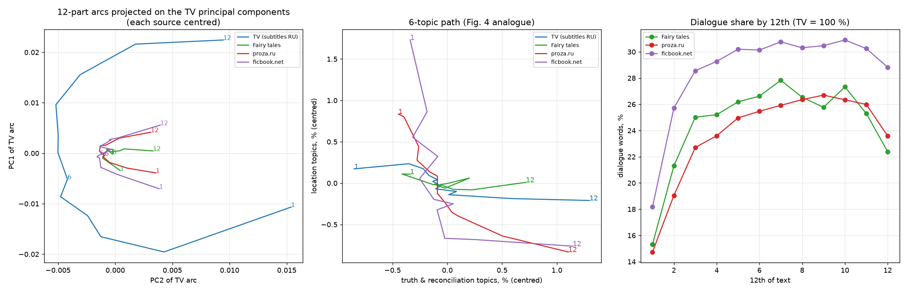

**Равные выборки по 2 000 текстов** ([comparison.csv](results/prose_joint/comparison.csv)):

| источник | тем \|r_lin\| > 0,9 | тем \|r_lin\| > 0,7 | тем \|r_arc\| > 0,7 | r(правда, t) | r(место, t) | 2 ГК | z(PC2) |
|---|---|---|---|---|---|---|---|
| ТВ (субтитры RU) | 5,9 | 35,1 | 9,1 | +0,80 | −0,93 | 0,81 | 0,6 |
| сказки | 7,6 | 35,0 | **25,5** | +0,83 | −0,60 | **0,95** | **11,6** |
| proza.ru | 13,8 | **43,7** | 18,8 | +0,85 | **−0,97** | 0,86 | 5,8 |
| ficbook | **14,8** | 40,5 | 11,6 | +0,74 | −0,93 | 0,92 | 1,8 |

**Контроль числа чанков** (по 600 текстов): z(PC2) для текстов только из 6 / только из 12 чанков:
* ТВ — 2,3 / −2,3;
* **сказки — 9,4 / 8,7**;
* proza.ru — 4,3 / 0,0;
* ficbook — 3,5 / 0,1.

**Перемешанная нулевая модель** ([shuffle_null.csv](results/prose_joint/shuffle_null.csv)): номинальное p≈0,005, кроме r(место) у сказок (p≈0,035) и r(правда) у прозы (p≈0,015). Последние два наблюдения не лежат за пределами всех 200 перестановок; прежняя формулировка «все метрики вне нулевого распределения» была неточной. Эти p приведены с оговорками §12.

**Что видно по корпусам** (топ трендов в общей модели):
* **Сказки.**
  * Убывают: «старик, старуха, дом, мать» (−0,96 — зачин «жили-были»), «лес, дерево, трава» (−0,96), «корова, поле, пастух» (−0,95).
  * Растут: «глаз, слеза, кровь, боль» (+0,93), «бежать, упасть» (+0,93), «правда, верить, ложь, предатель» (+0,91).
  * Пик в середине: «ночь, спать, утро» (+0,89), «ящик, коробка, старый» (+0,87), «дверь, открыть, ключ» (+0,85).
* **proza.ru.**
  * Растут: «слеза, кровь, боль» (+0,99), «суд, судья, адвокат» (+0,99), «убить, помочь, должный» (+0,99).
  * Убывают: школа (−0,99), внешность (−0,98).
  * Пик в середине: еда (+0,94), «стол, чай, кухня» (+0,92), «парень, нравиться, секс» (+0,92).
  * Провал в середине: «телефон, фото, экран» (−0,94) и «подарок, день рождения, праздник» (−0,93).
* **ficbook.**
  * Убывают: «столик, кофе, ресторан, кафе» (−0,99), «дед, баба, деревня» (−0,97), одежда (−0,96).
  * Растут: «убить, помочь, должный» (+0,97), «чувствовать, боль, сердце, страх» (+0,95).
  * Пик в середине: «понимать, почему, из-за» (+0,91). По краям: книги и письма, поездки, свадьба.
* **ТВ.**
  * Убывают: школа (−0,99), «место, река, дорога, лес» (−0,97).
  * Растут: «дом, пойти, вернуться, домой» (+0,98 — буквально «возвращение домой»), «жизнь, смерть» (+0,97), «слеза, кровь, боль» (+0,96).

**Сравнение с проекцией (8.3) и итог гипотез.**

| | проекция на ТВ-модель | общая модель |
|---|---|---|
| H1 трендовые темы | Поддержана при p≈0,005; исходный порог p<0,001 не проверен | Аналогично: 6–15 тем с \|r\| > 0,9 против ≈ 0 в перемешанных |
| H2 «место ↓ / правда ↑» | Частично: у сказок r(правда) = +0,68 | Частично: у сказок r(место) = −0,60; собственные темы леса, поля и дома убывают сильнее (−0,95…−0,96), но их выбор после просмотра результатов не заменяет исходный критерий |
| H3 сказки формульнее | Описательно: 10,2 против 6,5 / 7,9 | Описательно: 11,6 против 5,8 / 1,8; устойчиво к контролю числа чанков, без интервалов разностей |
| место фанфиков | между сказками и прозой | **ниже прозы** по z(PC2), но больше всех трендовых тем |

Главное расхождение двух оптик — ficbook. Его z(PC2) упал с 7,9 до 1,8, а число монотонных тем осталось максимальным (14,8). **Выраженность второй компоненты зависит от тематического пространства**, при этом направленные тренды сохраняются. Из снижения z нельзя заключить, что отдельные тексты не имеют «круговой» структуры или что их начало и конец не сходятся: расстояния H4 ещё не проверены. Сказки имеют наибольший z(PC2) среди четырёх корпусов в обеих LDA-оптиках, в том числе при контроле числа чанков. Это результат об агрегатной геометрии, а «формульность сюжета» — его рабочая интерпретация.

## 9. Тексты ficbook.net (преимущественно ориджиналы)

В ранних разделах и именах артефактов этот корпус условно называется «фанфиками». По метаданным 94 % выбранных работ — ориджиналы; выводы относятся к этой выборке платформы, а не к фанфикшну в целом.

Источник: `datasets/data_ficbook/ficbook_originals_2026.sqlite` и тексты глав `texts/2026/{02,03,04}/<work_id>/part-NNN.txt` — публикации за февраль–апрель 2026 года. База читается из копии в `work/` вместе с WAL-журналом: в режиме `immutable` свежие записи журнала не видны.

| этап отбора | работ |
|---|---|
| работ с текстом | 7 011 |
| статус «закончен», нет глав с ошибками и пропусков в нумерации | 5 375 |
| без стихов (тег «Стихи») и «Статей» | 4 349 |
| 1 000–10 000 слов после очистки (как у proza.ru), медианная строка ≥ 8 слов | 2 190 |
| ≤ 20 работ на автора | **2 190** (лимит не сработал; в анализе 2 188) |

Очистка ([src/prep_text.py](src/prep_text.py), `ficbook_text`):
* главы склеиваются по порядку, служебные страницы «спасибо автору» (`status = terminal`) и страницы оглавления отбрасываются;
* удаляются строки с названием работы и главы, «Примечания:», ссылки, даты публикации, «Отзывы: N».

Итог: **2 188 работ, 33 420 чанков** (по 150–300 слов), медиана — 2 349 слов и 12 чанков на работу, диалог — 26 % слов (медиана). 94 % — ориджиналы. Направленность: джен 808, слэш 623, гет 491, фемслэш 162.

Фанфики включены:
* в проекцию на ТВ-модель (`work/PROJ_FICBOOK`);
* в общую модель: обучение с весом ×2, вывод тем для всех работ.

Сравнение идёт на тех же равных выборках по 2 000 текстов, что и для сказок и прозы (таблицы в 8.3).

**Результаты проекции на ТВ-модель** ([results/PROJ_FICBOOK/](results/PROJ_FICBOOK/)):
* 14 тем с |r_lin| > 0,9; 2 ГК объясняют **96 %** дисперсии — больше всех корпусов.
* Убывают: одежда («носить, надеть, платье», −0,98), «дом, комната, вещь» (−0,98), внешность («волос, лицо, кожа», −0,95), «сэр, леди, мадам» (−0,94), школа (−0,93). Экспозиция в фанфиках — это описание внешности, одежды и обстановки.
* Растут: «жизнь, мир, бояться, чувствовать, сила» (+0,97), «простить, ошибка, жаль» (+0,96).
* Пик в середине: «почему, ненавидеть, понимать, нравиться» (+0,92) — эмоциональный конфликт пары.
* Провал в середине: «свет, звезда, солнце, небо» (−0,85), Рождество (−0,83), «поехать, уехать, отель, вернуться» (−0,83), «мама, папа» (−0,78) — пейзаж, праздник, поездка и семья обрамляют сюжет.
* r(правда, t) = +0,82, r(место, t) = −0,86. Диалога больше всего из трёх письменных корпусов (пик 31 % в 10-й части).

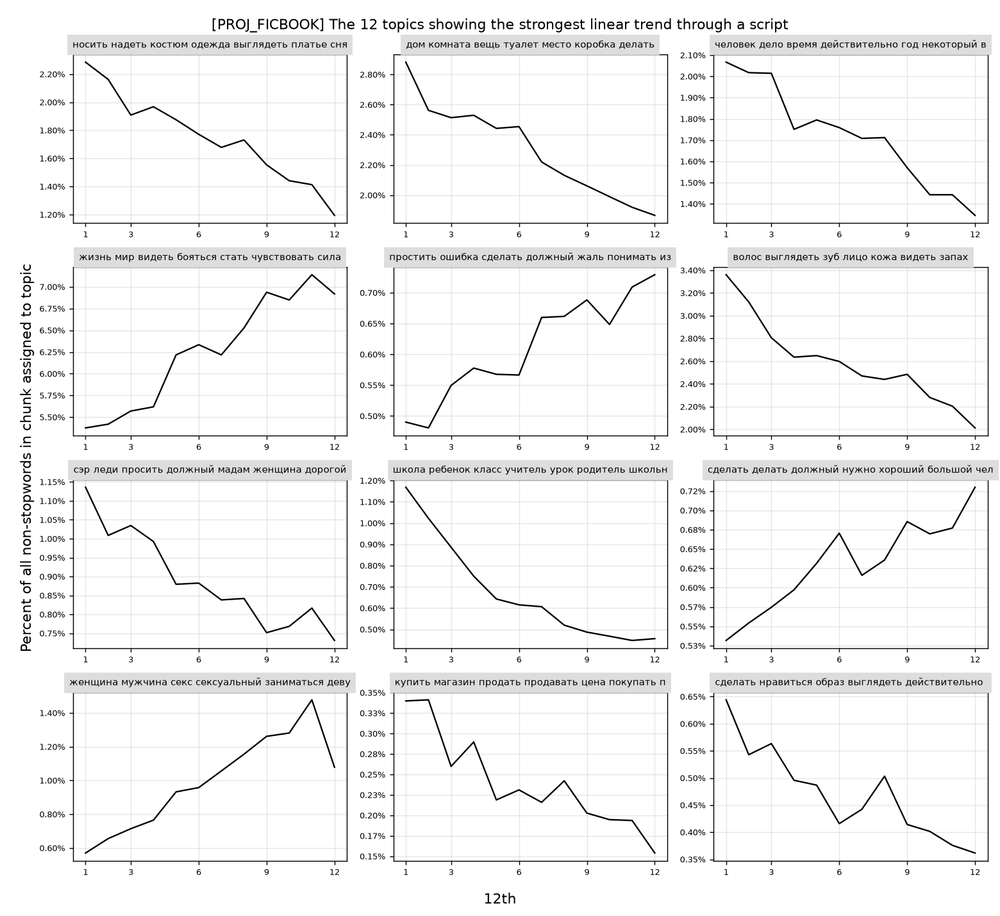

**Вывод (с учётом общей модели, 8.5):** ficbook имеет больше всего монотонных тем на равных выборках в обеих LDA-оптиках; максимальная доля дисперсии на 2 ГК наблюдается в проекции, но в общей модели выше показатель сказок (0,95 против 0,92). В общей модели z(PC2) = 1,8 — ниже прозы. Это не тест «кругового» сюжета. Кроме того, 94 % выборки — ориджиналы: корректнее говорить «тексты ficbook», а не обобщать результат на фанфикшн. Проверка на тегах финалов — эксперимент Э1 в разделе 10.

## 10. Направления для статьи на «Диалог»

«Диалог» (Компьютерная лингвистика и интеллектуальные технологии) ценит работы на русском материале с новыми ресурсами, аккуратной методологией и лингвистической интерпретацией. Чистая репликация англоязычной статьи 2015 года сама по себе слабовата. Сильная сторона нашего проекта в другом: **четыре разных типа русскоязычного повествования в одном измерительном аппарате** плюс параллельный EN–RU корпус. Формат, язык подачи и сроки нужно сверить с актуальным CFP: в последние годы основной трек принимает статьи на английском.

### 10.1. Возможные рамки статьи (по убыванию силы)

**A. «Сюжетные арки в русском повествовании: от сериалов до фанфиков»** — основная рекомендация.

Рабочий тезис: у проверенных корпусных агрегатов есть сходные направленные тематические изменения и различия геометрии арок. Их связь с сюжетом и переносимость на другие регистры требуют внешней валидации; строгая универсальность шести тематических осей не установлена.

Уже есть:
* субтитры RU (~81k эпизодов), сказки (2,2k), proza.ru (54k), ficbook (2,2k);
* общий протокол;
* перемешанная нулевая модель;
* равные выборки;
* сказки имеют наибольший z(PC2) в проверенных представлениях при равном n; порядок остальных корпусов зависит от представления и контроля числа чанков.

Вклад:
1. протокол сравнения арок между корпусами с контролем размера выборки и разрешения нарезки;
2. эмпирическое ранжирование регистров;
3. внешняя валидация на метках ficbook (10.2, Э1).

**B. Методологическая: «Как (не) проверять сюжетные арки».**

Наш результат: z(PC2) против случайных блужданий растёт с размером выборки от −1 до 9,5 (раздел 4a). Поэтому сравнение групп по этому тесту без выравнивания n некорректно. Предлагаем:
* перемешивание чанков внутри текста как более строгую нулевую модель;
* равные подвыборки;
* контроль числа чанков.

Короткая и чёткая статья, хорошо ложится в формат short paper. Можно сделать частью рамки A.

**C. «Инвариантность сюжетной арки к переводу».**

949 363 параллельных EN–RU чанка используются для сопоставления тем; PCA-профили полных языковых агрегатов близки (r = 0,999 / 0,991), хотя чёткого двойника имеет только треть тем. Следующий контроль — построить обе арки на одном наборе параллельных эпизодов и оценить интервалы по сериалам. Это поможет отделить устойчивость к переводу от сходства состава корпусов.

**D. Лингвистическая, самая «диалоговская»: морфосинтаксический профиль сюжета.** Вместо тем (или вместе с ними) — траектории грамматических признаков по нарративному времени. Русская морфология даёт то, чего нет в англоязычных работах:
* **вид глагола** (доля совершенного вида — событийность; ожидаем пик к кульминации);
* время (прошедшее/настоящее: переходы в настоящее историческое);
* лицо (1-е/3-е);
* наклонение (императив в диалоге, сослагательное);
* отрицание;
* модальность;
* длина предложения;
* доля диалога (уже есть: пик в 7–10-й частях из 12).

Всё это считается pymorphy3 на уже готовых чанках. Это аналог «narrative arc» Boyd, Blackburn & Pennebaker (2020), но на русском и с грамматикой, которой в английском нет. Хорошо сочетается с A: «что меняется по ходу сюжета — темы и грамматика».

### 10.2. Эксперименты, которых не хватает для сильной статьи

| # | Эксперимент | Зачем | Данные / объём работы |
|---|---|---|---|
| Э1 | **Внешняя валидация на тегах ficbook.** Отличают ли арки финалы: «Счастливый финал» (144), «Открытый финал» (146), «Смерть основных персонажей» (166), «Трагедия» (33)? Классификатор по профилю последних 2/12 текста и по форме всей траектории против бейзлайна «мешок слов всего текста». Отдельно: где в тексте находится тема признания у работ с тегом «Признания в любви». | Главный ответ на вопрос рецензента «а это вообще сюжет?» | теги уже в `work/FICBOOK/episodes.csv`; 1–2 дня |
| Э2 | **Морфосинтаксические арки (рамка D).** Вид, время, лицо, отрицание, длина предложения, диалог по 12-м частям для всех четырёх корпусов, с той же нулевой моделью. | Лингвистический вклад, независимый от LDA | pymorphy3 по сырым чанкам; 1–2 дня |
| Э3 | **Кластеризация индивидуальных траекторий** (H5) и сопоставление с метаданными. | Отличить воспроизводимое разбиение тематических изменений от типов сюжетов | Пилот выполнен (§13); остаётся условная проверка вклада порядка сверх тематики и амплитуды |
| Э4 | **Устойчивость к представлению** (H6): multilingual-e5, средние эмбеддинги и остаточный BERTopic. | Поддерживает воспроизводимость геометрии за пределами LDA; не доказывает сюжетную интерпретацию | Выполнено (§11.2–11.4); семантические оси и полная калибровка требуют оговорок §12 |
| Э5 | **Бутстреп по авторам** для proza.ru и ficbook, доверительные интервалы для всех сравнений регистров. | Строгость: авторы, а не тексты — единица выборки | 0,5 дня |
| Э6 | **Сказки и Пропп** (H4 «круг», дорога/испытание в середине). Ручная разметка функций Проппа на 50–100 сказках как золотой стандарт для части выводов. | Связь с классической нарратологией, понятная гуманитариям | разметка ~2–3 дня |
| Э7 | Тональная арка (RuSentiLex / rubert-sentiment) и сравнение с тематической (ARI кластеров). | Связь с линией Jockers / Reagan | 1 день |

Минимальный набор для подачи по рамке A: Э1 + Э5, плюс Э2 или Э3.

### 10.3. Ожидаемые вопросы рецензентов и ответы

* **«Подкова в PCA — известный артефакт».** Проверяем масштаб относительно двух нулевых моделей. Перемешивание контролирует состав текстов, но отличие от него показывает зависимость от порядка, а не автоматически сюжет. Внешняя валидация Э1 пока не выполнена.
* **«Субтитры и сказки — переводы, а не русская речь».** Поэтому основная ось сравнения — proza.ru и ficbook (оригинальные русские тексты), а переводы дают контролируемый эксперимент: параллельный корпус (рамка C).
* **«Темы LDA произвольны».** Ответ: инвариантность между независимыми моделями (EN/RU, ТВ-модель против общей), эмбеддинги (Э4), грамматические признаки без тем (Э2).
* **«Длина текстов разная».** Есть страты длины proza.ru и контроль числа чанков; proza.ru и ficbook отобраны по 1–10 тыс. слов, сказки — от 600 слов. Единый диапазон длины для всех корпусов не обеспечен.
* **«Самоотбор авторов / концентрация».** Ответ: лимит на автора, бутстреп по авторам (Э5).

### 10.4. Данные, этика, воспроизводимость

* Тексты proza.ru и ficbook защищены авторским правом и содержат пользовательский контент. **Публиковать только производные данные:** идентификаторы текстов, распределения тем по чанкам, агрегаты, код. Тексты не публиковать; при ссылке на примеры — короткие цитаты с указанием источника.
* Для proza.ru есть прецедент: корпус «Тайга» (Shavrina & Shapovalova, 2017) включает тексты proza.ru — на него стоит сослаться как на предшествующий ресурс.
* Метаданные ficbook (теги, направленность, рейтинг) содержат чувствительные категории (NC-17, сексуальный контент): в статье использовать только агрегаты.
* Код и производные данные — в этом репозитории; модели LDA (`lda.bin`) можно выложить отдельно (например, на Zenodo или Hugging Face).

### 10.5. Что цитировать (ядро)

Schmidt (2015) — исходная статья; Jockers (2015) — Syuzhet и критика Swafford (2015); Reagan et al. (2016) — эмоциональные арки, EPJ Data Science; Boyd, Blackburn & Pennebaker (2020) — «The narrative arc», Science Advances; Elkins (2022) — *The Shapes of Stories*; Piper (2015); Пропп (1928); Blei, Ng & Jordan (2003) — LDA; Shavrina & Shapovalova (2017) — «Тайга»; Лукашевич и др. — RuSentiLex (если Э7). Перед подачей библиографию нужно сверить по первоисточникам.

### 10.6. Скелет статьи (рамка A + D)

1. Введение: сюжет как траектория; русский материал; четыре регистра.
2. Данные: 4 корпуса (таблица отбора), параллельный EN–RU корпус.
3. Метод: нарезка 3·2ᵏ, общая модель, метрики, две нулевые модели, равные выборки (главный методологический урок — зависимость z от n).
4. Результаты:
   1. сходные направленные тренды «место → правда» и границы их устойчивости;
   2. геометрия агрегатных арок по регистрам и её интерпретация как формульности;
   3. валидация на тегах ficbook (Э1);
   4. грамматические арки (Э2).
5. Обсуждение: переводы, ограничения, LDA против эмбеддингов.
6. Заключение и ресурсы.

Объём — 4–5 рисунков:
* подкова в общем пространстве для четырёх корпусов;
* зависимость z от n;
* арки финалов ficbook;
* вид глагола и диалог по 12-м частям;
* таблица формульности.

## 11. Чувствительность к числу тем и BERTopic

### 11.1. Число тем K

**Завершено: 12 RU- и 4 EN-прогона.** Код: [src/ksweep.py](src/ksweep.py), визуализация: [src/ksweep_plot.py](src/ksweep_plot.py); исходные таблицы: [RU](results/ksweep/ksweep_RU.csv), [EN](results/ksweep/ksweep_EN.csv). Все запланированные сочетания K/seed имеют сохранённые темы, распределения чанков и метрики в `work/KSWEEP/`.

**Постановка.** Для каждого языка фиксируются 20 000 эпизодов (`sample(random_state=0)`); их чанки исключаются из обучения всех моделей перебора. Обучение: 300 000 чанков остальных эпизодов, 500 Gibbs-итераций, α-оптимизация, вывод тем — 100 итераций. При смене K/seed обучающая и оценочная выборки сохраняются. NPMI и C_v считаются по топ-10 словам на фиксированных 30 000 обучающих чанков; diversity — доля уникальных слов среди K×10 позиций. Это внутреннее сравнение настроек: исходная очистка и словарь строились по полному корпусу, а не заново только по train.

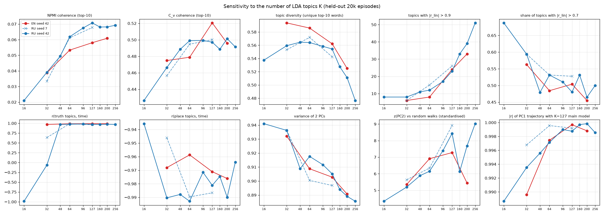

**RU.** `n_lin09` — число тем с |r_linear|>0,9; «2 ГК» — доля дисперсии PCA всех K тем без стандартизации. z_std — PC2 на min(K,100) наиболее частых темах после стандартизации против 1000 случайных блужданий той же размерности.

| K | seed | NPMI | C_v | diversity | n_lin09 | r(правда,t) | r(место,t) | 2 ГК | z_std(PC2) |
|---|---|---|---|---|---|---|---|---|---|
| 16 | 42 | 0,021 | 0,426 | 0,537 | 8 | −0,986 | −0,936 | 0,941 | 4,34 |
| 32 | 42 | 0,039 | 0,466 | 0,559 | 8 | −0,064 | −0,990 | 0,936 | 5,20 |
| 32 | 7 | 0,033 | 0,456 | 0,553 | 6 | +0,637 | −0,946 | 0,936 | 5,64 |
| 48 | 42 | 0,049 | 0,489 | 0,565 | 11 | +0,971 | −0,988 | 0,909 | 5,89 |
| 64 | 42 | 0,062 | 0,499 | 0,564 | 12 | +0,976 | −0,993 | 0,918 | 6,15 |
| 64 | 7 | 0,061 | 0,495 | 0,572 | 15 | +0,990 | −0,990 | 0,900 | 6,34 |
| 96 | 42 | 0,067 | 0,499 | 0,558 | 17 | +0,982 | −0,972 | 0,912 | 7,39 |
| 127 | 42 | 0,071 | 0,497 | 0,554 | 23 | +0,971 | −0,981 | 0,905 | 8,44 |
| 127 | 7 | 0,068 | 0,500 | 0,543 | 26 | +0,961 | −0,987 | 0,897 | 8,91 |
| 160 | 42 | 0,068 | 0,489 | 0,527 | 33 | +0,969 | −0,975 | 0,894 | 6,13 |
| 200 | 42 | 0,068 | 0,501 | 0,511 | 39 | +0,975 | −0,990 | 0,889 | 7,69 |
| 256 | 42 | 0,069 | 0,491 | 0,477 | 51 | +0,970 | −0,964 | 0,886 | 9,03 |

**EN**, seed=42:

| K | NPMI | C_v | diversity | n_lin09 | r(правда,t) | r(место,t) | 2 ГК | z_std(PC2) |
|---|---|---|---|---|---|---|---|---|
| 32 | 0,039 | 0,475 | 0,594 | 6 | +0,970 | −0,968 | 0,932 | 5,36 |
| 64 | 0,053 | 0,479 | 0,586 | 8 | +0,988 | −0,959 | 0,909 | 6,91 |
| 127 | 0,058 | 0,521 | 0,562 | 24 | +0,990 | −0,971 | 0,903 | 7,28 |
| 200 | 0,061 | 0,496 | 0,525 | 33 | +0,991 | −0,976 | 0,891 | 5,44 |

**Что устойчиво.** Две ГК объясняют 88,6–94,1 % в RU и 89,1–93,2 % в EN. Во всех прогонах PC1 связан со временем (|r|=0,937–0,990), PC2 — с серединностью (|r|=0,899–0,965). Абсолютные корреляции 12-точечных профилей с основной K=127-моделью: RU ≥0,9887 для PC1 и ≥0,9563 для PC2; EN ≥0,9896 и ≥0,9878. Это согласие временных профилей независимо вычисленных ГК, а не совпадение тематических осей. Основная модель обучалась по полному корпусу, поэтому это описательное сравнение с референсом, а не независимая оценка качества на внешних данных.

**Семантические оси менее устойчивы, чем геометрия.** «Место» убывает во всех прогонах. В RU при K≥48 выбранная ось «правды» растёт (r=+0,961…+0,990), однако K=16 даёт отрицательный знак, K=32 — слабый или умеренный рост в зависимости от seed. При K=16 автоматический подбор включает «человек сэр время должный корабль система президент» и «игра команда играть …», которые нельзя уверенно называть правдой/примирением. `find_topic` выбирает лучший доступный вариант даже при нулевом пересечении с затравкой; поэтому эти строки показывают предел применимости шести тематических осей, а не обратное течение сюжета. В EN положительный тренд сохраняется для всех проверенных K. Два seed при RU K=64/127 дают близкие знаки и PCA-профили; двух повторов недостаточно для оценки распределения межзапусковой вариации, а многопоточный tomotopy не гарантирует точной повторяемости даже при фиксированном seed.

**Выбор K.** RU NPMI заметно растёт до K≈96–127 и затем выходит на плато; максимум среди проверенных — K=127, seed42 (0,0707). C_v после K≈64 колеблется около 0,49–0,50, максимум при K=200 (0,5014), а diversity при больших K снижается. В EN NPMI максимален при K=200, C_v — при K=127. Поэтому **127 — обоснованная рабочая настройка для сопоставления со статьёй, но не доказанный единственный оптимум**; 64/96 дают более компактные RU-представления с близкой геометрией. Число трендовых тем растёт вместе с K, поэтому его нельзя сравнивать без знаменателя: например, 8/16=50 % при RU K=16 и 51/256≈20 % при K=256. Максимизация z(PC2) также не является критерием качества тем.

`heldout_ll_word` сохранён в CSV как диагностическое значение, но не использован для ранжирования K: это возвращённый `tomotopy.infer` лог-скор на слово с компонентами документного априорного распределения, а не отдельно проверенная сопоставимая оценка предсказательной перплексии. z в этой таблице нельзя напрямую сравнивать с полными корпусами §3–5: здесь другое n, обучение без оценочных эпизодов и при малых K другая размерность нулевой модели.

**Итог:** низкоразмерная агрегатная арка сохраняется во всём проверенном диапазоне K; сильная версия тезиса о неизменных семантических осях не подтверждается для малых RU K. Новые обучения для закрытия этого эксперимента не требуются.

### 11.2. Арки эмбеддингов без тематической модели (проверка H6)

Код: [src/embed_chunks.py](src/embed_chunks.py), [src/bertopic_run.py](src/bertopic_run.py); таблица: [results/bertopic/embedding_arcs.csv](results/bertopic/embedding_arcs.csv).

Каждый чанк закодирован многоязычной моделью `intfloat/multilingual-e5-small` (окно 512 токенов, 384 измерения). По предыдущей диагностике у субтитров медиана — 542 токена, и 58 % чанков длиннее окна. Поэтому чанки делятся на окна по ≤220 слов, эмбеддинги окон усредняются с весом по числу слов. Это уменьшает обрезку, но не гарантирует её отсутствия: 220 слов могут давать более 512 субтокенов, а код не проверяет токенизированную длину каждого окна. Для утверждения «без потери текста» нужен контроль tokenizer или нарезка по субтокенам.

Источники:
* 20 000 эпизодов RU и 20 000 эпизодов EN (те же отложенные эпизоды, что в 11.1);
* все сказки, 20 000 рассказов proza.ru, все фанфики.

Всего 778 842 чанка в одном пространстве. Дальше — никакой кластеризации: средний эмбеддинг каждой 12-й части текста → PCA, те же метрики, что для тем.

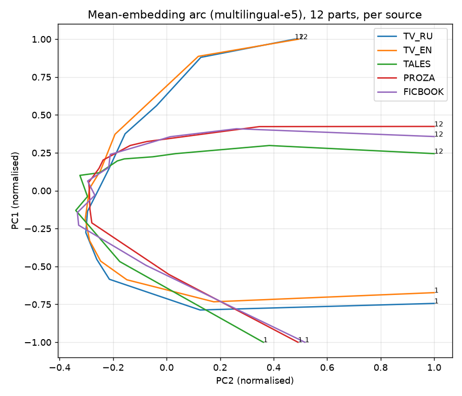

| источник | текстов | 2 ГК | \|r(PC1, t)\| | \|r(PC2, середина)\| | z(PC2), все | z(PC2), n = 2000 | z(PC2), перемешано |
|---|---|---|---|---|---|---|---|
| ТВ RU | 20 000 | 0,93 | 0,99 | 0,90 | 19,9 | 8,1 | −13,0 |
| ТВ EN | 20 000 | 0,93 | 0,98 | 0,92 | 18,6 | 6,7 | −13,0 |
| сказки | 2 174 | 0,92 | 0,82 | 0,79 | 16,5 | **15,8** | −12,6 |
| proza.ru | 20 000 | 0,95 | 0,92 | 0,89 | 24,5 | 9,0 | −12,9 |
| ficbook | 2 188 | 0,89 | 0,92 | 0,86 | 8,4 | 7,7 | −13,1 |

**H6 поддержана в части агрегатной геометрии.** Подковообразный профиль (PC1 ≈ время, PC2 ≈ «середина против краёв», 89–95 % дисперсии на 2 ГК) есть в эмбеддингах всех пяти источников без LDA. При перемешивании 2 ГК объясняют в среднем лишь 25–27 %, а z(PC2) относительно случайных блужданий составляет от −12,6 до −13,1. В CSV также есть расстояние наблюдения от среднего 100 перестановок в единицах их стандартного отклонения (58–83 для статистики z_pc2). **Это не гауссовская значимость «58–83σ»**: хвост такого уровня 100 перестановок не оценивает, отдельное эмпирическое p код здесь не сохраняет.

ТВ RU и EN имеют близкие профили при разных выборках эпизодов. При равном n у сказок наибольший z(PC2) (15,8 против 6,7–9,0); это описательная поддержка H3, без интервалов межкорпусных разностей. Чистые эмбеддинги не проверяют семантическую ось «место → правда», а значит полный повтор H1–H3 и сильная формулировка H6 ещё не закрыты.

### 11.3. BERTopic

Устройство:
* общий UMAP (5d, cosine) на сбалансированной выборке из 160 000 чанков всех пяти источников;
* кластеризация: HDBSCAN (`min_cluster_size` = 150, число тем подбирает сам) или KMeans с K = 32 / 64 / 127 на тех же координатах;
* c-TF-IDF по леммам; режим `language="multilingual"` (в режиме `english` BERTopic вырезает кириллицу);
* каждый чанк приписан к ближайшему центроиду темы в пространстве эмбеддингов, выбросов нет.

Результаты в том же формате, что LDA: `results/BERT*_*/summary.json`, сравнение — [results/prose_bert127/](results/prose_bert127/) и т. д.

**(а) Обычный BERTopic: темы описывают тексты, а не моменты сюжета.**
* HDBSCAN нашёл 15 тем. Они делятся по языку (английские и русские темы) и по именам персонажей — например, фанфики по k-pop и аниме («юнга, чимин, чонгук»); LDA таких тем не даёт, потому что имена вычищены.
* Трендовых тем почти нет: при K = 127 в среднем 1,9–2,9 темы с |r| > 0,9 на 2 000 текстов против 6–15 у LDA.
* Перемешанная нулевая модель часто неотличима от наблюдаемой: p до 1,0.
* Возможное объяснение: в этой реализации каждому чанку жёстко присваивается один ближайший центроид, а исходные эмбеддинги могут преимущественно отражать идентичность текста (сериал, фандом, язык, стиль). В отличие от смеси тем LDA, такое представление может терять внутритекстовые сдвиги. Распределение числа занятых тем на эпизод отдельно не оценено; утверждение «все эпизоды имеют одну-две темы» из этих таблиц не следует.

**(б) BERTopic на внутритекстовых остатках восстанавливает арку.** Из эмбеддинга каждого чанка вычитается средний эмбеддинг его текста, остаток нормируется, а затем кластеризуется так же (`RESID=1`, варианты `BERTres*`). Темы становятся «ситуациями»:
* «еда, стол, кухня»;
* «дерево, солнце, лес, небо»;
* «убийство, суд»;
* «чай, кофе, взгляд»;
* «дверь, комната, окно»;
* «школа, класс»;
* «король, принцесса, фея».

Равные выборки по 2 000 текстов, K = 64 / 127:

| источник | тем \|r_lin\| > 0,7 | r(правда, t) | r(место, t) | z(PC2) | z(PC2), только 6 / 12 чанков (K = 64) |
|---|---|---|---|---|---|
| ТВ | 25,0 / 39,0 | +0,90 / +0,91 | −0,93 / −0,84 | 3,3 / 4,0 | 1,2 / −1,8 |
| сказки | 15,9 / 25,2 | +0,56 / +0,56 | −0,91 / −0,79 | **7,5 / 7,1** | **5,9 / 5,5** |
| proza.ru | 24,5 / 35,5 | +0,67 / +0,80 | −0,94 / −0,94 | 1,9 / 2,2 | 0,6 / −2,6 |
| ficbook | 25,7 / 42,5 | +0,94 / +0,96 | −0,89 / −0,87 | 1,8 / 1,8 | 0,8 / −1,6 |

**Поправка от 06.11.2026.** В `compare_prose.py` случайные блуждания раньше всегда имели 100 координат, включая модели с K=15/32/64. Теперь размерность нулевой модели равна числу тем, поступающих в PCA: min(K,100). Пересчитаны сравнения `BERTauto`, `BERT32`, `BERT64`, `BERTres32`, `BERTres64`, включая страты длины и перестановочные таблицы. Подвыборки и перестановки сохранены; изменена калибровка z(PC2), а тематические тренды и доли дисперсии не изменились. Для K=127 использовались 100 тем и ранее, поэтому его результаты сохраняются. Значения K=64 в таблице выше уже исправлены.

При K=127 расстояние от среднего перестановок для числа тем с |r_lin|>0,7 составляет 13–31 стандартное отклонение, для статистики z(PC2) — 28–42; это описательные стандартизованные эффекты, а не гауссовская значимость. Номинальные перестановочные p≤0,04 для всех семи метрик четырёх источников при K=127 приведены без поправки на множественные проверки и с оговоркой о выборе хвоста (§12). У сказок r(правда,t)≈+0,56 не достигает исходного критерия H2, хотя направление положительное.

### 11.4. Вывод по методам

| метод | вектор «место ↓ / правда ↑» | агрегатная подкова | наибольший z(PC2) при равном n |
|---|---|---|---|
| LDA, проекция на ТВ-модель (8.3) | Знаки совпадают; H2 у сказок ниже порога | Есть | сказки |
| LDA, общая модель (8.5) | Знаки совпадают; H2 у сказок ниже порога | Есть | сказки |
| средние эмбеддинги, без тем (11.2) | — | ✅ | сказки |
| BERTopic на сырых эмбеддингах (11.3а) | Мало устойчивых трендовых тем | Зависит от K и контроля; полного отсутствия эффекта нет | порядок нестабилен |
| BERTopic на внутритекстовых остатках (11.3б) | Направления преимущественно совпадают; не все достигают порога H2 | Есть, с зависимостью от разрешения нарезки | сказки при K=32/64/127 |

В исходных постановках наблюдались низкоразмерная зависимость агрегатного представления от позиции и наибольший z(PC2) сказок. Проверка P2 (§15) не подтвердила строгое преимущество по стандартизированной PC2 при всех согласованных контролях; порядок корпусов нельзя считать независимо подтверждённым ранжированием формульности. **Универсальность семантического вектора также установлена слабее**: есть исключения по порогу H2 и при малых RU K; средние эмбеддинги семантические оси вообще не проверяют.

Негативный результат относится к **конкретной реализации BERTopic с жёстким присвоением чанка ближайшему центроиду**, выбранным эмбеддингам и настройкам. Он не доказывает непригодность BERTopic в целом. Вычитание среднего эмбеддинга текста улучшает ряд метрик, но его необходимость или оптимальность не установлены: не проверялись мягкие назначения, другие модели и способы удаления межтекстовой вариации. Это полезная методологическая находка для статьи с такими границами обобщения.

## 12. Ревизия выводов и ограничения (06.11.2026)

При сверке отчёта с кодом и сохранёнными CSV/JSON обнаружены следующие места, где исходные формулировки были сильнее результатов. Таблицы K-sweep внесены в §11.1; ошибка размерности случайных блужданий для малых BERTopic исправлена в коде и производных таблицах (§11.3). Ниже — ограничения, которые нельзя устранить одной редактурой.

1. **Арка — агрегатная статистика позиции, а не готовая модель сюжета.** В §2–11 PCA строится по средним частям корпуса. Низкая размерность средних не означает, что большинство индивидуальных текстов имеет одну и ту же арку. Перемешивание показывает зависимость от порядка, но не отделяет сюжетные события от смены регистра речи, экспозиции, титров и композиционной рамки. Нужны внешние метки (Э1) и интервалы по независимым единицам. Индивидуальные траектории впервые проверены в §13 и не дали оснований переносить простую геометрию агрегатов на каждый текст.

2. **Подкова не равна «кругу».** Совпадение знака PC2 у начала и конца совместимо с большим расстоянием по PC1. Ни наличие подковы, ни низкий z(PC2) у ficbook не проверяют H4. В отчёте убраны выводы о доказанной круговой/некруговой структуре; тест расстояний ещё предстоит выполнить. Интерпретация тематических слов как функций Проппа, кульминации или эпилога пока иллюстративна, без разметки этих функций.

3. **Универсальность и критерии гипотез.** При общих знаках тренда H2 не проходит собственный порог |r|>0,7 у сказок: в проекции по «правде», в общей модели по «месту», в остаточном BERTopic снова по «правде». При малых RU K автоматический выбор затравок нестабилен. Замена тем после просмотра результатов — исследовательский анализ, не подтверждение исходного критерия. H1 поддержана на доступном уровне p≈0,005, но порог p<0,001 при 200 перестановках недостижим; H6 поддержана для геометрии, полного повторения H1–H3 нет.

4. **Калибровка статистики.** z(PC2) против случайных блужданий и стандартизованное отклонение от перемешанных текстов — разные величины. Ни одно не является автоматически нормальным z-тестом. Значения 30–80 стандартных отклонений нельзя переводить в хвостовые вероятности нормального распределения. В `compare_prose.py` хвост перестановочного теста выбирается по знаку наблюдаемого отклонения от среднего нулевого распределения; направление заранее не зафиксировано. Поэтому сохранённые p следует считать номинальными исследовательскими значениями: для подтверждающей проверки нужен заранее заданный односторонний либо корректный двусторонний тест и учёт множественных сравнений. Для тематических тестов разрешение p — 1/201; в анализе эмбеддингов выполнено 100 перестановок, эмпирические p не сохранялись.

5. **«Формульность» — рабочая интерпретация.** Большой z(PC2) означает выраженную вторую компоненту агрегатной траектории относительно выбранной нулевой модели. Он не измеряет напрямую повторение сюжетов или близость индивидуальных траекторий. Равное n и контроль 6/12 чанков полезны, но не устраняют различия длины чанка, жанрового состава, перевода и авторской концентрации. Двадцать пересекающихся подвыборок — не двадцать независимых корпусов. Ранжирование сказок устойчиво описательно; доверительные интервалы разностей и бутстреп по авторам/сериалам пока отсутствуют.

6. **EN↔RU — устойчивость в данном корпусе.** Параллельных чанков 949 363, корреляции PCA полных агрегатов — 0,999 / 0,991; старые числа 934 тыс. и 0,996 в плане статьи исправлены. Это не тест независимости от всех языков. Следующий контроль — общий набор параллельных эпизодов, одинаковые веса и интервалы по сериалам. Похожие переводы одних шоу не являются независимой репликацией на других сюжетах.

7. **Ограничения BERTopic и эмбеддингов.** До вычитания среднего эмбеддинги включают сырые имена и другие признаки идентичности; лемматизированные подписи тем и вход LDA очищались иначе. Сравнение методов смешивает различия представлений, очистки и мягкого/жёсткого назначения. Длина окна ≤220 слов не гарантирует ≤512 субтокенов. Кроме того, `analyze.py` выбирает EN-затравки только при имени ровно `EN`: `BERT*_TVEN` получает RU-затравки. Семантические оси из его сводок для TVEN нельзя интерпретировать как проверенный EN-результат; таблица §11.3 использует RU ТВ и от этой ошибки не зависит.

8. **План и выполненная методика различаются.** В §7 сохранены предложения о MinHash, единых словесных чанках ТВ/прозы, отдельных LDA и микро-текстах; они не реализованы. Проза агрегируется по равным индексным долям чанков после сдвига границ к предложениям, а не по точным позициям каждого слова. Отдельные чанки могут выходить за ориентир 150–300 слов. Таблица §7.1 содержит предварительный отбор proza.ru, актуальный после всех фильтров объём — 53 998 (§8.1). Ficbook преимущественно состоит из ориджиналов. Библиографические сведения и актуальные условия подачи на конференцию в этой ревизии не проверялись.

**Что остаётся для статьи:** Э1 (валидация по тегам с разделением по авторам), Э5 (интервалы по авторам/сериалам), затем Э2 или углубление Э3 после пилота §13. Отдельно — уточнить перестановочный тест агрегатных арок и семантический подбор тем, проверить обрезку токенов и общий параллельный EN/RU-набор. Это новые проверки; они не требуются, чтобы закрыть уже выполненный перебор K, но нужны для сильных обобщений.

## 13. Индивидуальные траектории: пилот H5 (06.11.2026)

Код: [src/cluster_trajectories.py](src/cluster_trajectories.py), [src/h5_metadata.py](src/h5_metadata.py). Модели LDA не переобучались: использованы распределения общей модели JOINT. Результаты: [выбор k](results/h5/model_selection.csv), [выбранные решения и контроли](results/h5/selected.csv), [протокол](results/h5/protocol.json), [групповые связи с метаданными](results/h5/group_associations.csv), [контроль числа чанков](results/h5/chunk_controls.csv).

### 13.1. Что именно кластеризуется

1. Каждый текст агрегирован в **6 последовательных частей × 127 тем**. Взяты только тексты с ≥6 чанками и положительной длиной всех шести частей: ТВ — **19 982**, сказки — **1 732**, proza.ru — **19 942**, ficbook — **2 185**. Исключены короткие и неполные траектории; результаты не относятся ко всем исходным текстам без этого ограничения.
2. Из каждой части вычтено среднее распределение тем по шести частям данного текста. Это убирает постоянное тематическое смещение, но не делает изменения независимыми от тематики: например, сильный поздний рост темы возможен главным образом в текстах, где она вообще представлена.
3. Общая PCA обучена на центрированных траекториях сбалансированной выборки по 1 500 текстов каждого источника, без стандартизации отдельных тем и без whitening. Проверены 10 и 20 компонент, траектория развёрнута в вектор 6×d. Амплитуда сохранена в основном варианте; деление на полную норму траектории — отдельный контроль.
4. **KMeans отдельно внутри каждого корпуса**, k=2…8, `n_init=10`. Основной выбор — среди 10-компонентных вариантов со средней устойчивостью ARI≥0,6 и минимальным кластером ≥5 % текстов, по максимальному силуэту. Теги/жанры в выборе не использованы. Всего проверены 56 комбинаций корпус/d/k.
5. Для устойчивости заранее отделены 20 % авторов/сериалов как фиксированный опорный набор. В каждом из 10 повторов модель обучалась на 80 % остальных единиц, после чего предсказывались кластеры опорных текстов. Устойчивость — средний попарный ARI между этими предсказаниями (45 пар). Для сказок единица зависимости — поле автора, с заменой на категорию при его отсутствии. Это подвыборки без возвращения, не авторский bootstrap с возвращением. PCA оставлена общей, включая опорные тексты: проверка трансдуктивная и исследовательская, не полная внешняя валидация конвейера.

**Важное отличие от агрегатов:** первые 10 компонент объясняют лишь **21,3 %**, первые 20 — **35,2 %** вариации индивидуальных центрированных частей. PC1 — только 3,3 %. Простая двумерная подкова среднего корпуса не означает двумерности индивидуальных траекторий.

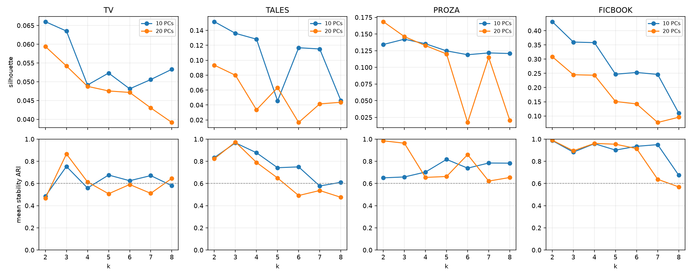

### 13.2. Найденные разбиения и их устойчивость

| корпус | k | размеры кластеров | силуэт | средний ARI устойчивости | ARI: 10 vs 20 ГК | ARI: исходная vs нормированная амплитуда |
|---|---|---|---|---|---|---|
| ТВ RU | 3 | 11 386 / 5 063 / 3 533 | 0,064 | 0,753 | 0,730 | 0,597 |
| сказки | 2 | 1 359 / 373 | 0,152 | 0,833 | 0,949 | 0,451 |
| proza.ru | 3 | 1 324 / 14 992 / 3 626 | 0,142 | 0,659 | 0,253 | 0,153 |
| ficbook | 2 | 1 930 / 255 | 0,432 | 0,987 | 1,000 | 0,036 |

Все четыре выбранных решения проходят описанный фильтр средней устойчивости, но это **не подтверждение малочисленной типологии сюжетов**. Для ТВ и proza.ru силуэты низкие, группы перекрываются. Минимальный попарный ARI среди повторов ТВ — 0,227, proza.ru — 0,454: средняя устойчивость не означает воспроизведение в каждом запуске. У proza.ru состав групп особенно чувствителен к числу компонент. У ficbook сильное и воспроизводимое основное разбиение почти полностью меняется после выравнивания амплитуды.

**Контроли.** Порядок шести частей случайно переставлен отдельно внутри каждого текста; сохраняются состав и норма изменений. При том же k устойчивость по авторам/сериалам снижается: ТВ 0,153; сказки 0,334; proza.ru 0,286; ficbook 0,444. Однако силуэты перемешанных данных остаются соответственно 0,039 / 0,142 / 0,128 / 0,374. Следовательно, сама возможность получить компактные группы во многом сохраняется без порядка — по тематической вариативности и амплитуде. Это один фиксированный случай перемешивания, а не перестановочный тест значимости разницы устойчивости.

После нормирования амплитуды новые разбиения сами по себе устойчивы (средний ARI 0,835 / 0,908 / 0,868 / 0,820), но не обязаны совпадать с исходными. ARI исходных кластеров с кластеризацией **средней тематики**: ТВ 0,005; сказки 0,057; proza.ru −0,069; ficbook **0,678**. Последнее — существенное предупреждение: вычитание среднего не устранило тематическую обусловленность разбиения ficbook.

При повторном обучении отдельно на текстах ровно из 6 / 12 чанков ARI с исходным разбиением: ТВ **0,079 / 0,781**, сказки 0,776 / 0,585, proza.ru 0,542 / 0,585, ficbook **0,930 / 0,978**. Таким образом, ficbook устойчив к этому контролю, но ТВ — далеко не во всех стратах. Низкая связь номера кластера с числом чанков сама по себе не исключает зависимости геометрии от разрешения нарезки.

### 13.3. Сопоставление с тегами, регионами и жанрами

Для основной проверки использованы **все тексты**, но единица перестановки — автор/сериал. Для каждой такой единицы вычислены доли текстов в кластерах и доля текстов с меткой; единицы имеют равный вес. Статистика — квадрат нормы ковариации между вектором частот кластеров и распространённостью метки. В 999 перестановках вектор метки перемешивается между единицами; тест направлен на увеличение статистики, минимальное p=0,001. Проверены метки с ≥20 текстами и ≥5 единицами, где они присутствуют, и аналогичным минимумом для отсутствия. Региональные и жанровые мульти-метки сохранены.

Всего **240 проверок** исходных кластеров; BH-поправка выполнена по общей семье четырёх источников. Те же проверки отдельно сделаны для кластеров средней тематики и нормированных траекторий. Это **маргинальные связи**, без условного контроля длины, тематики, других тегов и без доказательства причинности. Полные частоты по текстам приведены в [enrichment_all_texts.csv](results/h5/enrichment_all_texts.csv), групповые p/q — в [group_associations.csv](results/h5/group_associations.csv). Ранний дополнительный анализ одного случайного текста на автора/сериал сохранён в `associations.csv`; основные выводы ниже используют групповой тест по всем текстам.

**Ficbook: сильный результат о структуре контента, пока не о типах финала.**

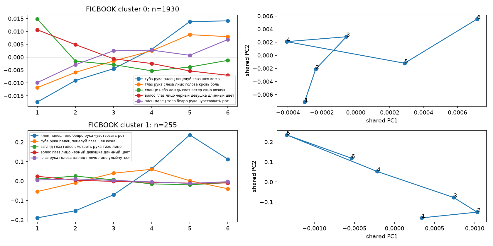

* Меньший кластер (255 текстов) характеризуется сильным ростом телесной/интимной лексики во второй половине текста. Медианная норма изменения **0,576 против 0,177** в основном кластере; медианная длина 2 495 против 2 324 слов, доля диалога 26,3 % против 25,8 %. Медианы длины и диалога близки, но без условного контроля это не исключает их влияния. Разбиение выраженно связано с амплитудой и тематикой.
* Тег **PWP** имеет 32,5 % текстов меньшего кластера против 2,8 % основного (83/255 против 55/1930). Групповой тест: p=0,001, q≈0,0041. Связь есть и для кластеризации средней тематики, и для нормированных траекторий, поэтому она не доказывает преимущество учёта порядка.
* **«Смерть основных персонажей»**: 3/255 (1,2 %) против 162/1930 (8,4 %), p=0,001, q≈0,0041. Но связь есть и у средней тематики (p=0,002, q≈0,0066), а после нормирования амплитуды незначима (q≈0,335). Разница не является самостоятельной валидацией сюжетной формы.
* **«Счастливый финал» и «Открытый финал»** значимой связи после BH не показали (q≈0,665 и 0,497). «Трагедия» — q≈0,131; «Признания в любви» — q≈0,625. Отсутствие связи при k=2 не доказывает отсутствия сигнала в непрерывных признаках: отдельная предсказательная проверка Э1 ещё не выполнена.

**Сказки: воспроизводимый переход между тематическими состояниями, но слабая региональная интерпретация.**

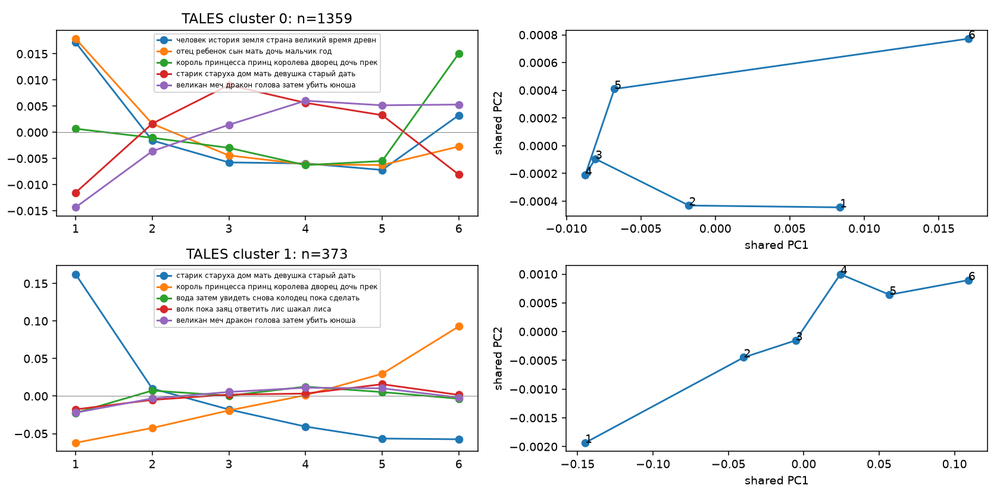

* У меньшего кластера (373 текста) в начале особенно выражена тема «старик, старуха, дом», к финалу растёт «король, принцесса, дворец». Это содержательная кандидатная композиционная схема, но не разметка функций Проппа. У большей группы изменения этих тем слабее; после нормирования амплитуды группы совпадают лишь частично.
* Из 21 допустимой региональной/коллекционной проверки после BH выделяется метка **«Итальянский»**: 7,8 % меньшего кластера против 4,0 % большего, 84 текста от 7 авторских групп; p=0,003, q≈0,0109. Связь есть и у средней тематики, а для нормированных траекторий q≈0,095. Это локальный исследовательский сигнал, не доказанная региональная сюжетная типология.
* Большинство сборников совпадает с одной или немногими авторскими группами. После требования ≥5 независимых единиц проверяемой осталась только категория «Братья Гримм» (p=0,917). Для большинства сборников доступны описательные доли, но не надёжная независимая проверка. Метки регионов местами имеют явные артефакты перевода; автоматическое объединение таких названий не проводилось.

**ТВ: связи с жанрами есть, но границы групп размыты.**

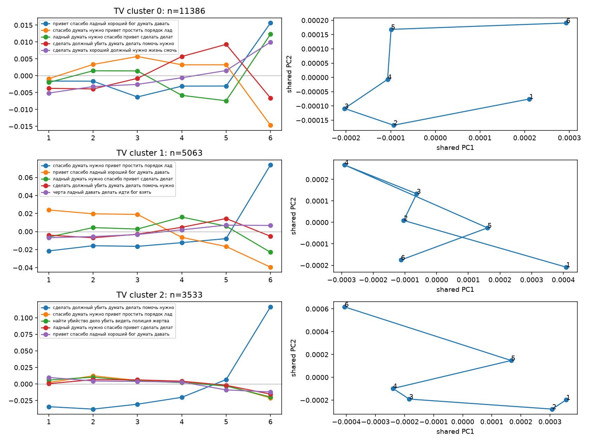

14 из 23 жанровых проверок имеют q<0,05, включая Comedy, Crime, Drama и Documentary. Например, Comedy встречается у 44,9 % текстов кластера 1 против 26,8 % кластера 2; Crime — 14,5 % против 24,7 %; Documentary — 4,8 % в кластере 0 против 0,9/0,5 % в остальных. Основные проверки по сериалам дают p=0,001, q≈0,0041. Однако эти жанры связаны и с кластерами средней тематики. Поэтому обнаружена связь жанра с профилем тематических изменений, а её независимость от содержания не доказана. Особенно слабый контроль для 6-чанковых эпизодов дополнительно ограничивает трактовку универсальных ТВ-типов.

**Proza.ru: геометрия менее надёжна, чем кажется по среднему ARI.**

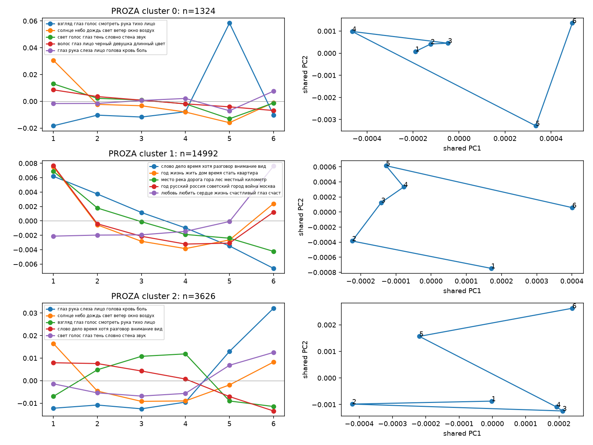

Большинство текстов попадает в крупный кластер со слабой амплитудой (14 992; медианная норма 0,076). В двух меньших группах норма выше (0,126 / 0,115), доля диалога — 27,4/23,7 % против 15,2 % в большой группе. У одной меньшей группы заметнее поздний рост темы слёз/крови/боли; у другой — локальный пик темы взгляда/голоса. Это лексические профили, не установленные сюжетные классы. Связь с 2025 годом даёт p=0,001, q≈0,0041, но исчезает после нормирования амплитуды (q≈0,348); разбиение нестабильно к числу компонент (ARI=0,253). Интерпретировать это как изменение сюжетов по годам преждевременно.

### 13.4. Вывод по H5 и следующий эксперимент

**Слабая вычислительная версия H5 поддержана:** в выбранном пространстве можно получить несколько воспроизводимых групп индивидуальных тематических изменений, и часть групп связана с внешними метками. **Сильная версия — небольшое число устойчивых типов сюжетов — не установлена.** Состав кластеров зависит от размерности, амплитуды и, для ficbook, средней тематики; после перемешивания частей компактные группы тоже возникают. Числа 2/3 здесь — выбранные настройки разбиения, не количество фундаментальных сюжетов.

После H5 запланирована **предсказательная проверка Э1 на ficbook**; её первый вычислительный цикл теперь выполнен в §14. Сравниваются средняя тематика, финальный фрагмент, упорядоченные и перемешанные траектории при одинаковом разделении по авторам. Кластеры PWP можно использовать как диагностический разрез или ковариату. Дополнительно для H5 нужны сравнение по более полному пространству (10 ГК сохраняют только 21 % вариации), повторные независимые разбиения авторов и несколько перемешиваний. Совместная кластеризация четырёх корпусов и DTW в этом пилоте не выполнялись; при нынешних ограничениях они не заменяют предсказательную проверку.

Для воспроизведения H5 из готовых JOINT-распределений:

```bash
.venv/bin/python src/cluster_trajectories.py
.venv/bin/python src/h5_metadata.py
.venv/bin/python -m unittest discover -s tests -p 'test_h5.py' -v
```

Сохранены назначения каждого текста (`results/h5/assignments_*.csv`), центроиды/проекции (`work/H5/`), профили тем, все варианты выбора k и контрольные показатели. Проверены согласованность наблюдаемой и пакетной перестановочной статистики, BH-коррекция и восстановление заведомо разделённых синтетических кластеров.

## 14. P1/D1: добавляет ли порядок частей информацию об авторском теге финала?

Первый вычислительный эксперимент выполнен 06.11.2026 по плану [DIALOGUE.md](DIALOGUE.md). **Гипотеза добавочной информации порядка не получила поддержки по заранее зафиксированному первичному критерию.** Это результат для определённого представления, линейного классификатора и авторских тегов; он не доказывает отсутствия композиционной информации вообще.

Код: [validate_endings.py](src/validate_endings.py), [p1_report.py](src/p1_report.py), [аудит окон](src/p1_audit.py). Сохранены [протокол](results/p1/protocol.json), [аудит меток](results/p1/tag_audit.csv), [OOF-предсказания](results/p1/predictions.csv), [качество](results/p1/scores.csv), [парные интервалы](results/p1/contrasts.csv), [проверки чувствительности](results/p1/sensitivity.csv), [версии и хеши входов](results/p1/manifest.json).

### 14.1. Данные, метки и разбиения

Взяты **2 188 текстов от 1 559 авторов**, 33 420 чанков из готовых замороженных `multilingual-e5-small`-эмбеддингов. Все тексты имеют ≥6 чанков и положительную длину шести частей. Поэтому когорта P1 отличается от 2 185 текстов H5: там использовались JOINT-LDA распределения, здесь — полные последовательности эмбеддингов.

| тег | положительных текстов | авторов с положительным тегом | распространённость |
|---|---|---|---|
| Счастливый финал — первичный | 144 | 121 | 6,58 % |
| Открытый финал — первичный | 146 | 125 | 6,67 % |
| Смерть основных персонажей — вторичный | 166 | 159 | 7,59 % |
| Трагедия — вторичный | 33 | 32 | 1,51 % |

Теги моделируются **отдельно**, а не как взаимоисключающие классы: у 9 текстов есть одновременно счастливый и открытый финал; у 16 — одновременно смерть персонажей и трагедия. Отсутствие тега не считается независимо подтверждённым отсутствием соответствующего свойства произведения. Смерть персонажей может происходить не в финале.

Точных дублей после нормирования регистра и пробелов не найдено; приблизительные дубли этим не исключены. Для независимой содержательной проверки подготовлен слепой пакет из положительных и немаркированных работ в `work/P1/audit_blind.jsonl`, ключ меток сохранён отдельно. **Независимый ручной аудит пока не выполнен.** Результат ниже — предсказание авторских меток платформы, а не валидация по размеченным исследователями сюжетным финалам.

Основная оценка — **5-fold внешняя CV по авторам**, seed=0; чувствительность — те же 5-fold процедуры с seed=17 и 42. Разбиение стратифицируется по сочетанию двух первичных тегов. Ни один автор не пересекает train/test; внутренний подбор также использует непересекающихся авторов, 3 folds. Первичные теги представлены в каждом внешнем test-fold примерно 28–30 положительными текстами; редкая «Трагедия» имеет существенно менее устойчивые оценки.

### 14.2. Что получает классификатор

Единица последовательности — шестая часть произведения, эмбеддинг которой усредняется с весами по числу слов. PCA обучается **только на частях обучающих авторов**, оставляются 16 компонент. Среднее содержание и финальная часть проецируются в ту же базу. PCA, нормирование, TF-IDF-словарь/IDF и регуляризация повторно обучаются внутри каждого inner-fold: информации тестовых авторов в обучаемых преобразованиях нет. Замороженная e5 не обучалась на этом исследовательском корпусе в рамках проекта.

| вариант | признаки |
|---|---|
| B0 | log длины текста, log числа чанков, доля диалога, норма центрированной эмбеддинговой траектории |
| B1 | B0 + средний эмбеддинг всего произведения |
| B2 | B1 + эмбеддинг последней шестой части |
| B3 | B2 + последовательность шести центрированных состояний, 6×16 координат |
| B4 | Тот же набор и размерность, что B3, но первые пять частей случайно переставлены **внутри каждого текста**, а последняя закреплена |
| B1_TFIDF | B0 + TF-IDF всего произведения |
| B2_TFIDF | B0 + TF-IDF всего произведения и отдельный TF-IDF финальной шестой части |

B4 сохраняет состав частей, финальный фрагмент и норму изменений; использованы три фиксированных перемешивания (101/202/303), первичное — 101. Общий фиксированный разворот последовательностей не использовался: линейная модель могла бы просто переучить соответствующие коэффициенты.

Классификатор — логистическая регрессия с L2, C∈{0,01; 0,1; 1; 10}, выбор по среднему inner-fold AP. Сетка и бюджет одинаковы для основных вариантов. TF-IDF использует uni-/bigram, `min_df=3`, до 12 000 признаков всего текста и 6 000 финала. Амплитуда и грубая длина доступны всем моделям через B0; авторские теги не входят в признаки.

**Основная метрика — average precision (AP), а не accuracy.** Доля положительных примеров служит ориентиром AP неинформативного ранжирования. Для каждого текста получен ровно один OOF-прогноз на вариант и внешнее разбиение; дополнительно сохранён ROC-AUC.

До обучения зафиксированы два первичных тега, контрасты B3−B2 и B3−B4(101), основной seed=0 и практически интересный прирост **+0,02 AP**. На фиксированных OOF-прогнозах проведено 5 000 парных ресэмплирований авторов с возвращением; все тексты выбранного автора получают одинаковую кратность. Для четырёх первичных контрастов приведены **98,75%-интервалы** по схеме Bonferroni, отдельно сохранены обычные 95%-интервалы. Интервалы условны на обученных OOF-моделях и не включают их полное переобучение; повторные авторские разбиения служат отдельной проверкой чувствительности. Это не точная гарантия покрытия для всей процедуры настройки.

### 14.3. Первичный результат

AP для основного внешнего разбиения (seed=0):

| вариант | Счастливый финал | Открытый финал |
|---|---|---|
| распространённость тега | 0,0658 | 0,0667 |
| B0: длина/диалог/амплитуда | 0,0913 | 0,0738 |
| B1: среднее содержание | 0,0997 | 0,1022 |
| B2: содержание + финал | 0,1017 | 0,0998 |
| B3: добавлен порядок | 0,1044 | 0,0775 |
| B4: внутренние части перемешаны, финал сохранён (101) | 0,1111 | 0,0699 |
| B1_TFIDF: лексика всего текста | 0,1217 | 0,0981 |
| B2_TFIDF: лексика всего текста и финала | **0,1670** | **0,1080** |

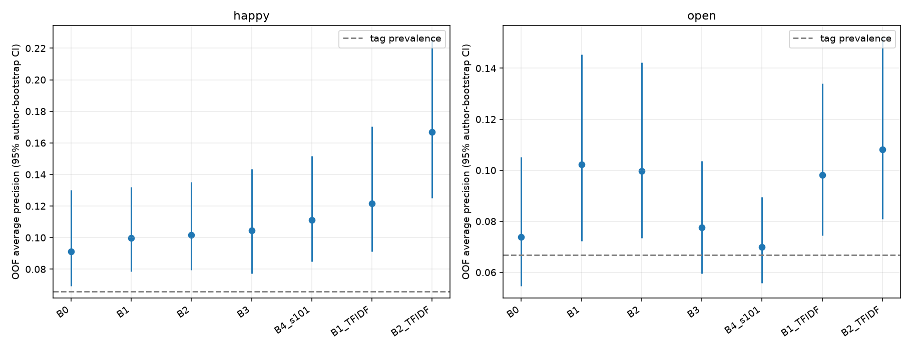

Парные приросты AP и интервалы с поправкой на четыре первичных сравнения:

| тег | сравнение | ΔAP | 98,75%-интервал |
|---|---|---|---|
| счастливый | B3 − B2 | +0,0027 | [−0,0276; +0,0378] |
| счастливый | B3 − B4(101) | −0,0067 | [−0,0544; +0,0375] |
| открытый | B3 − B2 | −0,0223 | [−0,0551; +0,0006] |
| открытый | B3 − B4(101) | +0,0076 | [−0,0130; +0,0326] |

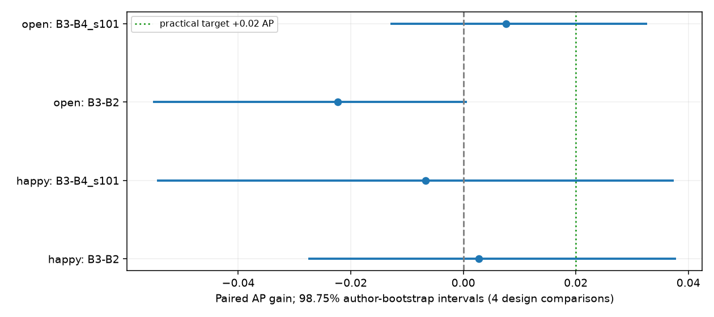

Ни один первичный контраст не имеет положительной нижней границы; ни один положительный точечный прирост не достигает +0,02 AP. Следовательно, **первичный критерий D1 не выполнен для обоих тегов**. У счастливого финала интервал B3−B2 допускает как вред, так и практически интересный выигрыш: это не доказательство эквивалентности моделей. Для открытого финала B3 хуже B2 в точечной оценке; обычный 95%-интервал отрицателен, но скорректированный включает ноль, поэтому подтверждённое ухудшение по первичному семейству также не заявляется.

### 14.4. Повторные разбиения, другие теги и аудит

| вариант | счастливый: диапазон AP по seed=0/17/42 | открытый: диапазон AP |
|---|---|---|
| B2 | 0,102–0,109 | 0,096–0,100 |
| B3 | 0,089–0,104 | 0,072–0,087 |
| B4(101) | 0,097–0,127 | 0,070–0,075 |
| B2_TFIDF | 0,153–0,167 | 0,094–0,108 |

Повторные разбиения не показывают устойчивого преимущества B3 над B2. Числа seed не являются независимыми повторениями корпуса. Дополнительные B4(202/303) также сохранены; нельзя выбрать наиболее удобное перемешивание после сравнения качества.

Для вторичной метки «Смерть основных персонажей» в основном разбиении AP: B1=0,156, B2=0,204, B3=0,206, B2_TFIDF=0,259 при распространённости 0,076. Это показывает предсказуемость метки по содержанию и финальному фрагменту, но добавка B3 к B2 мала. Для «Трагедии» всего 33 положительных текста; AP B3≈0,013 и B2≈0,021 при распространённости 0,015, поэтому сильных выводов о трагических сюжетах нет.

**Чувствительность на подгруппах фиксированных OOF-прогнозов:** без PWP — 2 050 текстов, только ориджиналы — 2 066, без работ с обрезанными окнами — 2 178, без возможных явных упоминаний меток — 2 180. В этих проверках первичного разбиения крупный выигрыш порядка также не появляется. Например, без PWP AP счастливого финала: B2=0,106, B3=0,103, B2_TFIDF=0,178. Это проверки оценок на подгруппах, **не новые обучения без этих произведений** и не отдельные подтверждающие тесты.

Аудит tokenizer показал **16 окон длиннее 512 субтокенов из 45 181 (0,035 %)**, затронувших 13/33 420 чанков и 10 произведений. Значит, прежняя гарантия отсутствия обрезки была неверной, но для этой когорты затронута малая доля данных. В 8 текстах найдены буквальные фразы вроде названия финального тега или PWP. Это автоматические флаги, а не доказанная утечка разметки: фраза может быть частью повествования. Исключение этих работ не меняет описанную картину. [Данные аудита](results/p1/token_window_audit.json).

**Дополнительная проверка регуляризации — после первичного анализа.** В исходном подборе C некоторые варианты часто выбирали границу сетки. Поэтому отдельно повторена nested CV на seed=0 для двух первичных тегов с C∈{0,0001; 0,001; 0,01; 0,1; 1; 10; 100}. Первичные файлы не заменялись; новая постановка помечена как post-hoc. Код: [p1_regularization.py](src/p1_regularization.py); [качество](results/p1/extended_grid/scores.csv), [интервалы](results/p1/extended_grid/contrasts.csv).

| вариант, расширенная сетка | счастливый: AP | открытый: AP |
|---|---|---|
| B2 | 0,0818 | 0,1029 |
| B3 | 0,1043 | 0,0786 |
| B4(101) | 0,1027 | 0,0788 |
| B2_TFIDF | 0,1550 | 0,1069 |

У счастливого финала ΔAP B3−B2 становится +0,0224, но 98,75%-интервал [−0,0060; +0,0590] включает ноль; сравнение B3−B4(101) даёт лишь +0,0015 [−0,0404; +0,0377]. Таким образом, расширение сетки не дало требуемой поддержки сразу обоих контрастов. Для открытого финала разность B3−B2 отрицательна, B3−B4≈0. Сравнение сеток также показывает чувствительность самого baseline к выбору C по шумной внутренней AP: более широкая сетка не обязана улучшать внешнее качество. Эти дополнительные результаты исследовательские, а не новая первичная проверка после подбора удобного протокола.

### 14.5. Границы вывода и значение для статьи

* Проверена **линейная модель на 16 обучаемых PCA-координатах e5**, сохраняющих около 28,1–28,4 % вариации частей обучающего корпуса. Результат не распространяется автоматически на полное пространство, нелинейные признаки, события, последовательностные модели или независимо размеченные финалы. Обученные PCA базируются на вариации самих частей, а не специально оптимизируются для внутритекстовых остатков.
* Добавление признаков увеличивает сложность модели; отсутствие выигрыша B3 может отражать малую выборку и ограничения регуляризации/представления. Поэтому отрицательный результат формулируется относительно конкретной постановки. Контроль B4 имеет ту же размерность, что B3, но B2 компактнее.
* Корпус и связи тегов уже изучались в H5. Запись протокола до запуска этого классификатора не делает данные ранее не просмотренной внешней выборкой. Сохраняется необходимость новых авторов/периода для независимой репликации.
* Ручная проверка истинного характера финалов остаётся открытой: автоматически проверены структура данных, пересечения меток, дубли, маркеры и окна, но не корректность авторской семантики тегов. Отсутствие тега — шумный отрицательный пример.

**Для публикации:** яркие средние арки и устойчивые индивидуальные кластеры не сопровождались подтверждённой добавкой порядка для двух выбранных тегов сверх содержания/финала. Это полезная граница интерпретации, но пока не общий отрицательный закон. Лексический контроль оказался сильным, особенно для счастливого финала. Следующий приоритет — P2/D2 (межкорпусные эффекты с интервалами) и содержательный аудит меток; усложнение моделей порядка следует мотивировать этим ограничением, а не поиском любого положительного результата.

Команды первого цикла:

```bash
.venv/bin/python src/validate_endings.py
.venv/bin/python src/p1_audit.py
.venv/bin/python src/p1_report.py
.venv/bin/python src/p1_regularization.py  # отдельная post-hoc проверка
.venv/bin/python -m unittest discover -s tests -p 'test_p1.py' -v
```

## 15. P2/D2: сказки и proza.ru при согласованных контролях

**Итог:** первичный критерий D2 не выполнен. При согласованной длине и равном весе текстов разница стандартизированной PC2 в LDA практически нулевая, в эмбеддингах положительная, но оба групповых интервала включают ноль. В дополнительной метрике — доле дисперсии двух ГК **без стандартизации** — сказки выше. Эта разница сохраняется в нескольких текстовых выборках, однако резко ослабевает при равном весе авторов внутри страт длины. Результат следует читать как зависимость геометрии агрегатов от определения популяции и весов, а не как доказательство большей формульности любого сказочного сюжета.

Код: [compare_registers.py](src/compare_registers.py), [аудит окон](src/p2_audit.py), [проверка выбора тематических координат](src/p2_coordinates.py). Сохранены [протокол](results/p2/protocol.json), [эффекты и интервалы](results/p2/effects.csv), [баланс длины](results/p2/balance.csv), [выборки](results/p2/cohorts.csv), [повторные сопоставления](results/p2/matching_sensitivity.csv), [перемешанные контроли](results/p2/shuffle_controls.csv), [заключение](results/p2/conclusion.json), [версии и хеши](results/p2/manifest.json).

### 15.1. Выборки и оцениваемые величины

Взяты тексты **1 000–10 000 слов** с полными 12-частными последовательностями одновременно в общей LDA и e5. Доступно **1 578 сказок, 121 авторская/120 коллекционных групп**, и **19 435 рассказов proza.ru, 7 333 автора**. Это пересечение готовых JOINT- и EMB-артефактов, а не новый полный корпус. ТВ и ficbook в этот первичный контраст не входят; ранжирование всех четырёх источников им не подтверждено.

До оценки эффектов зафиксированы:

* первичная выборка по **1 000 текстов** каждого источника;
* одинаковые количества в девяти интервалах длины: 1 000–1 200, 1 201–1 500, 1 501–1 800, 1 801–2 200, 2 201–2 700, 2 701–3 600, 3 601–5 000, 5 001–7 200, 7 201–10 000 слов;
* отбор внутри интервалов случайный, без возвращения, seed=0; для дополнительных проверок — ещё 20 фиксированных seed;
* отдельные выборки **по 600 текстов ровно из 6 или 12 чанков**, также согласованные по интервалам длины;
* основной вес — одинаковый для каждого текста; дополнительный — вес слов, как в предыдущих агрегатах;
* основная статистика — `λ₂ / (λ₂ + …)` после стандартизации каждой координаты по 12 частям; все **127 общих LDA-тем** или **384 координаты e5**, без отдельного выбора тем для каждого корпуса;
* дополнительные показатели — та же доля PC2 без стандартизации, доля всей дисперсии на двух ГК и z(PC2) против случайных блужданий соответствующей размерности.

В основной выборке 105 сказочных групп и 873 автора proza.ru. Средняя длина — **2 281 против 2 287 слов**, стандартизованная разность средних −0,0047. Среднее число чанков совпадает — **10,908**. Это хорошее согласование по наблюдаемой длине, но не точное попарное совпадение каждого текста или каждой длины предложения. Реальное число слов в чанке остаётся переменным; одинаковая схема нарезки письменных текстов и контроли 6/12 сокращают это различие.

### 15.2. Интервалы и ограничения оценивания

Сделано **2 000 групповых bootstrap-повторов**: авторы выбираются с возвращением, все тексты одного автора получают одну кратность. Затем веса нормируются внутри интервалов длины до исходных квот. Так сохраняется одинаковый номинальный объём и распределение длины двух корпусов; bootstrap-веса дробные, а не новая выборка из 1 000 независимых текстов. Для сказок отдельно повторено группирование по сборнику/категории.

Первичные два контраста (LDA и e5) оцениваются **97,5%-перцентильными интервалами** — уровни Bonferroni для семьи из двух проверок. Остальные сравнения исследовательские, в таблицах доступны 95%- и 97,5%-интервалы; единой поправки на все комбинации метрик/контролей для них не заявляется. Сильная поддержка D2 требовала положительной нижней границы в обеих первичных проверках и отсутствия обращения знака в контролях 6/12 чанков и равного веса авторов.

**Интервалы условны на зафиксированную согласованную выборку и уже обученные представления.** Они не включают переобучение LDA/e5, неопределённость авторских идентификаторов или всей процедуры отбора. Общая LDA обучалась с участием этих текстов; здесь изучается описание корпуса, а не качество индуктивного предсказания на новых авторах. Двадцать новых сопоставлений дают отдельную чувствительность к выбору текстов, а не дополнительные независимые корпуса.

Проверка с одинаковым весом авторов внутри каждого интервала длины — **другая оцениваемая популяция**. Это не синоним группового bootstrap: последний учитывает зависимость, сохраняя исходную текстовую частотность; равные веса меняют вклад продуктивных авторов/сборников.

### 15.3. Первичная статистика: стандартизированная PC2

| представление | сказки | proza.ru | разность «сказки − проза» | 97,5%-интервал разности |
|---|---|---|---|---|
| общая LDA, 127 тем | 0,3050 | 0,3052 | **−0,0002** | [−0,0498; +0,0654] |
| e5, 384 координаты | 0,5405 | 0,4743 | **+0,0662** | [−0,0343; +0,1493] |

В обоих случаях нижняя граница отрицательна. При той же размерности и одном случайном baseline разность z(PC2) — лишь положительно масштабированная разность этой статистики; переход к z не устранит неопределённость. z разных представлений не сопоставлялся как одна абсолютная шкала.

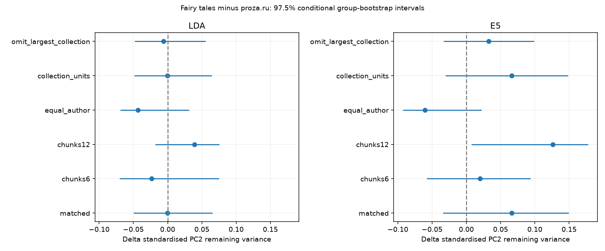

Дополнительные контроли, равный вес текстов:

| контроль | Δ PC2, LDA | 95%-интервал | Δ PC2, e5 | 95%-интервал |
|---|---|---|---|---|
| ровно 6 чанков, n=600 | −0,0233 | [−0,0607; +0,0665] | +0,0201 | [−0,0480; +0,0843] |
| ровно 12 чанков, n=600 | +0,0389 | [−0,0100; +0,0703] | +0,1261 | [+0,0208; +0,1710] |
| равный вес авторов внутри страт, n=1000 | −0,0433 | [−0,0634; +0,0236] | −0,0605 | [−0,0864; +0,0145] |
| исключён крупнейший сказочный сборник | −0,0059 | [−0,0437; +0,0495] | +0,0327 | [−0,0254; +0,0917] |

Положительный эффект e5 в 12-чанковой группе — локальное исследовательское наблюдение; он не подтверждает преимущество во всех длинах и представлениях. Отрицательные точки в авторском контроле также не доказывают обратного ранжирования: их интервалы включают ноль. Альтернативный bootstrap по сборникам даёт ту же общую картину, что по полю автора.

В 20 новых согласованных выборках первичная разность LDA меняется от **−0,0579 до +0,0492**, e5 — от **+0,0426 до +0,1248**. Следовательно, у e5 направление воспроизводится при выборе текстов, но остаётся неопределённость между авторскими/коллекционными группами; у LDA нестабилен и сам знак. Нельзя заменять групповой интервал устойчивостью по seed.

### 15.4. Что всё же различается: концентрация дисперсии без стандартизации

| представление | доля двух ГК, сказки | доля двух ГК, proza.ru | разность | 95%-перцентильный групповой интервал |
|---|---|---|---|---|
| LDA | 0,9342 | 0,8197 | **+0,1145** | [+0,0744; +0,2171] |
| e5 | 0,8968 | 0,8262 | **+0,0706** | [+0,0321; +0,1529] |

Это заранее предусмотренная дополнительная метрика, **не положительный исход первичной гипотезы, переопределённой после расчёта**. У текстовой популяции выбранной коллекции сказок больше вариации среднего временного профиля сосредоточено в двух направлениях. Такой результат не равен специфической подкове PC2 и тем более повторению одинаковых событий в индивидуальных произведениях. Без стандартизации вклад координат зависит от их масштаба; стандартизация, напротив, уравнивает и крупные, и маловариативные темы. Стандартизированные показатели также зависят от выбора координат; PCA сырых признаков инвариантна к ортогональному повороту, покоординатная стандартизация — нет.

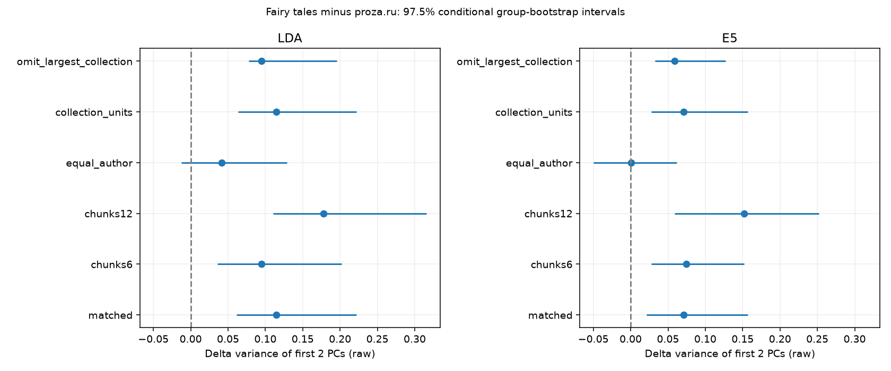

Для 6-чанковых текстов разность доли двух ГК составляет +0,0947 (LDA) и +0,0748 (e5), для 12-чанковых — +0,1781 и +0,1518. Во всех 20 повторных основных сопоставлениях разность положительна: LDA +0,0854…+0,1539, e5 +0,0568…+0,1038. Исключение крупнейшего сборника сохраняет положительные точки +0,0944/+0,0591. Но при равном весе авторов в стратах остаётся лишь **+0,0411** в LDA (95%-интервал [−0,0034; +0,1220]) и **+0,0009** в e5 ([−0,0425; +0,0544]). Это ограничивает переносимость от «текстов данной коллекции» к «типичному автору/сборнику».

**Чувствительность к способу интервала.** Нелинейность PCA и групповое ресэмплирование дают асимметричные bootstrap-распределения. Дополнительно, уже после первичного расчёта, сохранены basic-интервалы (отражённые перцентильные границы): [interval_sensitivity.csv](results/p2/interval_sensitivity.csv). Для основной разности доли двух ГК 95%-basic-интервал LDA остаётся положительным [+0,0119; +0,1546], но e5 включает ноль [−0,0117; +0,1092]. Поэтому формулировка о «подтверждённом в обоих представлениях преимуществе» была бы слишком сильной даже для этой дополнительной метрики. Первичный вывод о недостатке поддержки стандартизированной PC2 при basic-интервалах не меняется.

### 15.5. Координаты, перестановки и качество данных

**Связь с прежними топ-100 темами.** Раньше z(PC2) считался по наиболее частым темам отдельно для каждого источника, а первичная P2 использует все 127 общих координат. Чтобы отличить влияние этой замены от контролей длины/групп, выполнена отдельная post-hoc проверка на тех же выборках: [coordinate_sensitivity.csv](results/p2/coordinate_sensitivity.csv).

* Общие 100 тем, равный вес текстов: Δ=+0,0372, 95%-интервал [−0,0371; +0,0890].
* По 100 наиболее частых тем отдельно в каждом источнике, вес слов как раньше: Δ=+0,0377, интервал [−0,0294; +0,0903].

Таким образом, сохранение прежнего принципа выбора координат не восстанавливает уверенного межкорпусного вывода. Старые описательные z остаются результатами своих постановок, но не заменяют интервал разности и не являются доказательством свойства всех сказок.

**Перемешивание исходных чанков.** Для каждой основной/6-чанковой/12-чанковой фиксированной выборки выполнено по 100 перестановок внутри текстов. Переставлены сами чанки вместе с длинами, после чего заново выполнена агрегация в 12 частей; это не простая перестановка уже интерполированных 12 точек. В основной выборке:

| источник / представление | доля двух ГК в порядке текста | средняя доля после перестановок |
|---|---|---|
| сказки, LDA | 0,934 | 0,440 |
| proza.ru, LDA | 0,820 | 0,374 |
| сказки, e5 | 0,897 | 0,332 |
| proza.ru, e5 | 0,826 | 0,330 |

Структура позиции заметна **в обоих** корпусах. Наличие эффекта порядка не означает, что сказки сильнее прозы по любой метрике, и не противоречит P1: позиционные изменения могут существовать без обнаружимой добавки к предсказанию авторских тегов финала. Эти перестановочные сводки описательные; экстремальные гауссовские p из их стандартизованных расстояний не выводятся.

**Аудит окон e5** на первичных 1 000+1 000 текстах: у сказок 0 из 15 106 окон длиннее 512 субтокенов; у proza.ru 10 из 15 325 (0,065 %), затронуты 7 произведений. Эмбеддинги не пересчитывались, отдельная переоценка P2 без этих 7 работ не выполнялась. [window_audit.json](results/p2/window_audit.json). Аудит относится к основным согласованным когортам, а не всему корпусу.

Контроль без крупнейшего сборника исключает «Сказочные книги Эндрю Лэнга», после чего **сопоставление строится заново по распределению длины оставшихся сказок**. Это проверка альтернативной популяции, а не чистое удаление одной группы при неизменных всех остальных весах. Поля автора/сборника не гарантируют независимости перевода, редакции и пересказов; численность текстов не заменяет численности независимых источников.

### 15.6. Значение для исследования и публикации

1. **Сильная формулировка D2/H3 не подтверждена:** нельзя утверждать, что сказки универсально имеют более выраженную стандартизированную PC2 или более формульный сюжет, чем любительская проза.
2. **Описательная разница есть:** для текстовой частотности выбранной коллекции у сказок вариация среднего профиля сильнее концентрируется в двух сырых ГК. Она воспроизводится при согласовании длины, в разных выборках и после удаления крупнейшего сборника. Уверенность и размер эффекта зависят от представления, способа интервала и оцениваемой популяции.
3. **Авторская композиция — часть результата.** Групповые интервалы и равные веса авторов отвечают разным вопросам. Разница текстовых агрегатов не должна автоматически приписываться жанру каждого произведения или способности каждого автора следовать формуле.
4. **Следующий содержательный шаг — D3/P3:** отделить изменения диалога/повествования от тематических сдвигов, с проверкой эвристик прямой речи. Для линии предсказания остаётся независимый аудит тегов P1. Новые переборы K и кластеров не устранят эти ограничения сами по себе.

Для статьи на «Диалог» это аргумент в пользу исследования **композиционных профилей и чувствительности их измерения**, а не ещё одного заявления об универсальных сюжетных типах. P1 и P2 вместе показывают, почему простота средних траекторий и выразительная визуализация недостаточны для сильной сюжетной интерпретации.

Воспроизведение P2 из готовых артефактов:

```bash
.venv/bin/python src/compare_registers.py
.venv/bin/python src/p2_audit.py
.venv/bin/python src/p2_coordinates.py  # отдельная post-hoc чувствительность
.venv/bin/python -m unittest discover -s tests -p 'test_p2.py' -v
```

## Воспроизведение

```bash
python -m venv .venv && .venv/bin/pip install -r requirements.txt     # Python 3.12
PY=.venv/bin/python scripts/run_all.sh                                 # ранний конвейер EN/RU + сказки/proza.ru
```

`scripts/run_all.sh` не включает подготовку ficbook, K-sweep и эмбеддинги/BERTopic, а `requirements.txt` содержит только основной стек LDA. Для §11 в рабочей `.venv` дополнительно установлены `sentence-transformers==6.2.0`, `torch==2.15.0`, `bertopic==0.17.4`, `umap-learn==0.5.12`, `hdbscan==0.8.44`; устройство эмбеддингов в коде — `mps`. Установка только из requirements не воспроизводит поздние эксперименты целиком.

Готовые артефакты K-sweep визуализируются без переобучения:

```bash
.venv/bin/python src/ksweep_plot.py
```

Команды выполненного перебора (повторный запуск читает корпус и пересчитывает когерентность, но пропускает строки K/seed, уже присутствующие в CSV):

```bash
.venv/bin/python src/ksweep.py RU 16,32,48,64,96,127,160,200,256 42
.venv/bin/python src/ksweep.py RU 32,64,127 7
.venv/bin/python src/ksweep.py EN 32,64,127,200 42
```

Данные (`datasets/`) и модели/промежуточные файлы (`work/`) в репозиторий не входят. Структура данных описана в [README.md](README.md), карта артефактов — в [PROJECT_INDEX.md](PROJECT_INDEX.md). Детали прогона:
* обе ТВ-модели EN и RU в финальном запуске выводились со 100 итерациями Gibbs (`work/run_ororo.sh` экспортировал `INFER_ITERS=100`); стандартное значение в коде — 40, оно же используется без переопределения в проекциях/общей модели;
* основные LDA seed=42, дополнительный K-sweep seed=7; сиды выборок зависят от этапа (например, отложенные эпизоды K-sweep — 0, ТВ общей модели — 42). Многопоточное обучение tomotopy не гарантирует побитовую повторяемость.
